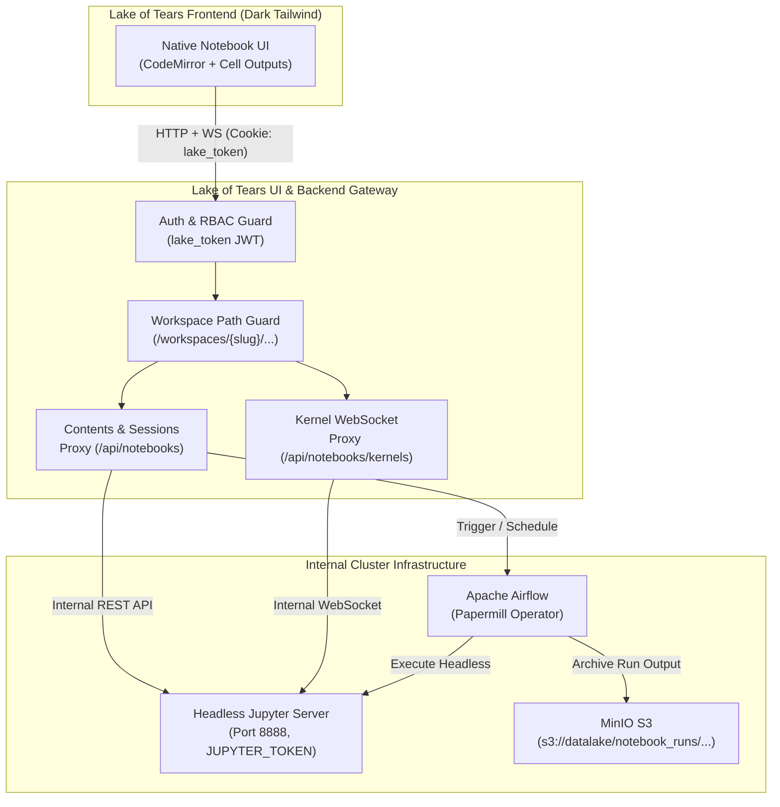

# Native Notebooks via Jupyter Server API & Airflow Integration Spec

- **Issue:** [Lake-of-Tears/lake-of-tears#85](https://github.com/Lake-of-Tears/lake-of-tears/issues/85)
- **Branch:** `feat/85-native-notebooks`
- **Milestone:** version 1.0.0
- **Status:** Proposed for Review

---

## 1. Overview & Motivation

Lake of Tears currently exposes JupyterLab by rendering an `<iframe>` pointing to the `/jupyter/` endpoint inside `ui/templates/embed.html`. While this enables interactive data science, it introduces severe architectural and user experience limitations:

1. **UX Fragmentation & Third-Party Chrome:** JupyterLab renders its own application menus, toolbars, status bar, and logos in an interface detached from Lake of Tears' dark Tailwind aesthetic.
2. **Security & RBAC Bypass:** JupyterLab relies on a single cluster-wide `JUPYTER_TOKEN` passed in query parameters. Lake of Tears user identity, workspace isolation, and RBAC permissions (`admin`, `member`, `viewer`) are bypassed once a user enters the iframe.
3. **Cross-Tenant File Leakage:** While the iframe initially loads `/jupyter/lab/tree/{workspace_slug}/`, the built-in JupyterLab file tree permits users to navigate up to `/home/jovyan` and view other workspaces' notebook files.
4. **No Direct Pipeline Integration:** Users cannot schedule or run notebooks as automated background jobs in Apache Airflow from within Lake of Tears.

### Target State
Replace the third-party JupyterLab iframe embedding with a **native, first-class notebook experience** built directly into the Lake of Tears frontend:
- **Headless Backend:** JupyterLab runs headlessly in the background purely as an execution and kernel engine; its default UI is completely hidden from end users.
- **Native Frontend:** A custom, responsive notebook interface built with Lake of Tears Tailwind styles, CodeMirror editors, rich output renderers, and workspace file navigation.
- **Lake of Tears RBAC & Auth Parity:** All notebook reads, writes, and executions are mediated by Lake of Tears API endpoints checking `lake_token` JWTs and workspace memberships. Viewers are restricted to read-only outputs.
- **Airflow + Papermill Integration:** A single-click workflow to schedule or trigger headless notebook execution via Airflow, archiving timestamped notebook run artifacts into MinIO S3.



---

## 2. Invariants & Security Rules

| Invariant | Specification | Enforcement Point |
| :--- | :--- | :--- |
| **Zero Raw Token Exposure** | The browser must never receive or transmit `JUPYTER_TOKEN`. All interactions pass through authenticated Lake of Tears proxy routes. | Lake UI API Proxy |
| **Strict Workspace Scoping** | A workspace member can only access notebooks residing in their active workspace root (`/workspaces/{workspace_slug}/`). Path traversal (`..`) is rejected. | Backend Path Guard |
| **RBAC Execution Policy** | Workspace `viewer` role can view cells and outputs, but cannot save, create, delete, or execute kernels. `member` and `admin` have full execution rights. | API & WebSocket Handshake |
| **No External Jupyter Ingress** | JupyterLab's direct ingress `/jupyter/` is removed from public routing; all traffic flows through Lake UI internal networking. | Helm Ingress & Compose |
| **Immutable Run Archives** | Scheduled or on-demand Airflow runs save executed `.ipynb` snapshots and logs into MinIO S3 without modifying the working source notebook. | Airflow Papermill DAG |

---

## 3. Architecture & Technical Design

### 3.1. Lake of Tears API Proxy Layer (`ui/main.py`)

The Lake UI backend will expose clean REST endpoints and a WebSocket proxy under `/api/notebooks`:

#### REST Endpoints
1. `GET /api/notebooks`
   - Lists notebooks, directories, and last modified dates in the current workspace.
   - Upstream: `GET http://jupyter:8888/jupyter/api/contents/workspaces/{slug}`
2. `GET /api/notebooks/{path:path}`
   - Retrieves notebook JSON structure (cells, metadata, outputs).
   - Upstream: `GET http://jupyter:8888/jupyter/api/contents/workspaces/{slug}/{path}`
3. `POST /api/notebooks`
   - Creates a new notebook or folder in the workspace.
   - Upstream: `POST http://jupyter:8888/jupyter/api/contents/workspaces/{slug}`
4. `PUT /api/notebooks/{path:path}`
   - Saves notebook content (cells, metadata). Requires `member` or `admin` role.
   - Upstream: `PUT http://jupyter:8888/jupyter/api/contents/workspaces/{slug}/{path}`
5. `DELETE /api/notebooks/{path:path}`
   - Deletes a notebook or folder. Requires `member` or `admin` role.
   - Upstream: `DELETE http://jupyter:8888/jupyter/api/contents/workspaces/{slug}/{path}`
6. `PATCH /api/notebooks/{path:path}`
   - Renames a notebook or directory. Requires `member` or `admin` role.
   - Upstream: `PATCH http://jupyter:8888/jupyter/api/contents/workspaces/{slug}/{path}`

#### Kernel & Session Management
7. `POST /api/notebooks/sessions`
   - Starts or binds a kernel session to a notebook path.
   - Upstream: `POST http://jupyter:8888/jupyter/api/sessions`
8. `POST /api/notebooks/kernels/{kernel_id}/interrupt`
   - Sends SIGINT to interrupt a running cell.
   - Upstream: `POST http://jupyter:8888/jupyter/api/kernels/{kernel_id}/interrupt`
9. `POST /api/notebooks/kernels/{kernel_id}/restart`
   - Restarts the Python/DuckDB kernel.
   - Upstream: `POST http://jupyter:8888/jupyter/api/kernels/{kernel_id}/restart`

#### Kernel WebSocket Proxy
10. `WS /api/notebooks/kernels/{kernel_id}/channels`
    - Validates `lake_token` cookie and workspace role (`viewer` connections rejected with 403).
    - Establishes a bidirectional WebSocket bridge with `ws://jupyter:8888/jupyter/api/kernels/{kernel_id}/channels?token={JUPYTER_TOKEN}`.
    - Proxies standard Jupyter messaging protocol:
      - Client sends: `execute_request`
      - Upstream streams: `status`, `execute_input`, `stream` (stdout/stderr), `display_data` (PNG/HTML/tables), `execute_result`, and `error`.

---

### 3.2. Native Frontend Component Design

The new page replaces `ui/templates/embed.html` for notebooks with `ui/templates/notebooks.html`:

```
┌────────────────────────────────────────────────────────────────────────────────────────┐
│ Lake of Tears  [Workspace: Default ▾]   Catalogs  SQL  Notebooks*  Pipelines  Settings │
├──────────────────────────┬─────────────────────────────────────────────────────────────┤
│ Workspace Notebooks      │  my_analysis.ipynb  [Python 3 (Idle) ●]   [Run All] [Schedule]│
│  [+ New]  [Filter...]    ├─────────────────────────────────────────────────────────────┤
│                          │  In [1]: import duckdb, os                                  │
│  📁 etl_scripts          │          con = duckdb.connect()                             │
│     📄 bronze_clean.ipynb│          df = con.execute("SELECT 1 AS ok").df()            │
│  📄 exploratory.ipynb    │          df                                                 │
│  📄 customer_churn.ipynb ├─────────────────────────────────────────────────────────────┤
│                          │  Out[1]: ┌──────┐                                           │
│                          │          │  ok  │                                           │
│                          │          ├──────┤                                           │
│                          │          │  1   │                                           │
│                          │          └──────┘                                           │
│                          ├─────────────────────────────────────────────────────────────┤
│                          │  [+ Code]  [+ Markdown]                                     │
└──────────────────────────┴─────────────────────────────────────────────────────────────┘
```

#### Frontend Modules:
1. **Sidebar File Tree (`ui/static/js/notebook_tree.js`):**
   - Displays workspace notebooks and folders.
   - Actions: New notebook, new folder, rename, delete, duplicate, download.
2. **Notebook Editor Core (`ui/static/js/notebook_editor.js`):**
   - Code editor powered by CodeMirror 6 with Python & SQL syntax highlighting and dark theme matching Lake of Tears.
   - Markdown cells rendered with marked.js.
   - Cell controls: Add cell above/below, delete cell, move cell up/down, toggle code/markdown, run cell (`Shift+Enter`).
   - Execution state: Running spinners, execution order counters (`[1]`, `[*]`), execution duration indicators.
3. **Output Renderer (`ui/static/js/notebook_outputs.js`):**
   - Plain text / ANSI colored console logs.
   - HTML and Markdown tables (Pandas / DuckDB dataframes).
   - PNG, JPEG, and SVG graphics (Matplotlib, Seaborn).
   - Traceback and syntax error formatting with code snippet highlights.
4. **WebSocket Kernel Client (`ui/static/js/kernel_client.js`):**
   - Handles connection lifecycle, heartbeat ping/pong, session UUIDs, message parsing, and execution queues.

---

### 3.3. Airflow + Papermill Integration

#### Architecture:
Lake of Tears provides automated pipeline execution for any workspace notebook using Apache Airflow and Papermill:

1. **Airflow Execution DAG (`pipeline/dags/run_notebook_dag.py`):**
   - Implements a parameterized DAG triggered via Airflow REST API (`POST /api/v1/dags/run_notebook/dagRuns`).
   - Execution parameters:
     ```json
     {
       "workspace_slug": "marketing",
       "notebook_path": "campaign_roi.ipynb",
       "parameters": { "cutoff_date": "2026-10-01" },
       "triggered_by": "user@example.com"
     }
     ```
   - Tasks:
     1. `prepare_workspace`: Mounts workspace directory or downloads source `.ipynb` from storage.
     2. `execute_papermill`: Executes the notebook headlessly with parameter injection.
     3. `archive_artifacts`: Uploads the executed `.ipynb` with all generated cell outputs and error logs to:
        `s3://datalake/notebook_runs/{workspace_slug}/{notebook_name}/{execution_date}.ipynb`
     4. `emit_metrics`: Emits execution status, duration, and cell error counts to the metadata store.

2. **Lake UI Execution & Scheduling Modal:**
   - In the Notebook toolbar, users click **Schedule / Run**:
     - **Run Now:** Fires an immediate execution via Airflow REST API.
     - **Schedule Recurring:** Configures recurrence (Hourly, Daily, Weekly, Custom Cron).
     - **Run History Drawer:** Shows past runs, status (Success/Failed), execution duration, and link to view/download the output artifact.

---

## 4. Workload Permission & RBAC Mapping

| Lake of Tears Role | Notebook File Operations | Kernel Execution | Airflow Scheduling |
| :--- | :--- | :--- | :--- |
| **`superadmin`** | Full access across all workspaces | Allowed | Allowed |
| **`workspace_admin`** | Full access in own workspace | Allowed | Allowed |
| **`workspace_member`** | Create, edit, save, delete in own workspace | Allowed | Allowed |
| **`workspace_viewer`** | Read-only view of notebook & outputs | Blocked (403) | Blocked (403) |
| **Non-member** | No access (404/403) | Blocked (403) | Blocked (403) |

---

## 5. Deployment & Configuration Changes

### 5.1. Docker Compose (`docker-compose.yml`)
- Jupyter container:
  - Mounts workspace directories under `/home/jovyan/workspaces/`.
  - Removed from public host port binding (`8888:8888` removed from external exposure); accessible only within internal `datalake` network.
- Airflow container:
  - Installs `papermill` in Dockerfile (`docker/airflow/Dockerfile`).

### 5.2. Helm Chart (`deploy/helm/lake-of-tears/`)
- Ingress (`ingress.yaml`):
  - Remove public `/jupyter/` Ingress rule (closed to outside traffic).
  - WebSockets and REST traffic routed via `/api/notebooks/` through Lake UI service.
- Values (`values.yaml`):
  - Retain `jupyter.resources`, `jupyter.podSecurityContext`, and `jupyter.securityContext`.
  - Add `jupyter.internalService: true`.

---

## 6. Implementation Plan & Milestones

1. **Phase 1: Backend API Gateway & Proxy:**
   - Implement `ui/notebook_proxy.py` handling Jupyter Contents API and session lifecycles.
   - Implement WebSocket proxy with JWT authentication and RBAC checks.
   - Add workspace directory isolation logic.
2. **Phase 2: Native Frontend Notebook Editor:**
   - Build `ui/templates/notebooks.html` with sidebar file tree and editor canvas.
   - Integrate CodeMirror 6 with Python/SQL syntax highlighting and cell management.
   - Implement WebSocket kernel protocol client and output renderer.
3. **Phase 3: Airflow & Papermill Integration:**
   - Create `pipeline/dags/run_notebook_dag.py` parameterized DAG.
   - Implement "Run Now" and "Schedule" triggers from Lake UI.
   - Add run history drawer displaying archived run outputs from MinIO S3.
4. **Phase 4: Security Hardening & Ingress Cleanup:**
   - Remove public `/jupyter/` ingress routes.
   - Ensure Jupyter runs strictly on internal cluster networking.
   - Write comprehensive unit tests for proxy routing, RBAC enforcement, and WebSocket handling.

---

## 7. Verification & Acceptance Criteria

- [ ] **UI Integration:** Visiting `/notebooks` loads the native Lake of Tears dark-themed notebook editor with zero third-party JupyterLab UI or branding.
- [ ] **RBAC Enforcement:** Users with `viewer` role can inspect notebooks but cannot run cells or save changes.
- [ ] **Workspace Isolation:** Notebook file tree strictly confines users to `/workspaces/{slug}/`.
- [ ] **Interactive Execution:** Running code cells executes Python/DuckDB queries, displaying stdout, stderr, dataframes, and plots.
- [ ] **Airflow Execution:** Clicking "Run in Pipeline" triggers `run_notebook_dag` in Airflow, successfully archiving executed notebooks to MinIO S3.
- [ ] **Network Security:** Jupyter Server is inaccessible outside the internal network.
- [ ] **Test & Quality Gate:** Passes `ruff check`, `ruff format`, `pytest tests/`, and `helm lint`.
