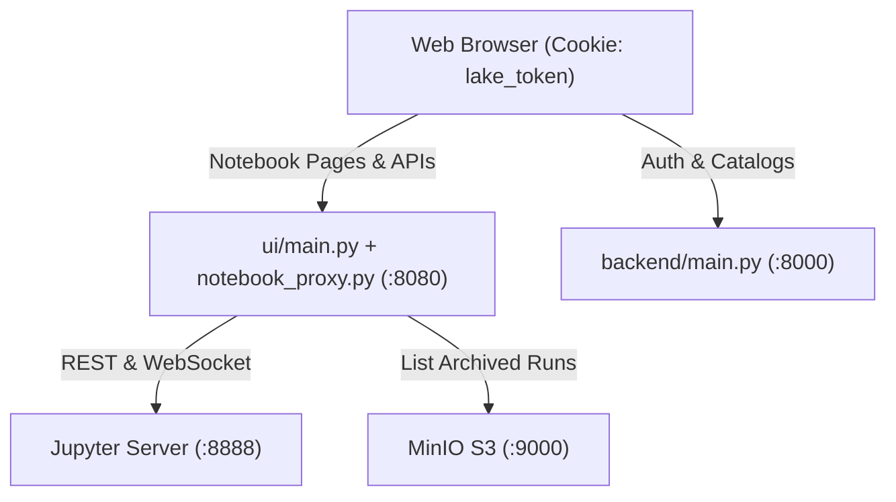
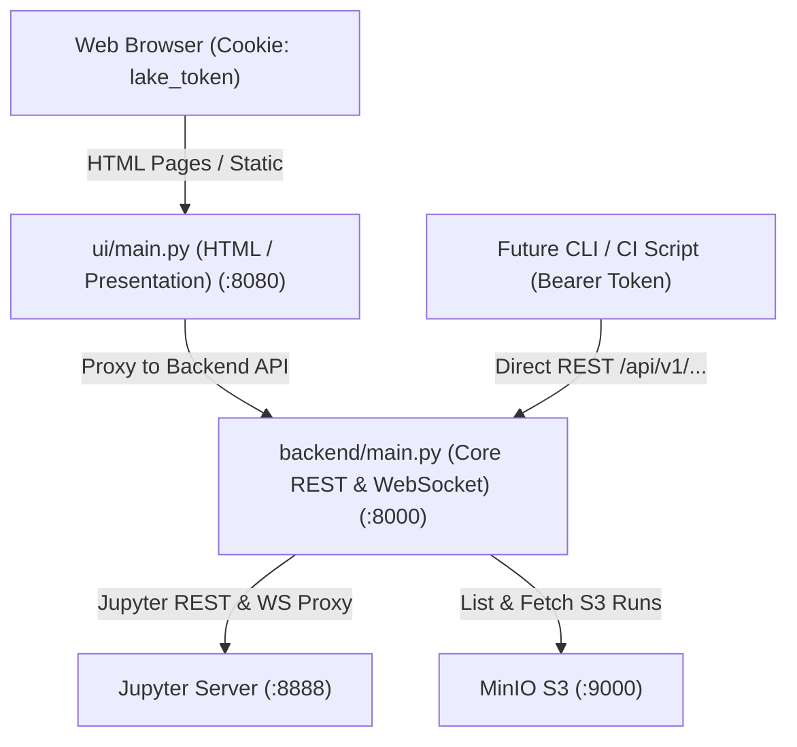

# Technical Specification: Migrate Notebook API to Core Backend (Issue #97)

## 1. Overview & Architectural Goals

The goal of this refactor is to migrate the Jupyter Notebook integration—including file exploration, notebook CRUD, kernel execution, WebSocket proxying, and S3 run archives—out of the presentation layer ([`ui/notebook_proxy.py`](file:///Users/Jay/Development/lake-of-tears/ui/notebook_proxy.py)) and into the core Lake of Tears platform backend ([`backend/main.py`](file:///Users/Jay/Development/lake-of-tears/backend/main.py)).

### Key Objectives
1. **CLI Readiness**: Provide clean, machine-readable REST API endpoints under `/api/v1/notebooks/...` accepting standard `Authorization: Bearer <lake_token>` headers for the future `lake` CLI tool.
2. **Unified Backend Gateway**: Eliminate the split-brain architecture where data/auth operations live in `backend:8000` while notebook operations live in `ui:8080`.
3. **Strict RBAC & Multi-Tenancy**: Centralize workspace authorization and role enforcement (`viewer` read-only vs `editor`/`admin` write) within [`backend/auth.py`](file:///Users/Jay/Development/lake-of-tears/backend/auth.py).
4. **Zero Frontend Regression**: Maintain 100% backward compatibility for the existing interactive canvas in [`ui/templates/notebooks.html`](file:///Users/Jay/Development/lake-of-tears/ui/templates/notebooks.html), preserving cell execution, ANSI tracebacks, rich tables, and directory navigation.

---

## 2. Architecture Comparison

### Current State (Presentation-Coupled)


### Target State (Unified Core Backend Gateway)


---

## 3. Detailed Component Design

### 3.1. Backend Service Layer (`backend/notebook_service.py`)
Extract the core logic from [`ui/notebook_proxy.py`](file:///Users/Jay/Development/lake-of-tears/ui/notebook_proxy.py) into a clean, reusable service module in `backend/`:

- **Path Sanitization & Isolation**:
  - `sanitize_notebook_path(path: str) -> str`: Block directory traversal (`..`, `.`) and illegal characters (`<`, `>`, `:`, `"`, `|`, `?`, `*`, `\0`).
  - `get_workspace_dir(workspace_slug: str, subpath: str = "") -> str`: Strictly confines workspace file access to `workspaces/{workspace_slug}/`.
- **Jupyter Communication**:
  - `jupyter_request(method, path, params, json_body, timeout)`: Async HTTP requests to Jupyter Server using `httpx.AsyncClient`.
  - `ensure_workspace_dir(workspace_slug: str)`: Automatic bootstrap of the workspace root folder.
  - `list_workspace_notebooks(workspace_slug: str, subpath: str)`: Hierarchical directory contents listing.
  - `get_notebook(workspace_slug: str, path: str)`: Fetches raw `.ipynb` JSON.
  - `save_notebook(workspace_slug: str, path: str, content: dict)`: Saves `.ipynb` JSON with format validation.
  - `create_notebook(workspace_slug, folder, title, content)`: Creates new notebook with default DuckDB/Python template cells.
  - `create_folder(workspace_slug, folder_path)`: Directory creation.
  - `delete_item(workspace_slug, path)`: Deletion.
  - `rename_item(workspace_slug, old_path, new_path)`: Rename and move operations.
  - `search_workspace_items(workspace_slug, query, subpath)`: Recursive directory search.
- **Kernel & Session Management**:
  - `get_or_create_session(workspace_slug, path, kernel_name)`: Starts or attaches to an active Jupyter kernel session.
  - `restart_kernel(kernel_id)` & `interrupt_kernel(kernel_id)`: Execution flow controls.
- **MinIO S3 Run Archive Integration**:
  - `list_archived_runs(workspace_slug, notebook_path)`: Queries S3 bucket `s3://datalake/notebook_runs/{workspace_slug}/{notebook_name}/` for executed artifacts.

---

### 3.2. REST & WebSocket Endpoints (`backend/main.py`)

All notebook endpoints will be exposed under the prefix `/api/v1/notebooks` with workspace resolution via header (`X-Workspace-Id` or `X-Workspace-Slug`), cookie (`active_workspace_id`), or query parameter (`workspace_slug`).

| Method | Endpoint | Description | Role Required |
| :--- | :--- | :--- | :--- |
| `GET` | `/api/v1/notebooks/contents` | List workspace directory items & breadcrumbs | `viewer`, `editor`, `admin` |
| `GET` | `/api/v1/notebooks/contents/{path:path}` | Get `.ipynb` or file content | `viewer`, `editor`, `admin` |
| `POST` | `/api/v1/notebooks/contents/{path:path}` | Create notebook or folder | `editor`, `admin` (403 for viewer) |
| `PUT` | `/api/v1/notebooks/contents/{path:path}` | Save notebook content | `editor`, `admin` (403 for viewer) |
| `PATCH` | `/api/v1/notebooks/contents/{path:path}` | Rename or move item | `editor`, `admin` (403 for viewer) |
| `DELETE` | `/api/v1/notebooks/contents/{path:path}` | Delete notebook or directory | `editor`, `admin` (403 for viewer) |
| `GET` | `/api/v1/notebooks/search` | Search notebook filenames and contents | `viewer`, `editor`, `admin` |
| `GET` | `/api/v1/notebooks/directories` | List folder tree for move destination picker | `viewer`, `editor`, `admin` |
| `POST` | `/api/v1/notebooks/sessions` | Start / get session and kernel | `editor`, `admin` (403 for viewer) |
| `POST` | `/api/v1/notebooks/kernels/{kernel_id}/interrupt` | Send SIGINT interrupt to kernel | `editor`, `admin` (403 for viewer) |
| `POST` | `/api/v1/notebooks/kernels/{kernel_id}/restart` | Restart kernel execution | `editor`, `admin` (403 for viewer) |
| `GET` | `/api/v1/notebooks/runs` | List MinIO S3 execution snapshots | `viewer`, `editor`, `admin` |
| `WS` | `/api/v1/notebooks/kernels/{kernel_id}/channels` | Interactive WebSocket channel proxy | `editor`, `admin` (403 for viewer) |

---

### 3.3. Workspace & RBAC Helper (`backend/auth.py`)

A dependency helper `get_workspace_and_role` will resolve the workspace context and enforce authorization:

```python
def get_notebook_workspace_and_role(
    workspace_slug: str | None = None,
    current_user: User = Depends(get_current_user),
    db: Session = Depends(get_db),
    require_write: bool = False,
) -> tuple[Workspace, str]:
    """Resolves workspace and verifies membership.
    
    Returns (workspace, user_role_in_workspace).
    Raises 403 if user lacks access or if require_write=True and role is 'viewer'.
    """
```

---

### 3.4. Presentation Layer Updates (`ui/main.py`)

To ensure the web UI continues functioning seamlessly without needing a massive rewrite of frontend templates:
1. **Reverse-Proxy Bridge**: [`ui/main.py`](file:///Users/Jay/Development/lake-of-tears/ui/main.py) will forward `/api/notebooks/*` requests to `BACKEND_URL/api/v1/notebooks/*`, passing along the user's `lake_token` and active workspace cookie.
2. **WebSocket Relay**: The UI's WebSocket endpoint `/api/notebooks/kernels/{kernel_id}/channels` will bridge either directly to the backend's WebSocket endpoint or directly to Jupyter, ensuring browser clients do not require host reconfigurations.
3. **Deprecate Presentation Proxy**: [`ui/notebook_proxy.py`](file:///Users/Jay/Development/lake-of-tears/ui/notebook_proxy.py) will be streamlined into a client that talks to `BACKEND_URL`.

---

### 3.5. Container & Environment Configuration

Update [`docker-compose.yml`](file:///Users/Jay/Development/lake-of-tears/docker-compose.yml):
- Pass Jupyter & MinIO variables to `backend:`:
  ```yaml
  JUPYTER_SERVER_URL: http://jupyter:8888
  JUPYTER_BASE_URL: /jupyter
  JUPYTER_TOKEN: ${JUPYTER_TOKEN}
  MINIO_ENDPOINT: minio:9000
  MINIO_ACCESS_KEY: ${MINIO_ROOT_USER}
  MINIO_SECRET_KEY: ${MINIO_ROOT_PASSWORD}
  MINIO_BUCKET: datalake
  ```
- Add `boto3==1.35.40` and `websockets` to [`backend/requirements.txt`](file:///Users/Jay/Development/lake-of-tears/backend/requirements.txt).

---

## 4. Test Strategy

1. **Unit & Service Tests (`tests/test_backend_notebooks.py`)**:
   - Port all 27 tests from [`tests/test_ui_notebooks.py`](file:///Users/Jay/Development/lake-of-tears/tests/test_ui_notebooks.py) to target the backend endpoints directly.
   - Test Bearer token authentication header (`Authorization: Bearer <token>`).
   - Test Cookie authentication (`lake_token=<cookie>`).
   - Verify 403 Forbidden enforcement on write/execute operations for users with `viewer` role.
   - Verify path traversal attack mitigation (`../`, `\0`, special characters).
2. **Integration / UI Compatibility Tests**:
   - Verify [`tests/test_ui_notebooks.py`](file:///Users/Jay/Development/lake-of-tears/tests/test_ui_notebooks.py) still passes with `ui/` routing to `backend/`.
   - Verify all 53 existing tests in the suite pass cleanly.
