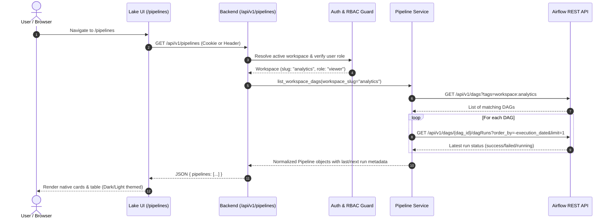

# Technical Specification: Native Lake of Tears Airflow UI & Pipeline Orchestration

**Issue Link:** [#91 - feat(pipelines): native Lake of Tears Airflow UI and pipeline orchestration](https://github.com/Lake-of-Tears/lake-of-tears/issues/91)  
**Status:** In Review  
**Milestone:** `version 1.0.0`  
**Target Release:** Headless Core Backend (`backend/`), Native Frontend UI (`ui/`), Notebook Scheduler  

---

## 1. Executive Summary

Historically, Lake of Tears embedded Apache Airflow via an `<iframe>` pointing to `/airflow/` inside `ui/templates/embed.html`. This created significant product limitations:
1. **Broken Theme Consistency:** Airflow's default light/grey web UI clashed with Lake of Tears' dark slate styling and failed to respond to the global theme switcher (`data-theme="dark"` / `data-theme="light"`).
2. **Tenancy & Security Leaks:** Users inside the iframe were exposed to all global Airflow DAGs without workspace isolation or role-based access controls matching Lake of Tears workspace roles (`admin`, `editor`, `viewer`).
3. **Headless Automation Barrier:** The Lake of Tears CLI tool (`lake`) requires headless Bearer token access to orchestrate pipelines, which an iframe cannot accommodate.
4. **Disjointed Notebook Scheduling:** Notebooks in `/notebooks` lacked first-class recurring schedule management directly linked to Airflow pipelines.

This specification details the transition to a **native Lake of Tears UI for pipelines**, powered by a centralized gateway in the **Core Backend Router (`backend/main.py`)** that proxies and controls Airflow through its REST API, enforces workspace tenancy and RBAC, creates dynamic isolated DAGs (Databricks Job Cluster Model), and supports full dual theme switching.

---

## 2. High-Level Architecture

### 2.1. System Component Diagram

```mermaid
flowchart TD
    subgraph Clients["Presentation & Automation Clients"]
        Browser["Web Browser (Cookie: lake_token)"]
        CLI["Lake CLI / Automation (Authorization: Bearer <token>)"]
    end

    subgraph Presentation["Presentation Layer (:8080)"]
        UI_Server["Lake UI Server (ui/main.py)"]
        Pipelines_UI["Native Pipelines UI (ui/templates/pipelines.html)"]
        Notebooks_UI["Notebooks Schedule Modal (ui/templates/notebooks.html)"]
    end

    subgraph Backend_Gateway["Lake of Tears Core Backend (:8000)"]
        Auth_Guard["Workspace Auth & RBAC Guard (backend/auth.py)"]
        Pipelines_Router["Pipelines Router (backend/pipelines_router.py)"]
        Pipeline_Service["Pipeline Service & DAG Generator (backend/pipeline_service.py)"]
        Postgres_Auth["PostgreSQL Auth DB (Workspace & Membership)"]
    end

    subgraph Orchestration["Apache Airflow (:8080)"]
        Airflow_API["Airflow REST API (/api/v1/...)"]
        Airflow_Scheduler["Airflow Scheduler & DAG Parser"]
        Workspace_DAGs["Workspace DAGs (/opt/airflow/dags/workspaces/{slug}/)"]
    end

    subgraph Execution["Ephemeral Execution Engine (Databricks Job Cluster Model)"]
        K8s_Pods["KubernetesPodOperator (Isolated Pods with CPU/RAM Limits)"]
        Docker_Workers["Docker / Papermill Worker with Timeouts"]
        MinIO["MinIO S3 (Artifacts & Run Archives)"]
    end

    Browser -->|HTTP GET /pipelines| UI_Server
    UI_Server --> Pipelines_UI
    Browser -->|REST API /api/v1/pipelines/*| Backend_Gateway
    CLI -->|REST API /api/v1/pipelines/*| Backend_Gateway

    Backend_Gateway --> Auth_Guard
    Auth_Guard --> Postgres_Auth
    Auth_Guard --> Pipelines_Router
    Pipelines_Router --> Pipeline_Service

    Pipeline_Service -->|Airflow REST API (Basic Auth)| Airflow_API
    Pipeline_Service -->|Write/Delete Dynamic DAG Files| Workspace_DAGs
    Workspace_DAGs --> Airflow_Scheduler
    Airflow_Scheduler --> Airflow_API

    Airflow_Scheduler -->|Launch Job| K8s_Pods
    Airflow_Scheduler -->|Launch Job| Docker_Workers
    K8s_Pods -->|Archive Run .ipynb| MinIO
    Docker_Workers -->|Archive Run .ipynb| MinIO
```

### 2.2. Request Flow: Pipeline Listing & Workspace Scoping



---

## 3. Backend Implementation Specification

### 3.1. Airflow Service Layer (`backend/pipeline_service.py`)
Encapsulates communication with Airflow REST API (`/api/v1/...`) and dynamic DAG generation:
- **Authentication:** HTTP Basic Auth with `AIRFLOW_ADMIN_USER` and `AIRFLOW_ADMIN_PASSWORD`.
- **Base URL Resolution:** `AIRFLOW_URL` (default: `http://airflow:8080/airflow` or `http://airflow:8080`).
- **Workspace Filtering:**
  - Airflow API `GET /api/v1/dags?tags=workspace:{workspace_slug}` or post-filtering by tag `workspace:{workspace_slug}`.
  - DAGs without workspace tags are either classified as system/global (accessible only to `superadmin`) or hidden from tenant views.
- **Dynamic DAG Generation:**
  - Workspace directory: `${AIRFLOW_DAGS_DIR}/workspaces/{workspace_slug}/`.
  - Generates Python DAG code for recurring scheduled notebook jobs.
  - Compute template: `KubernetesPodOperator` on K8s clusters (falling back to parameterized `Papermill` worker task on Docker).
  - Configures CPU (e.g. `1 core`), Memory (e.g. `2Gi`), and execution timeout (`2 hours`).
  - Automatically tags DAG with `workspace:{workspace_slug}`, `notebook`, and `scheduled`.

### 3.2. Pipelines API Router (`backend/pipelines_router.py`)
Mounted at `/api/v1/pipelines` and `/api/pipelines`:

| Method | Endpoint | Description | Min Role Required |
|---|---|---|---|
| `GET` | `/` | List workspace DAGs with pause status, last run, next run | `viewer` |
| `GET` | `/{dag_id}` | Detailed DAG metadata | `viewer` |
| `PATCH` | `/{dag_id}` | Pause / unpause DAG (`{"is_paused": bool}`) | `editor` |
| `POST` | `/{dag_id}/trigger` | Trigger manual run with parameters (`{"conf": dict}`) | `editor` |
| `GET` | `/{dag_id}/runs` | List execution history for a DAG | `viewer` |
| `GET` | `/{dag_id}/runs/{run_id}` | Specific DAG run status and timings | `viewer` |
| `GET` | `/{dag_id}/runs/{run_id}/tasks` | Task instances for a DAG run | `viewer` |
| `GET` | `/{dag_id}/runs/{run_id}/tasks/{task_id}/logs` | Fetch task execution log (with `try_number`) | `viewer` |
| `POST` | `/schedule-notebook` | Create/update recurring notebook schedule DAG | `editor` |
| `DELETE` | `/schedule-notebook/{dag_id}` | Delete scheduled notebook DAG | `editor` |

### 3.3. API Request & Response Schemas

#### 1. `GET /api/v1/pipelines`
**Response (200 OK):**
```json
{
  "workspace": "analytics",
  "total": 2,
  "pipelines": [
    {
      "dag_id": "ws_analytics_daily_etl",
      "pipeline_name": "Daily Analytics ETL",
      "description": "Scheduled Papermill notebook execution for daily metrics",
      "is_paused": false,
      "schedule_interval": "@daily",
      "timetable_description": "At 00:00",
      "next_dagrun": "2026-10-15T00:00:00Z",
      "tags": ["workspace:analytics", "notebook", "scheduled"],
      "is_notebook_job": true,
      "notebook_path": "etl/daily_metrics.ipynb",
      "last_run": {
        "dag_run_id": "scheduled__2026-10-14T00:00:00+00:00",
        "state": "success",
        "execution_date": "2026-10-14T00:00:00Z",
        "start_date": "2026-10-14T00:00:05Z",
        "end_date": "2026-10-14T00:03:22Z",
        "duration_seconds": 197.0
      }
    }
  ]
}
```

#### 2. `PATCH /api/v1/pipelines/{dag_id}`
**Request Body:**
```json
{
  "is_paused": true
}
```
**Response (200 OK):**
```json
{
  "dag_id": "ws_analytics_daily_etl",
  "is_paused": true,
  "message": "Pipeline paused successfully"
}
```

#### 3. `POST /api/v1/pipelines/{dag_id}/trigger`
**Request Body:**
```json
{
  "conf": {
    "target_date": "2026-10-14",
    "batch_size": 1000
  }
}
```
**Response (201 Created):**
```json
{
  "dag_id": "ws_analytics_daily_etl",
  "dag_run_id": "manual__2026-10-14T19:00:00Z__user",
  "state": "queued",
  "execution_date": "2026-10-14T19:00:00Z",
  "conf": {
    "target_date": "2026-10-14",
    "batch_size": 1000
  }
}
```

#### 4. `POST /api/v1/pipelines/schedule-notebook`
**Request Body:**
```json
{
  "notebook_path": "models/forecast.ipynb",
  "pipeline_title": "Weekly Sales Forecast",
  "schedule_interval": "0 4 * * 1",
  "parameters": {
    "alpha": 0.05,
    "horizon_days": 14
  },
  "compute_resources": {
    "cpu": "1",
    "memory": "2Gi"
  }
}
```
**Response (201 Created):**
```json
{
  "dag_id": "ws_analytics_weekly_sales_forecast",
  "file_path": "/opt/airflow/dags/workspaces/analytics/ws_analytics_weekly_sales_forecast.py",
  "schedule_interval": "0 4 * * 1",
  "status": "created"
}
```

#### 5. `GET /api/v1/pipelines/{dag_id}/runs/{run_id}/tasks/{task_id}/logs`
**Query Parameters:** `try_number=1` (optional, defaults to latest)  
**Response (200 OK):**
```json
{
  "dag_id": "ws_analytics_daily_etl",
  "run_id": "manual__2026-10-14T19:00:00Z__user",
  "task_id": "execute_and_archive_notebook",
  "try_number": 1,
  "content": "[2026-10-14 19:00:06,120] {taskinstance.py:1159} INFO - Executing <Task(PythonOperator): execute_and_archive_notebook> on 2026-10-14...\n[2026-10-14 19:00:12,450] {papermill:120} INFO - Executing cell 1 of 8..."
}
```

### 3.4. Workspace Tenancy & RBAC Enforcement
- Evaluated via `get_pipeline_workspace_and_role` in `backend/auth.py` (matching the pattern from `get_notebook_workspace_and_role`):
  - Resolves workspace via `X-Workspace-Slug`, `X-Workspace-Id`, or cookie `lake_active_workspace`.
  - Enforces workspace membership for non-superadmins.
  - Verifies that any targeted `dag_id` has the tag `workspace:{workspace_slug}` or matches the workspace namespace.
- **`viewer`:** Read-only access to `/` (list), `/{dag_id}`, `/runs`, `/tasks`, and `/logs`. Attempting to trigger, pause, or create/delete schedules yields `403 Forbidden` (`{"detail": "Workspace viewer role is read-only. Cannot modify or trigger pipelines."}`).
- **`editor` / `admin` / `superadmin`:** Full permission to trigger runs, modify pause states, and create/delete schedules.

---

## 4. Frontend UI Specification (`ui/templates/pipelines.html`)

### 4.1. Layout & Theme Compliance
- **Replaces `embed.html` iframe** at route `/pipelines`.
- **Dual-Theme Compliant:**
  - Dark Theme (`data-theme="dark"`): Background `#111111`, Card `#161616`, Borders `rgba(255,255,255,0.07)`, Text `#f3f4f6`, Accent `#3b82f6`.
  - Light Theme (`data-theme="light"`): Background `#f5f5f5`, Card `#ffffff`, Borders `#e5e7eb`, Text `#111111`, Accent `#2563eb`.
- **Header:**
  - Title: "Pipelines" with active workspace indicator pill.
  - Search input: Live fuzzy filtering by pipeline name, DAG ID, or tags.
  - Status filter pills: `All`, `Active`, `Paused`, `Failed`, `Running`.
  - Action buttons: "Refresh" (with last updated timestamp) and "Schedule Notebook" button linking to `/notebooks`.

### 4.2. Pipeline Cards & Table View
- **Status Toggle:** Inline toggle switch to Pause/Unpause DAG with immediate UI response and optimistic state updates. Disabled with tooltip for `viewer` role.
- **Pipeline Metadata:** Name, description, schedule interval badge (e.g. `@daily`, `@hourly`, `0 2 * * *`), and tags.
- **Last Run Pill:** Visual status badge:
  - `success`: Solid green (`bg-emerald-500/10 text-emerald-400 border border-emerald-500/20`)
  - `running`: Animated pulsing blue (`bg-blue-500/10 text-blue-400 border border-blue-500/20 animate-pulse`)
  - `failed`: Solid red (`bg-rose-500/10 text-rose-400 border border-rose-500/20`)
  - `queued`: Solid amber (`bg-amber-500/10 text-amber-400 border border-amber-500/20`)
- **Run Duration & Next Run Time:** Formatted in human-readable relative time (e.g., `in 5 hours`, `2 mins ago`).
- **Action Controls:**
  - **"Run Now" (Play Icon):** Opens Parameter Injection Modal.
  - **"History / Logs" (Terminal/List Icon):** Opens Slide-Over Inspector Drawer.

### 4.3. Run History & Task Log Inspector Drawer
- Slide-over drawer opening smoothly from the right side of the screen (`w-full max-w-2xl`).
- **Runs Tab:** Chronological list of historical runs with run IDs, trigger type (`manual` vs `scheduled`), start/finish times, and duration.
- **Tasks Breakdown:** Shows each task in the DAG run (e.g., `execute_and_archive_notebook`), state, and retry count.
- **Interactive Log Viewer:**
  - Renders raw logs with ANSI color escape code parsing (`ansi_up`).
  - Terminal-like dark styling with monospace font, line numbers, and "Scroll to bottom" button.
  - Auto-polling every 5 seconds while task state is `running` or `queued`.

---

## 5. Notebook Orchestration Integration (`ui/templates/notebooks.html`)

### 5.1. Enhanced "Schedule / Run" Modal
The existing notebook "Schedule / Run" modal is expanded with two distinct tabs:
1. **Immediate Execution ("Run Now"):**
   - Injects JSON parameters and immediately triggers `run_notebook` DAG via `POST /api/v1/pipelines/run_notebook/trigger`.
   - Links directly to live execution in the Pipelines viewer.
2. **Recurring Schedule ("Recurring Pipeline"):**
   - **Preset Cadence:** Hourly (`@hourly`), Daily at midnight (`@daily`), Weekly (`@weekly`), or Custom Cron expression (`0 4 * * 1-5`).
   - **Parameter Defaults:** Key-value or JSON config passed to Papermill on each scheduled invocation.
   - **Pipeline Title:** Automatically generated or customized (e.g., `ws-analytics-daily-etl`).
   - Calls `POST /api/v1/pipelines/schedule-notebook`.
   - Persists dynamic DAG file into workspace DAG directory.

---

## 6. Visual 24-Hour Pipeline Schedule Timeline & Color Management

### 6.1. Visual 24-Hour Timeline Architecture & Layout
To give data engineering and analytics teams immediate visual situational awareness of their job executions, Lake of Tears provides an interactive 24-hour visual schedule timeline directly above the pipelines table (Split / Combined View):
- **Collapsible Timeline Banner:** Positioned prominently at the top of `/pipelines`, with a toggle switch (`[− Hide Timeline]` / `[+ Show Timeline]`) and persistent visibility state saved in user preferences / localStorage.
- **Calendar Day Window Scope:**
  - Strict 24-hour window from **00:00:00 to 23:59:59** in the user's local timezone.
  - **Date Navigation Controls:** `< Previous Day`, `Today` (with active badge), and `Next Day >` buttons, plus an interactive calendar date selector.
  - **Real-Time "NOW" Indicator:** When viewing the current calendar day, a bright, vertical glowing cursor line indicates the current time and moves in real time (refreshing every 60s).

### 6.2. Interactive Zoom & Pan Engine
Users can fluidly inspect high-density schedules or zoom in to examine micro-batches and tight cadences:
- **Zoom Presets & Granularity:**
  - `24h` (Full Day): 1-hour primary tick marks. High-level daily overview.
  - `12h` (Half Day): 30-minute tick marks. Balanced workload view.
  - `6h` (Quarter Day): 15-minute tick marks. Detailed shift scheduling.
  - `1h` (Micro View): 5-minute tick marks. High-frequency or cascading pipeline sequences.
- **Zoom Controls:** Range slider (`1h` to `24h`) alongside mousewheel/trackpad zoom and click-and-drag horizontal panning when zoomed in.
- **Auto-Scroll to "NOW":** When viewing "Today", opening the timeline or switching zoom automatically centers the view on the current time cursor.

### 6.3. Timeline Swimlanes & Visual Job Nodes
- **Pipeline Swimlanes:** Each pipeline has its own horizontal swimlane with the pipeline name, status pill, and assigned color swatch badge on the left sticky header.
- **Job Run Blocks:**
  - **Executed / Past Runs:** Solid colored rectangular pill blocks spanning the actual duration (`start_date` to `end_date`), color-coded by pipeline with a status border/badge (Emerald = Success, Rose = Failed, Amber = Running with glowing pulse animation).
  - **Projected / Upcoming Runs:** Translucent / striped pill blocks positioned at predicted future firing times based on cron intervals, clearly differentiating scheduled invocations from historical executions.
- **Hover Micro-Inspector Tooltip:** Hovering over any job block reveals a floating card with:
  - Pipeline Title & DAG ID
  - Scheduled Time & Actual Start/End Timestamps
  - Execution Duration (e.g., `42.5s`)
  - Run Status & Trigger Type (`manual` vs `scheduled`)
  - Run Parameters Summary

### 6.4. Unified Slide-Drawer Integration
- **Direct Link to Unified Inspector:** Clicking any job block (past or scheduled) on the timeline immediately opens the **identical slide-over inspector drawer** that opens when clicking a row in the pipeline table.
- **Deep Linking to Run & Logs:**
  - Clicking an executed run opens the drawer directly on the **Task Execution Log** tab for that specific `dag_run_id`, auto-scrolling to the ANSI live terminal log output.
  - Clicking a scheduled run opens the drawer on the **Execution Runs** history tab with pre-filled trigger configuration.

### 6.5. Workspace-Shared Color Management & Customization
To allow teams to instantly categorize pipelines by domain (e.g., Ingestion = Blue, Transformation = Violet, Notebook Analytics = Emerald, Maintenance = Amber):
- **12-Color Accessible Master Palette:**
  - Emerald (`#10B981`), Blue (`#3B82F6`), Indigo (`#6366F1`), Violet (`#8B5CF6`), Fuchsia (`#D946EF`), Pink (`#EC4899`), Rose (`#F43F5E`), Amber (`#F59E0B`), Orange (`#F97316`), Teal (`#14B8A6`), Cyan (`#06B6D4`), Lime (`#84CC16`).
- **Workspace-Shared Persistence in Database:**
  - Pipeline display configurations are stored in PostgreSQL table `pipeline_metadata` (or workspace-scoped JSON settings):
    ```sql
    CREATE TABLE pipeline_metadata (
        id UUID PRIMARY KEY DEFAULT gen_random_uuid(),
        workspace_id UUID NOT NULL REFERENCES workspaces(id) ON DELETE CASCADE,
        dag_id VARCHAR(255) NOT NULL,
        color_hex VARCHAR(32) NOT NULL DEFAULT '#3B82F6',
        display_label VARCHAR(255),
        is_visible_on_timeline BOOLEAN NOT NULL DEFAULT TRUE,
        updated_by UUID REFERENCES users(id),
        updated_at TIMESTAMP WITH TIME ZONE DEFAULT NOW(),
        UNIQUE (workspace_id, dag_id)
    );
    ```
- **Interactive Color Swatch & Custom Hex Picker:**
  - Clicking the color dot next to any pipeline opens a lightweight popover palette with the 12 preset colors plus a custom hex input.
  - Updating a color saves immediately via `PATCH /api/v1/pipelines/{dag_id}/settings` and updates all timeline swimlanes, table badges, and team member views in real time.
- **Default Auto-Assignment:** If a pipeline has no custom color assigned, a deterministic hash of `dag_id` selects a default color from the master palette.

### 6.6. Timeline Schedule Calculation & Data Gateway API
- **Endpoint:** `GET /api/v1/pipelines/timeline`
  - **Query Parameters:**
    - `date`: `YYYY-MM-DD` (defaults to today in user's local timezone).
    - `tz`: IANA timezone string (e.g. `America/New_York` or `UTC`).
  - **Processing Logic:**
    1. Determines calendar day boundaries: `[dateT00:00:00, dateT23:59:59]` in requested timezone.
    2. Queries Airflow REST API `GET /api/v1/dags/{dag_id}/dagRuns` within the day window to collect actual runs.
    3. For active (unpaused) pipelines with recurring cron schedules, uses `croniter` to calculate all scheduled firing timestamps within the 24-hour day window.
    4. Enriches each pipeline with its assigned color, display label, past runs, and upcoming predicted runs.
  - **Response Schema:**
    ```json
    {
      "date": "2026-10-14",
      "timezone": "America/New_York",
      "window_start": "2026-10-14T00:00:00-04:00",
      "window_end": "2026-10-14T23:59:59-04:00",
      "current_time": "2026-10-14T19:45:00-04:00",
      "pipelines": [
        {
          "dag_id": "ingest_weather",
          "display_label": "Ingest Weather Data",
          "color_hex": "#06B6D4",
          "schedule_interval": "0 6 * * *",
          "is_paused": false,
          "runs": [
            {
              "type": "actual",
              "dag_run_id": "scheduled__2026-10-14T06:00:00+00:00",
              "state": "success",
              "start_time": "2026-10-14T06:00:02-04:00",
              "end_time": "2026-10-14T06:00:45-04:00",
              "duration_seconds": 43.2
            },
            {
              "type": "projected",
              "dag_run_id": "projected__2026-10-14T18:00:00-04:00",
              "state": "scheduled",
              "scheduled_time": "2026-10-14T18:00:00-04:00"
            }
          ]
        }
      ]
    }
    ```

---

## 7. Compute Isolation Model (Databricks Job Cluster Model)

To prevent noisy-neighbor starvation where long-running notebooks consume CPU/RAM required by production ingestion pipelines:

### 6.1. Kubernetes Environment
- Dynamic DAGs invoke `KubernetesPodOperator`.
- Each run launches an isolated ephemeral worker pod in the `lake-of-tears` namespace:
  ```python
  from airflow.providers.cncf.kubernetes.operators.pod import KubernetesPodOperator
  from kubernetes.client import models as k8s

  run_notebook_task = KubernetesPodOperator(
      task_id="execute_and_archive_notebook",
      name=f"lake-notebook-{workspace_slug}",
      namespace="lake-of-tears",
      image="jupyter/datascience-notebook:latest",
      cmds=["papermill"],
      arguments=[
          "/workspace/notebook.ipynb",
          "/workspace/output.ipynb",
          "-f",
          "/workspace/params.json",
      ],
      container_resources=k8s.V1ResourceRequirements(
          requests={"cpu": "500m", "memory": "1Gi"},
          limits={"cpu": "2", "memory": "4Gi"},
      ),
      is_delete_operator_pod=True,
      get_logs=True,
  )
  ```
- Ephemeral pods are spun up on demand and terminated immediately upon completion.

### 6.2. Local / Docker Compose Environment
- Dynamic DAGs fall back to `PythonOperator` with Papermill execution.
- Tasks execute with explicit execution timeouts (`execution_timeout=timedelta(hours=2)`).
- Temporary scratch directories isolated per execution run in `/tmp/lake_runs/{run_id}`.

### 6.3. Artifact Archival
- Executed notebook and HTML report are written directly to MinIO S3:
  `s3://datalake/notebook_runs/{workspace_slug}/{notebook_name}/{execution_date}.ipynb`
- Metadata is registered in backend for immediate preview in Notebooks Run History.

---

---

## 8. Comprehensive Unit & Integration Test Specification

To guarantee platform stability, multi-tenant isolation, RBAC compliance, and zero regression, two dedicated test suites cover backend logic and frontend presentations:
1. `tests/test_backend_pipelines.py` (Backend router, service layer, RBAC, AST code generation, Airflow proxying, timeline calculation, and color settings)
2. `tests/test_ui_pipelines.py` (UI presentation layer, dual-theme rendering, role-restricted UI elements, timeline zoom/pan, and notebook schedule modal)

### 8.1. Backend Unit Tests (`tests/test_backend_pipelines.py`)

#### 8.1.1. Service Layer Tests (`backend/pipeline_service.py`)
- **`test_sanitize_pipeline_name_and_dag_id`**:
  - Verify alphanumeric characters, hyphens, and underscores are preserved.
  - Verify spaces and illegal symbols (`/`, `\`, `..`, `:`, `?`, `*`) are sanitized or rejected.
  - Verify directory traversal sequences like `../../etc` throw `ValueError`.
- **`test_resolve_workspace_dag_prefix`**:
  - Verify workspace-scoped DAGs follow the naming pattern `ws_{workspace_slug}_{normalized_title}`.
- **`test_airflow_client_auth_and_base_url`**:
  - Verify `httpx.AsyncClient` requests include HTTP Basic Auth credentials (`AIRFLOW_ADMIN_USER`, `AIRFLOW_ADMIN_PASSWORD`).
  - Verify `AIRFLOW_URL` handles both trailing slashes and subpath prefixes (e.g. `http://airflow:8080/airflow` vs `http://airflow:8080`).
- **`test_list_workspace_dags_filters_by_tag`**:
  - Mock Airflow REST API returning DAGs from multiple workspaces (`workspace:analytics`, `workspace:finance`, and untagged system DAGs).
  - Verify `list_workspace_dags(workspace_slug="analytics")` returns *only* DAGs tagged with `workspace:analytics`.
- **`test_list_workspace_dags_enriches_last_and_next_run`**:
  - Mock Airflow DAG runs endpoint.
  - Verify execution state (`success`, `failed`, `running`), start/end timestamps, and duration calculations are correctly mapped to pipeline objects.
- **`test_trigger_pipeline_run_payload`**:
  - Verify `POST /api/v1/dags/{dag_id}/dagRuns` payload includes generated `dag_run_id` (`manual__<timestamp>__<user>`) and runtime `conf` dictionary.
- **`test_pause_unpause_pipeline`**:
  - Verify `PATCH /api/v1/dags/{dag_id}` correctly sends `{"is_paused": True}` and `{"is_paused": False}`.
- **`test_fetch_task_logs_ansi`**:
  - Mock Airflow task logs endpoint returning ANSI-formatted logs.
  - Verify string extraction, handling of try numbers, and graceful handling of empty or 404 logs.
- **`test_dynamic_dag_generator_ast_syntax_validity`**:
  - Generate dynamic DAG code for recurring notebook schedules.
  - Parse the output code using Python's `ast.parse(code)`.
  - Assert that generated code is 100% syntactically valid Python.
- **`test_dynamic_dag_generator_k8s_vs_docker`**:
  - In Kubernetes mode (`EXECUTION_MODE=k8s`), assert generated DAG imports and instantiates `KubernetesPodOperator` with CPU/RAM requests and limits.
  - In Docker/Local mode (`EXECUTION_MODE=docker`), assert generated DAG instantiates `PythonOperator` with Papermill execution and `execution_timeout=timedelta(hours=2)`.
- **`test_delete_dynamic_dag_removes_file_and_calls_airflow`**:
  - Mock filesystem unlinking of dynamic DAG file in `/opt/airflow/dags/workspaces/{slug}/`.
  - Verify backend calls `DELETE /api/v1/dags/{dag_id}` on Airflow to purge metadata.
- **`test_airflow_unreachable_graceful_handling`**:
  - Simulate `httpx.ConnectError` or `httpx.TimeoutException` from Airflow API.
  - Assert backend returns HTTP 503 / 502 with structured error JSON `{"error": "Airflow service unavailable", "detail": "..."}` without unhandled exceptions or crashes.

#### 8.1.2. Router & RBAC Matrix Tests (`backend/pipelines_router.py`)
- **`test_pipelines_unauthenticated_returns_401`**:
  - Request `/api/v1/pipelines` without token or cookie -> Assert HTTP 401 Unauthorized.
- **`test_pipelines_viewer_can_read_all_get_endpoints`**:
  - Generate user with `viewer` role in workspace.
  - Assert HTTP 200 on:
    - `GET /api/v1/pipelines`
    - `GET /api/v1/pipelines/timeline`
    - `GET /api/v1/pipelines/{dag_id}`
    - `GET /api/v1/pipelines/{dag_id}/runs`
    - `GET /api/v1/pipelines/{dag_id}/runs/{run_id}`
    - `GET /api/v1/pipelines/{dag_id}/runs/{run_id}/tasks`
    - `GET /api/v1/pipelines/{dag_id}/runs/{run_id}/tasks/{task_id}/logs`
- **`test_pipelines_viewer_mutation_forbidden_403`**:
  - User with `viewer` role attempts mutations:
    - `PATCH /api/v1/pipelines/{dag_id}` (toggle pause) -> Assert HTTP 403 Forbidden.
    - `PATCH /api/v1/pipelines/{dag_id}/settings` (change color) -> Assert HTTP 403 Forbidden.
    - `POST /api/v1/pipelines/{dag_id}/trigger` (manual run) -> Assert HTTP 403 Forbidden.
    - `POST /api/v1/pipelines/schedule-notebook` (new schedule) -> Assert HTTP 403 Forbidden.
    - `DELETE /api/v1/pipelines/schedule-notebook/{dag_id}` (delete schedule) -> Assert HTTP 403 Forbidden.
  - Assert response detail message clearly states: `"Workspace viewer role is read-only. Cannot modify or trigger pipelines."`
- **`test_pipelines_editor_and_admin_full_access`**:
  - User with `editor` or `admin` role executes all mutation endpoints -> Assert HTTP 200/201.
- **`test_pipelines_workspace_tenant_isolation`**:
  - User belonging to `workspace-a` attempts to trigger or inspect a DAG belonging to `workspace-b`.
  - Assert HTTP 404 Not Found (preventing cross-workspace information disclosure).
- **`test_pipelines_bearer_token_cli_authentication`**:
  - Invoke endpoints with `Authorization: Bearer <lake_token>` header.
  - Assert seamless headless authentication without requiring browser session cookies.

#### 8.1.3. Timeline & Color Settings Tests (`backend/pipelines_router.py`)
- **`test_timeline_schedule_calculation_24h_window`**:
  - Request `GET /api/v1/pipelines/timeline?date=2026-10-15`.
  - Verify recurring cron schedules (e.g. `0 6 * * *`, `@hourly`, `*/30 * * * *`) generate correct projected firing times within calendar day boundary `2026-10-15T00:00:00` to `2026-10-15T23:59:59`.
- **`test_timeline_merges_past_actual_and_upcoming_projected_runs`**:
  - Mock Airflow actual runs for the specified day.
  - Assert the response merges both past actual execution bars (with real duration/status) and future projected firing blocks.
- **`test_pipeline_color_settings_persistence`**:
  - Send `PATCH /api/v1/pipelines/{dag_id}/settings` with `{"color_hex": "#10B981", "display_label": "Production Weather ETL"}` as workspace editor.
  - Assert HTTP 200 and verify persistence in `pipeline_metadata`.
  - Assert subsequent `GET /api/v1/pipelines` and `GET /api/v1/pipelines/timeline` reflect the custom color `#10B981`.

---

### 8.2. UI Unit Tests (`tests/test_ui_pipelines.py`)

- **`test_pipelines_page_renders_native_template`**:
  - Send `GET /pipelines` with authenticated user session.
  - Assert HTTP 200 OK.
  - Assert response HTML does NOT contain `<iframe` or `embed.html`.
  - Assert response HTML contains `#pipelines-container`, search input, status filter pills, and inspector drawer skeleton.
- **`test_pipelines_page_renders_timeline_banner`**:
  - Send `GET /pipelines`.
  - Assert `#timeline-wrapper`, zoom presets (`24h`, `12h`, `6h`, `1h`), date controls (`Previous Day`, `Today`, `Next Day`), and collapsible toggle switch exist in DOM.
- **`test_pipelines_page_dual_theme_elements`**:
  - Verify template references CSS variables and Tailwind classes conforming to both `:root` and `html[data-theme="light"]`.
- **`test_pipelines_viewer_mode_ui_restrictions`**:
  - Render `/pipelines` with `role="viewer"`.
  - Assert pause switches are disabled (`disabled` attribute and visual opacity).
  - Assert "Run Now" buttons and color picker buttons are hidden or disabled.
- **`test_notebooks_page_contains_enhanced_schedule_modal`**:
  - Send `GET /notebooks`.
  - Assert `#airflow-modal` contains tabs for "Run Now" (`tab-run-now`) and "Recurring Pipeline" (`tab-schedule-recurring`).
  - Assert cadence select inputs (`@hourly`, `@daily`, `@weekly`, custom cron) exist in the DOM.
- **`test_ui_pipeline_proxy_endpoints`**:
  - Test `/api/pipelines/...` routes in `ui/main.py` correctly forward requests to `backend:8000` with the user's `lake_token`.

---

### 8.3. Test Execution & Quality Gates

| Check | Command | Passing Target |
|---|---|---|
| Full Pytest Suite | `uv run pytest tests/` | 100% pass (All existing 73+ tests + new pipeline tests) |
| Ruff Linting | `uv run ruff check` | Zero lint violations |
| Ruff Formatting | `uv run ruff format --check` | 100% code style adherence |
| DAG AST Validation | `python -m pytest tests/test_backend_pipelines.py -k ast` | 100% syntax validity on dynamic DAG templates |
