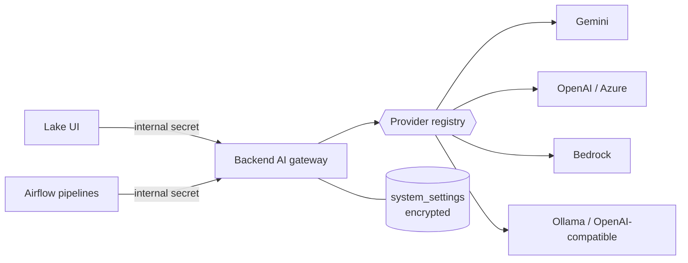

# AI Providers

Lake of Tears uses a language model and an embedding model for AI Query, the SQL assistant, Genie, the `ai_*` SQL functions and the embedding pipelines. Which service provides them is a setting: a superadmin picks a provider in **Settings, Admin Panel, AI Provider**, and the change applies immediately with no restart or redeploy.

> **Availability.** This guide describes the multi-provider support from tickets #68, #69, #70 and #71. Until those pull requests are merged, Lake of Tears is Gemini-only and the other guides in this wiki describe that behaviour. Every statement below was verified against the code; the Ollama path was also run end to end on a local stack. OpenAI, Azure AI Foundry and Amazon Bedrock were tested with mocked requests only, because they need paid accounts.

## 1. Supported providers

| Provider | Where your data goes | Authentication | Notes |
|---|---|---|---|
| Google Gemini | Google | API key | The default. 768-dimension embeddings. |
| OpenAI | OpenAI | API key | Defaults `gpt-4o-mini`, `text-embedding-3-small`, 1536 dimensions. |
| Azure AI Foundry | Your Azure tenant | API key | Models are addressed by *deployment name*. Entra ID is not supported yet. |
| Amazon Bedrock | Your AWS account | IAM role, or access key and secret | Chat through the Converse API; Titan or Cohere embeddings. |
| Ollama | Your own machine or network | None, or a bearer token | Fully offline. Run locally or as a Kubernetes service. |
| OpenAI-compatible server | Wherever it runs | Optional bearer token | vLLM, LocalAI, LM Studio, Groq, DeepSeek and others. `/v1` is added if missing. |

## 2. How it works



- **Credentials stay in the backend.** The UI and the Airflow scripts never see a provider key; they call `/api/internal/ai/info`, `/embed` and `/generate`, which accept only the internal shared secret and never return credentials.
- **Settings live in PostgreSQL**, in `system_settings`, with secrets encrypted. The Admin Panel reads them masked and a blank secret field keeps the stored value.
- **Precedence:** Admin Panel settings, then the older Gemini Admin Panel settings, then environment variables (`LLM_PROVIDER`, `LLM_API_KEY`, `LLM_MODEL`, `LLM_EMBEDDING_MODEL`, `LLM_EMBEDDING_DIMENSION`, `LLM_BASE_URL`, `GEMINI_API_KEY`, `OPENAI_API_KEY`, `AZURE_OPENAI_*`) as defaults for a fresh or unattended install.
- The reasons for these choices, and the alternatives that were not chosen, are in [`docs/decisions/0001-ai-provider-architecture.md`](https://github.com/Lake-of-Tears/lake-of-tears/blob/main/docs/decisions/0001-ai-provider-architecture.md), including how to revert each one.

## 3. Choose a provider

1. Sign in as a superadmin and open **Settings, Admin Panel, AI Provider**.
2. Pick the provider. The form shows only that provider's fields.
3. Fill them in (section 4) and click **Test Connection**. It uses the values on screen, saved or not, and reports the chat model and the embedding model separately, each with its latency and the embedding dimension.
4. Click **Save**. Every part of Lake of Tears uses the new provider from the next request.

## 4. Provider settings

### Google Gemini
API key from Google AI Studio, chat model, embedding model and dimension.

### OpenAI
API key. The models and dimension default as in the table above.

### Azure AI Foundry
Endpoint (`https://<resource>.openai.azure.com`), API key, the **chat deployment name**, the **embedding deployment name** and the API version (default `2024-10-21`). The key is sent in an `api-key` header.

### Amazon Bedrock
Region, chat model id, embedding model id and an optional dimension (Titan v2 allows 256, 512 or 1024).
- **IAM role (recommended on AWS):** leave the access key fields blank; the workload's role is used. The identity needs `bedrock:InvokeModel`, and model access must be enabled in that region.
- **Static keys:** enter the access key id and the secret (and a session token for temporary credentials). Entering only one of the two is rejected.
- The Helm chart does not create a service account yet, so an EKS role (IRSA) needs one added to the backend deployment.

### Ollama (offline)
```bash
# If running Ollama locally or in your Kubernetes cluster
ollama run llama3.2
ollama pull nomic-embed-text
```
Choose **Ollama**, set the base URL to your Ollama endpoint (e.g., `http://host.docker.internal:11434` or your in-cluster service `http://ollama.lake-of-tears.svc.cluster.local:11434`) and enter the two model names. The dimension is detected on first use. Some embedding models expect a prefix; for `nomic-embed-text` set the query prefix to `search_query: ` and the document prefix to `search_document: `.

### OpenAI-compatible server
Base URL, optional token, chat model, embedding model, optional dimension and prefixes, as for Ollama.

## 5. Embeddings and switching providers

Every embedding file records which `provider`, `model` and `dimension` produced it. Searches compare only vectors of the **active** model's dimension (and, when the file records it, the active model), so:

- Switching provider never breaks a query. Old vectors stay on disk but are simply not matched until you re-embed them.
- Files written before this change have no `model` column and count as `gemini-embedding-001` at 768 dimensions.
- To make old data searchable under a new provider, re-run the embedding DAG for the dates you need.

The search query is built by `vector_search_sql(dimension, has_model_column)`, which casts to `DOUBLE[<dimension>]` for the active dimension instead of the fixed 768 shown in [Chunking and Vector Embeddings](Chunking-and-Vector-Embeddings.md). There are three identical copies (backend, UI, pipeline) because the images are separate, and tests keep them in step.

## 6. Troubleshooting

| Symptom | Cause and fix |
|---|---|
| Test Connection says it could not connect | The backend cannot reach the address. Inside Docker use the service name (`http://ollama:11434`), not `localhost`. |
| HTTP 404 from Ollama or an OpenAI-compatible server | The model name is wrong or not pulled. For Azure, use the *deployment* name, not the model name. |
| HTTP 401 or 403 | Wrong key or token, or (Bedrock) missing `bedrock:InvokeModel` or model access in the region. |
| Chat works but embeddings fail with a dimension error | The configured dimension differs from what the model returns. Clear the dimension field to auto-detect it. |
| AI Query finds nothing after switching provider | Only rows made by the active model are searched. Re-embed the data. |
| Bedrock: "no AWS credentials" | Attach an IAM role to the workload or enter an access key id and secret. |
