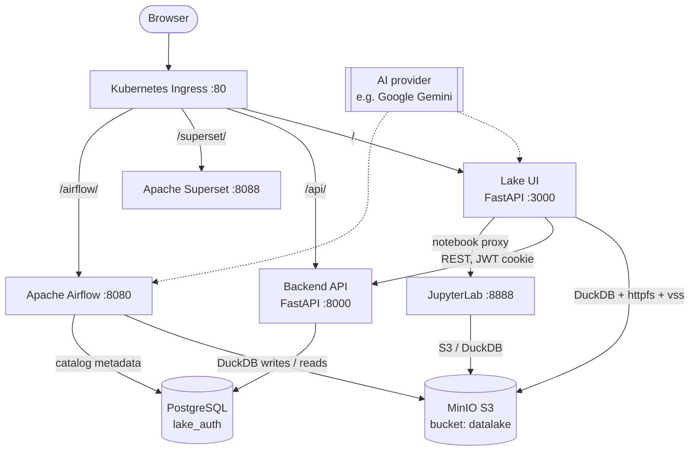

# Architecture Overview

Lake of Tears is a handful of well-known open-source services behind one entry point, built around a simple idea: keep data as Parquet files in object storage and query them in place with an embedded engine. This page explains the model, where data lives, how requests are routed, what each component does and how the stack is deployed.

## 1. The DuckDB-first lakehouse model

There is no separate query cluster. SQL runs **in process** with [DuckDB](https://duckdb.org/):

- The Lake UI keeps a pool of warm DuckDB connections. Each one loads the `httpfs` extension to read `s3://` paths directly from MinIO, and the `vss` extension for vector similarity search.
- Airflow pipeline tasks use DuckDB the same way, to write Parquet to MinIO (`COPY ... TO 's3://...' (FORMAT PARQUET)`) and to read it back for embeddings and anomaly detection.
- A SQL query is just a read over Parquet files, for example `SELECT * FROM read_parquet('s3://datalake/raw/weather/**/*.parquet')`.

Because storage and compute are separate, the data is plain Parquet in an S3 bucket. It can be inspected with any other Parquet-aware tool, and scaling the compute side means running more UI replicas rather than resizing a cluster.

Catalogs add a naming layer on top. A catalog holds schemas, a schema holds tables, and each table records an `s3_path_pattern` pointing at its Parquet files. See [Workspaces and Catalog Management](Workspaces-and-Catalog-Management.md) for how catalogs are owned, shared and deleted.

## 2. Object storage layout

All data lives in one MinIO bucket named `datalake`, written as Hive-partitioned Parquet (`year=/month=/day=`).

| Prefix | What is stored | Written by |
|---|---|---|
| `s3://datalake/raw/<source>/year=YYYY/month=MM/day=DD/data.parquet` | Raw records from each ingest pipeline (for example `weather`, `truenas`, `jellyfin`) | Airflow ingest DAGs |
| `s3://datalake/embeddings/<source>/year=YYYY/month=MM/day=DD/data.parquet` | The raw records plus an `embedding` vector column | The embedding DAG |
| `s3://datalake/<catalog>/<schema>/<table>/year=YYYY/month=MM/day=DD/data.parquet` | Catalog-organized tables | Pipelines or notebooks that write to a catalog |

The `raw/` and `embeddings/` prefixes are the original, catalog-free layout. The catalog layout is a convention: each catalog table stores its own `s3_path_pattern`, so a table can point at any prefix, including another source's `raw/` data. Deleting a catalog removes the objects under its tables' prefixes, except prefixes that other catalogs also use.

## 3. Single-entry-point routing

Everything a user touches is served from one address. In Kubernetes, an Ingress controller listens on **port 80** (and 443 with TLS) and routes by path:

| Path | Goes to | Notes |
|---|---|---|
| `/` | Lake UI (port 3000) | The shell, sidebar and pages |
| `/api/notebooks` | Lake UI | Notebook endpoints: the UI talks to JupyterLab for you through its notebook proxy |
| `/api/` | Backend (port 8000) | Auth, workspaces, catalogs, admin settings |
| `/airflow/` | Apache Airflow (port 8080) | Pipeline UI |

Superset and the MinIO console can also be reached via Ingress hosts or dedicated paths. JupyterLab has no public route of its own by default. The Lake UI reaches it over the internal network (its base URL is `/jupyter`) and exposes notebooks through `/api/notebooks`. Having one origin keeps cookies, sign-in and the browser's same-origin rules simple.

## 4. Component map

| Component | Role |
|---|---|
| **Ingress** | The single entry point and path router (Kubernetes Ingress). |
| **Lake UI** | A FastAPI app that serves the shell and pages, runs SQL through its DuckDB pool, proxies notebook traffic and calls the backend with the user's session. |
| **Backend API** | A FastAPI service for sign-in (password and SSO), workspaces, catalogs, sharing and admin settings. It stores its data in PostgreSQL and manages the schema with Alembic migrations. |
| **PostgreSQL** | The `lake_auth` database: users, workspaces, catalogs, grants and system settings. |
| **MinIO** | S3-compatible object storage holding all Parquet data in the `datalake` bucket. |
| **DuckDB** | The embedded SQL engine, running inside the UI and in pipeline tasks, not as a separate server. |
| **Apache Airflow** | Runs the ingest, embedding, anomaly-detection and maintenance DAGs (for example purging deleted catalogs and workspaces, and refreshing catalog schemas). |
| **JupyterLab** | Interactive notebooks. The Lake UI proxies to it over the internal network; it has no public route by default. |
| **Apache Superset** | Business-intelligence dashboards, reachable at `/superset/`. |
| **AI provider** | A hosted model service used for embeddings and natural-language answers. Google Gemini is the default (see [AI Providers](AI-Providers.md) for the others); its key and models are configured in the Admin Panel. |

## 5. Deployment model

Lake of Tears standardizes on **Kubernetes with Helm** across both local development and production:

| Aspect | Kubernetes / Helm |
|---|---|
| **Best for** | Local development (OrbStack, minikube, kind, k3s) and production clusters |
| **Entry point** | Ingress controller (ingress-nginx) with path and host routing |
| **Storage** | PersistentVolumeClaims on your StorageClass (NFS, Longhorn, local-path and others) |
| **Configuration** | Helm values files (`values-local.yaml`, `values-prod.yaml`), with secrets kept in values or sealed secrets |
| **Start it with** | `helm upgrade --install lake-of-tears ./deploy/helm/lake-of-tears` |

The repository also ships Terraform modules under `deploy/terraform/foundation` for provisioning infrastructure such as MinIO buckets. See the [README](https://github.com/Lake-of-Tears/lake-of-tears#readme) for the full Helm walkthrough, local-cluster values (`values-local.example.yaml`) and production secrets handling.

## Related pages

- [Home](Home.md)
- [Workspaces and Catalog Management](Workspaces-and-Catalog-Management.md)
