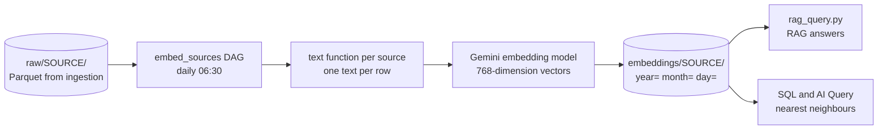

# Chunking and Vector Embeddings

Lake of Tears turns text from your data into **vector embeddings** so you can search it by meaning and ask questions in plain English. This guide explains how embeddings are produced and stored, how to register a new source, how "chunking" works today, how to query the vectors, and what is planned.

> **Status of chunking.** Today every row becomes exactly one embedding (one row = one chunk). The pluggable chunking strategies (`recursive`, `document`, `agentic`) are a **planned design** tracked in [#72](https://github.com/Lake-of-Tears/lake-of-tears/issues/72) and are **not implemented yet**; section 4 separates what works now from what is planned.

The embedding pipeline and queries in this guide were run against a local stack, using a stand-in embedder instead of the real model, so no API key is needed to reproduce them.

## 1. How embeddings flow through the lake



1. **Ingestion** writes rows to `raw/<source>/...` (see [Data Ingestion and Pipelines](Data-Ingestion-and-Pipelines.md)).
2. The **`embed_sources`** Airflow DAG runs `embed_sources.py` every day at 06:30. For each registered source it reads **yesterday's rows** (`WHERE source_date = <yesterday>`).
3. A small function per source (`_text_<source>`) turns each row into one sentence of text.
4. The texts are sent to the Gemini embedding model (`gemini-embedding-001`) in batches of 100, asking for **768-dimension** vectors.
5. The rows, their text and their vectors are written to `embeddings/<source>/year=YYYY/month=MM/day=DD/data.parquet`.

The Gemini API key and default model are configured by a superadmin in **Settings, Admin Panel**; the pipeline fetches the key from the backend when it runs.

## 2. Embedding architecture

### No separate vector database

Vectors live in ordinary Parquet files in MinIO, next to the rest of the data, and are searched with DuckDB. There is nothing extra to deploy.

### The embeddings schema

Each file under `embeddings/` has these columns (confirmed with `DESCRIBE` on pipeline output):

| Column | Type | Meaning |
|---|---|---|
| `id` | `VARCHAR` | The row's `id`/`Id`/`ID` column if the source has one, otherwise an MD5 hash of the text |
| `source` | `VARCHAR` | Source name, for example `weather` |
| `content` | `VARCHAR` | The text that was embedded |
| `embedding` | `DOUBLE[]` | The 768-dimension vector, stored as a list of doubles |
| `source_date` | `VARCHAR` | The day the data is about (`YYYY-MM-DD`) |
| `ingested_at` | `TIMESTAMP` | When the embedding was created |

The writer replaces one file per source per day, so **re-running a day replaces that partition** instead of duplicating it. We ran the same day twice and the row count stayed the same.

### Querying vectors

Parquet stores the vector as a variable-length list, but DuckDB's similarity function needs a fixed-length array, so queries cast both sides to `DOUBLE[768]`:

```sql
SELECT content,
       array_cosine_similarity(embedding::DOUBLE[768], ?::DOUBLE[768]) AS score
FROM read_parquet('s3://datalake/embeddings/**/*.parquet')
ORDER BY score DESC
LIMIT 5;
```

Things to know:

- **Cosine similarity** returns a score up to 1.0; the closest text scores highest. In our test the row whose text was the query scored `1.0`.
- **The query vector must come from the same model and dimension** as the stored vectors (768). A vector of a different length fails to cast; a 3072-long vector gives `Cannot cast list with length 3072 to array with length 768`.
- **`array_cosine_similarity` does not need the `vss` extension.** We ran it on a connection with only `httpfs` loaded. The pipeline and the UI still load `vss` so that an index can be added later, but today there is no vector index: every search scans the matching Parquet files and sorts. A persistent HNSW index is a planned improvement ([#107](https://github.com/Lake-of-Tears/lake-of-tears/issues/107)), so search speed falls as the data grows.
- **Embed documents and queries differently.** The pipeline asks for task type `RETRIEVAL_DOCUMENT` when embedding stored text and `RETRIEVAL_QUERY` for a question (`embed_query`), which improves results.

## 3. Register a new source

Embedding only runs for sources you register in `pipeline/embed/embed_sources.py`. Assume your ingestion pipeline already writes `raw/example_orders/` (see the ingestion guide).

### Step 1: write the text function

A function takes one row (a pandas Series) and returns the text to embed. Put the information a person would search for into one readable sentence:

```python
def _text_example_orders(row) -> str:
    return f"Order {row.get('order_id', '')}: {row.get('status', 'unknown')}, ${row.get('amount', 0):.2f}"
```

### Step 2: register it

Add it to both lookups in the same file:

```python
TEXT_FN = {
    # ... existing sources ...
    "example_orders": _text_example_orders,
}

SOURCES = {
    # ... existing sources ...
    "example_orders": "raw/example_orders/**/*.parquet",
}
```

`SOURCES` maps the source name to the glob (relative to `s3://datalake/`) that holds its raw data. The text function is looked up by the same name.

### Step 3: make sure the rows have `source_date`

The pipeline selects only rows where `source_date` equals **yesterday's date** (`YYYY-MM-DD`), so your ingestion script must set that column to the day the rows belong to, as the shipped scripts do. If the column is missing the run prints `No data for <date>` followed by a long `Binder Error: Referenced column "source_date" not found` message and writes nothing.

### Step 4: run it

The `embed_sources` DAG covers every registered source. To run it by hand after ingestion has produced yesterday's data:

```bash
docker compose exec airflow airflow dags trigger embed_sources
```

The log ends with `[example_orders] Embedded N records for <date>`. See [Airflow Orchestration](Airflow-Orchestration.md) for how to find the log. The Gemini key must be configured in the Admin Panel first.

### Testing without calling Gemini

The pipeline calls a function named `embed_texts`. For a quick local test you can replace it with a deterministic stand-in before importing `embed_sources`, then check the output with SQL:

```python
import hashlib, math, sys
sys.path[:0] = ["pipeline/shared", "pipeline/embed"]

def fake_vec(text, dims=768):
    vals, i = [], 0
    while len(vals) < dims:
        vals += [(b - 127.5) / 127.5 for b in hashlib.sha256(f"{i}:{text}".encode()).digest()]
        i += 1
    vals = vals[:dims]
    norm = math.sqrt(sum(v * v for v in vals))
    return [v / norm for v in vals]

import gemini_embedder
gemini_embedder.embed_texts = lambda texts, task_type="RETRIEVAL_DOCUMENT": [fake_vec(t) for t in texts]

import embed_sources
embed_sources.embed_source("example_orders", "raw/example_orders/**/*.parquet")
```

Run it with `MINIO_ENDPOINT=localhost:9000` against the local stack. The vectors are meaningless for real search, but the schema, partitions, re-run behavior and query shapes are all real.

## 4. Chunking

### What happens today: one row, one chunk

A **chunk** is the piece of text that gets one embedding. Today the chunk is simply the string your `_text_<source>` function returns for a row. There is no splitting. That works well for structured records (a weather reading, a storage pool status, a log line) and is the same idea as the planned `document` strategy.

If your rows contain long text, there are two practical options until chunking lands:

- **Shorten it** in the text function so the important content fits the embedding model's input limit. Longer inputs are truncated or produce a vector that blurs many topics together.
- **Split it during ingestion.** Have your ingest script write one row per chunk, with its own stable `id` plus your own `parent_id` and `chunk_index` columns. The embedding pipeline treats each row independently, and you can keep those columns for tracing results back to the source document.

### Planned: pluggable chunking strategies (#72)

> **Not implemented.** The following is the design proposed in [#72](https://github.com/Lake-of-Tears/lake-of-tears/issues/72). Names, options and defaults may change before it ships, and none of it can be used yet.

| Strategy | Intended use | How it works |
|---|---|---|
| `recursive` (planned default for unstructured text) | Documents, articles, long logs | Splits by a hierarchy of separators (paragraph, line, sentence, word), with a target `chunk_size` and a `chunk_overlap`; no LLM cost |
| `document` | Structured events, metrics, sensor data | Keeps one row as one chunk (today's behavior) |
| `agentic` | Contracts, papers, transcripts | Uses an LLM to extract standalone statements or topic sections before embedding |

The proposal also adds lineage columns so each chunk can be traced back to the row it came from:

| Planned column | Meaning |
|---|---|
| `parent_id` | The original document or row ID |
| `chunk_index` | Position of the chunk, starting at 0 |
| `total_chunks` | How many chunks the parent produced |

and a declarative way to choose a strategy per source in `SOURCES`. When the framework is built, this section will be updated with working examples.

## 5. Query examples

### From SQL

The nearest-neighbour query in section 2 is the core. Other useful queries over the embeddings:

```sql
-- how much is embedded per source
SELECT source, COUNT(*) AS rows
FROM read_parquet('s3://datalake/embeddings/**/*.parquet')
GROUP BY source
ORDER BY rows DESC;

-- the text behind the embeddings for one day
SELECT source, content
FROM read_parquet('s3://datalake/embeddings/**/*.parquet')
WHERE source_date = '2026-10-16'
LIMIT 20;
```

### From Python: embed a question, then search

```python
import duckdb
# run with PYTHONPATH=pipeline/shared so that gemini_embedder can be imported
from gemini_embedder import embed_query

question = "Was it hot yesterday?"
vec = embed_query(question)          # 768 numbers, task type RETRIEVAL_QUERY

con = duckdb.connect()
con.execute("INSTALL httpfs; LOAD httpfs;")
# ... set s3_endpoint, s3_access_key_id, s3_secret_access_key, s3_use_ssl=false, s3_url_style='path'

rows = con.execute(
    """
    SELECT source, content,
           array_cosine_similarity(embedding::DOUBLE[768], ?::DOUBLE[768]) AS score
    FROM read_parquet('s3://datalake/embeddings/**/*.parquet')
    ORDER BY score DESC
    LIMIT 5
    """,
    [vec],
).fetchall()
```

The shipped `pipeline/query/rag_query.py` does exactly this and then asks Gemini to answer using the top matches as context:

```bash
python pipeline/query/rag_query.py "Was it hot yesterday?"
```

## 6. Known gaps and troubleshooting

| Problem | What is going on |
|---|---|
| **The AI Query page fails or returns nothing** | The page's SQL selects a `summary` column, but embeddings contain `content`. Tracked in [#171](https://github.com/Lake-of-Tears/lake-of-tears/issues/171). Use the SQL above with `content` in the meantime. |
| `No data for <date>` followed by a `Binder Error` in the embed log | Your raw rows have no `source_date` column. Set it in the ingest script. |
| `[source] Empty for <date>, skipping` | There were no rows for yesterday. Check that ingestion ran and that `source_date` matches the date. |
| `GEMINI_API_KEY is not set` | A superadmin must add the key in Settings, Admin Panel. |
| `Cannot cast list with length N to array with length 768` | The query vector has the wrong dimension. Use the same model and `output_dimensionality` of 768. |
| The new source never appears in `embeddings/` | It is missing from `SOURCES` or `TEXT_FN`, or both lookups use different names. |
| Daily AI summaries are not searchable | The `summarize` DAG writes plain text summaries to `raw/summaries/<source>/` (columns `source`, `date`, `summary`). They are not embedded. |
| Searches get slower as data grows | There is no vector index yet (#107); every search scans all embedding files. |

## Related pages

- [Home](Home.md)
- [Data Ingestion and Pipelines](Data-Ingestion-and-Pipelines.md): producing the raw rows
- [Airflow Orchestration](Airflow-Orchestration.md): running and debugging the `embed_sources` DAG
- [Architecture Overview](Architecture-Overview.md): where embeddings sit in the storage layout
