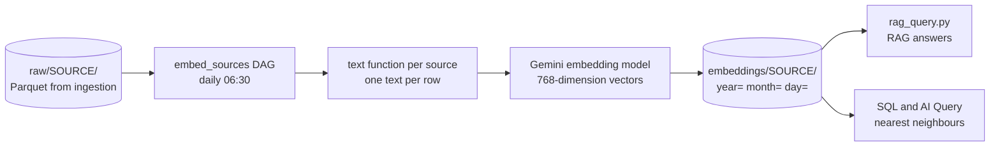

# Chunking and Vector Embeddings

Lake of Tears turns text from your data into **vector embeddings** so you can search it by meaning and ask questions in plain English. This guide explains how embeddings are produced and stored, how to register a new source, how long text is split into chunks, how to query the vectors, and what is still missing.

> **Chunking.** Long text is split into chunks before embedding, with a strategy you choose per source: `recursive` (the default for unstructured text), `document` (one row is one chunk, used by the shipped structured sources) or `agentic` (an LLM writes standalone statements). Implemented in [#72](https://github.com/Lake-of-Tears/lake-of-tears/issues/72); see section 4.

> **AI providers.** With multi-provider support ([#68](https://github.com/Lake-of-Tears/lake-of-tears/issues/68) to [#71](https://github.com/Lake-of-Tears/lake-of-tears/issues/71)), the model, key and vector dimension described here depend on the provider chosen in the Admin Panel; the pipeline calls the backend AI gateway instead of `gemini_embedder`, and searches cast to the active dimension instead of a fixed 768. See [AI Providers](AI-Providers.md). The examples below show the Gemini defaults.

The embedding pipeline and queries in this guide were run against a local stack, using a stand-in embedder instead of the real model, so no API key is needed to reproduce them.

## 1. How embeddings flow through the lake



1. **Ingestion** writes rows to `raw/<source>/...` (see [Data Ingestion and Pipelines](Data-Ingestion-and-Pipelines.md)).
2. The **`embed_sources`** Airflow DAG runs `embed_sources.py` every day at 06:30. For each registered source it reads **yesterday's rows** (`WHERE source_date = <yesterday>`).
3. A small function per source (`_text_<source>`) turns each row into one sentence of text.
4. The texts are sent to the Gemini embedding model (`gemini-embedding-001`) in batches of 100, asking for **768-dimension** vectors.
5. The rows, their text and their vectors are written to `embeddings/<source>/year=YYYY/month=MM/day=DD/data.parquet`.

The Gemini API key and default model are configured by a superadmin in **Settings, Admin Panel**; the pipeline fetches the key from the backend when it runs.

## 2. Embedding architecture

### No separate vector database

Vectors live in ordinary Parquet files in MinIO, next to the rest of the data, and are searched with DuckDB. There is nothing extra to deploy.

### The embeddings schema

Each file under `embeddings/` has these columns, one row per chunk (the provider, model and dimension columns are described in [AI Providers](AI-Providers.md)). Files written before chunking existed lack `parent_id`, `chunk_index`, `total_chunks` and `metadata`; searches read old and new files together and those cells are simply empty for old rows.

| Column | Type | Meaning |
|---|---|---|
| `id` | `VARCHAR` | One-chunk records: the row's `id`/`Id`/`ID` column if the source has one, otherwise an MD5 hash of the text. Records split into several chunks: `<parent_id>:<chunk_index>` |
| `source` | `VARCHAR` | Source name, for example `weather` |
| `content` | `VARCHAR` | The text that was embedded |
| `embedding` | `DOUBLE[]` | The 768-dimension vector, stored as a list of doubles |
| `source_date` | `VARCHAR` | The day the data is about (`YYYY-MM-DD`) |
| `parent_id` | `VARCHAR` | The `id` of the record this chunk came from (equals `id` for a one-chunk record) |
| `chunk_index` | `BIGINT` | Position of the chunk within its record, starting at 0 |
| `total_chunks` | `BIGINT` | How many chunks the record produced |
| `metadata` | `VARCHAR` | The record's other fields as JSON (long values shortened, missing ones left out, the text column and the `year`/`month`/`day` folder columns excluded), the same on every chunk of a record |
| `ingested_at` | `TIMESTAMP` | When the embedding was created |

The writer replaces one file per source per day, so **re-running a day replaces that partition** instead of duplicating it. We ran the same day twice and the row count stayed the same.

### Querying vectors

Parquet stores the vector as a variable-length list, but DuckDB's similarity function needs a fixed-length array, so queries cast both sides to `DOUBLE[768]`:

```sql
SELECT content,
       array_cosine_similarity(embedding::DOUBLE[768], ?::DOUBLE[768]) AS score
FROM read_parquet('s3://datalake/embeddings/**/*.parquet')
ORDER BY score DESC
LIMIT 5;
```

Things to know:

- **Cosine similarity** returns a score up to 1.0; the closest text scores highest. In our test the row whose text was the query scored `1.0`.
- **The query vector must come from the same model and dimension** as the stored vectors (768). A vector of a different length fails to cast; a 3072-long vector gives `Cannot cast list with length 3072 to array with length 768`.
- **`array_cosine_similarity` does not need the `vss` extension.** We ran it on a connection with only `httpfs` loaded. The pipeline and the UI still load `vss` so that an index can be added later, but today there is no vector index: every search scans the matching Parquet files and sorts. A persistent HNSW index is a planned improvement ([#107](https://github.com/Lake-of-Tears/lake-of-tears/issues/107)), so search speed falls as the data grows.
- **Embed documents and queries differently.** The pipeline asks for task type `RETRIEVAL_DOCUMENT` when embedding stored text and `RETRIEVAL_QUERY` for a question (`embed_query`), which improves results.

## 3. Register a new source

Embedding only runs for sources you register in `pipeline/embed/embed_sources.py`. Assume your ingestion pipeline already writes `raw/example_orders/` (see the ingestion guide).

### Step 1: choose where the text comes from

For **structured records** (an order, a reading, a log line) write a function that takes one row (a pandas Series) and returns one readable sentence with what a person would search for:

```python
def _text_example_orders(row) -> str:
    return f"Order {row.get('order_id', '')}: {row.get('status', 'unknown')}, ${row.get('amount', 0):.2f}"
```

For **documents** (articles, pages, transcripts) you do not need a function: the pipeline uses a `text_column` you name, or the first of `content`, `text`, `body`, `description`, `overview`, `summary`, `title` that your data has.

### Step 2: register it

Add an entry to `SOURCES` in `pipeline/embed/embed_sources.py`, and the function to `TEXT_FN` when you wrote one:

```python
TEXT_FN = {
    # ... existing sources ...
    "example_orders": _text_example_orders,
}

SOURCES = {
    # ... existing sources ...
    "example_orders": {
        "glob": "raw/example_orders/**/*.parquet",
        "text_fn": _text_example_orders,
        "chunking": "document",          # one row = one chunk
    },
    "company_wiki": {
        "glob": "raw/company_wiki/**/*.parquet",
        "text_column": "body",           # optional; detected if you leave it out
        # "chunking" defaults to "recursive" (512 characters, 64 overlap) for a source with no text_fn
    },
}
```

`glob` is relative to `s3://datalake/`. The other options are described in section 4.

### Step 3: make sure the rows have `source_date`

The pipeline selects only rows where `source_date` equals **yesterday's date** (`YYYY-MM-DD`), so your ingestion script must set that column to the day the rows belong to, as the shipped scripts do. If the column is missing the run prints `No data for <date>` followed by a long `Binder Error: Referenced column "source_date" not found` message and writes nothing.

### Step 4: run it

The `embed_sources` DAG covers every registered source. To run it by hand after ingestion has produced yesterday's data:

```bash
kubectl exec -it deployment/lake-of-tears-airflow -n lake-of-tears -- airflow dags trigger embed_sources
```

The log ends with a line such as `[company_wiki] Embedded 42 chunks from 5 records for <date> (recursive chunking)`. See [Airflow Orchestration](Airflow-Orchestration.md) for how to find the log. The Gemini key must be configured in the Admin Panel first.

### Testing without calling Gemini

The pipeline calls a function named `embed_texts`. For a quick local test you can replace it with a deterministic stand-in before importing `embed_sources`, then check the output with SQL:

```python
import hashlib, math, sys

sys.path[:0] = ["pipeline/shared", "pipeline/embed"]


def fake_vec(text, dims=768):
    vals, i = [], 0
    while len(vals) < dims:
        vals += [(b - 127.5) / 127.5 for b in hashlib.sha256(f"{i}:{text}".encode()).digest()]
        i += 1
    vals = vals[:dims]
    norm = math.sqrt(sum(v * v for v in vals))
    return [v / norm for v in vals]


import gemini_embedder

gemini_embedder.embed_texts = lambda texts, task_type="RETRIEVAL_DOCUMENT": [
    fake_vec(t) for t in texts
]

import embed_sources

embed_sources.embed_source("example_orders", "raw/example_orders/**/*.parquet")
```

Run it with `MINIO_ENDPOINT=localhost:9000` against the local stack. The vectors are meaningless for real search, but the schema, partitions, re-run behavior and query shapes are all real.

## 4. Chunking

A **chunk** is the piece of text that gets one embedding. Long text embedded as one piece is truncated by the embedding model or becomes a vector that blurs many topics together, so it is cut into chunks first, and each chunk is searched and returned on its own. The code is in `pipeline/embed/chunking/`.

### Strategies

| Strategy | Use for | How it works | Cost |
|---|---|---|---|
| `recursive` | Documents, articles, long logs. **Default** for a source with no `text_fn` | Cuts at the coarsest boundary that fits: paragraph, then line, then sentence, then word, then character. Every chunk is at most `chunk_size` characters, and consecutive chunks share up to `chunk_overlap` characters of whole sentences so a fact near a cut is still found | None |
| `document` | Structured events, metrics, sensor data. **Default** for a source with a `text_fn`, and used by the shipped `jellyfin`, `truenas`, `weather` and `truenas_logs` | One row is one chunk, unchanged | None |
| `agentic` | Contracts, papers, transcripts | Sends the text to the AI provider in windows and asks for standalone statements (names instead of pronouns, numbers kept exactly). A window the model answers badly is split with `recursive` instead, so a bad reply never fails the run | One model call per `window` characters |

Options per source in `SOURCES`:

| Option | Applies to | Default | Meaning |
|---|---|---|---|
| `chunking` | all | `document` with a `text_fn`, else `recursive` | The strategy name |
| `chunk_size` | `recursive` | 512 | Maximum characters per chunk (about 4 characters per token in English) |
| `chunk_overlap` | `recursive` | 64 | Characters repeated between neighbouring chunks; must be smaller than `chunk_size` |
| `window` | `agentic` | 4000 | Characters sent to the model per call |
| `text_column` | without `text_fn` | detected | The column holding the text |

An unknown strategy name or invalid sizes stop that source's run with a clear error.

### What is written

Each chunk is a row with `parent_id`, `chunk_index`, `total_chunks` and `metadata` (see the schema in section 2), so a search hit can be traced back to its record: for example, find every chunk of one document with `WHERE parent_id = 'doc-backups' ORDER BY chunk_index`. A record that is one chunk keeps its own `id`, so structured sources look exactly as before.

We ran this on a local stack with real embeddings: three documents of about 1,000 characters (`chunk_size` 400, `chunk_overlap` 60) became nine chunks of at most 397 characters, each with a 768-dimension vector. The question "How long are nightly database backups kept before they are deleted?" returned the chunk containing the retention rule first (score 0.91; the next chunk scored 0.77), even though the document was about backups in general.

### Choosing sizes

- Smaller chunks (200 to 400 characters) answer narrow factual questions precisely but can lose context; larger ones (800 to 1,500) keep context but dilute the vector. The default of 512 with an overlap of 64 is a starting point, not a measured optimum for your data.
- Keep `chunk_overlap` at roughly 10 to 15 percent of `chunk_size`.
- Changing the settings changes the chunks and their ids for new days only. Existing days are not re-chunked; re-run the DAG for a past date if you need that (it replaces that day's file).

### Deploying to Airflow

`embed_sources.py` imports the `chunking` folder, so it must sit next to the script. In Docker Compose copy it into the jobs folder with the script (see the ingestion guide for the layout):

```bash
cp -R pipeline/embed/chunking "$DATALAKE_DATA_DIR/datalake/jobs/pipeline/"
cp pipeline/embed/embed_sources.py "$DATALAKE_DATA_DIR/datalake/jobs/pipeline/"
```

### Adding your own strategy

Subclass `BaseChunker` (`chunking/base.py`), set `name`, implement `split(text) -> list[str]`, and register the class in `STRATEGIES` in `chunking/__init__.py`. Blank text and `None` are handled for you by `chunk()`.

## 5. Query examples

### From SQL

The nearest-neighbour query in section 2 is the core. Other useful queries over the embeddings:

```sql
-- how much is embedded per source
SELECT source, COUNT(*) AS rows
FROM read_parquet('s3://datalake/embeddings/**/*.parquet')
GROUP BY source
ORDER BY rows DESC;

-- the text behind the embeddings for one day
SELECT source, content
FROM read_parquet('s3://datalake/embeddings/**/*.parquet')
WHERE source_date = '2026-10-16'
LIMIT 20;
```

### From Python: embed a question, then search

```python
import duckdb

# run with PYTHONPATH=pipeline/shared so that gemini_embedder can be imported
from gemini_embedder import embed_query

question = "Was it hot yesterday?"
vec = embed_query(question)  # 768 numbers, task type RETRIEVAL_QUERY

con = duckdb.connect()
con.execute("INSTALL httpfs; LOAD httpfs;")
# ... set s3_endpoint, s3_access_key_id, s3_secret_access_key, s3_use_ssl=false, s3_url_style='path'

rows = con.execute(
    """
    SELECT source, content,
           array_cosine_similarity(embedding::DOUBLE[768], ?::DOUBLE[768]) AS score
    FROM read_parquet('s3://datalake/embeddings/**/*.parquet')
    ORDER BY score DESC
    LIMIT 5
    """,
    [vec],
).fetchall()
```

The shipped `pipeline/query/rag_query.py` does exactly this and then asks Gemini to answer using the top matches as context:

```bash
python pipeline/query/rag_query.py "Was it hot yesterday?"
```

## 6. Known gaps and troubleshooting

| Problem | What is going on |
|---|---|
| **The AI Query page fails or returns nothing** | The page's SQL selects a `summary` column, but embeddings contain `content`. Tracked in [#171](https://github.com/Lake-of-Tears/lake-of-tears/issues/171). Use the SQL above with `content` in the meantime. |
| `No data for <date>` followed by a `Binder Error` in the embed log | Your raw rows have no `source_date` column. Set it in the ingest script. |
| `[source] Empty for <date>, skipping` | There were no rows for yesterday. Check that ingestion ran and that `source_date` matches the date. |
| `GEMINI_API_KEY is not set` | A superadmin must add the key in Settings, Admin Panel. |
| `Cannot cast list with length N to array with length 768` | The query vector has the wrong dimension. Use the same model and `output_dimensionality` of 768. |
| The new source never appears in `embeddings/` | It is missing from `SOURCES`, or its `glob` does not match, or (with a `text_fn`) the function is missing from `TEXT_FN` under the same name. |
| `ModuleNotFoundError: No module named 'chunking'` in the embed log | The `chunking` folder was not copied next to `embed_sources.py` in Airflow (see section 4). |
| `Unknown chunking strategy` or `Invalid options` | Fix the `chunking` name or the sizes of that source in `SOURCES`. |
| A source with long text still gives one huge chunk | It has a `text_fn` or `chunking: "document"`. Set `chunking` to `recursive`. |
| `agentic` log line says it fell back to recursive splitting | The model's reply was not a JSON list of statements, or the AI provider was unreachable. The run continues with recursive chunks. |
| Daily AI summaries are not searchable | The `summarize` DAG writes plain text summaries to `raw/summaries/<source>/` (columns `source`, `date`, `summary`). They are not embedded. |
| Searches get slower as data grows | There is no vector index yet (#107); every search scans all embedding files. |

## Related pages

- [Home](Home.md)
- [Data Ingestion and Pipelines](Data-Ingestion-and-Pipelines.md): producing the raw rows
- [Airflow Orchestration](Airflow-Orchestration.md): running and debugging the `embed_sources` DAG
- [Architecture Overview](Architecture-Overview.md): where embeddings sit in the storage layout
