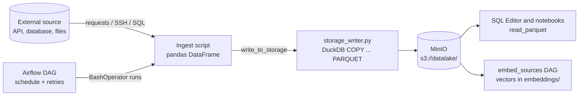

# Data Ingestion and Pipeline Authoring

This guide is for developers adding a new ingestion pipeline to Lake of Tears. You will see how data gets from an external source into MinIO as Parquet, then build a small working pipeline step by step and learn the practices that keep it safe to re-run.

The code in this guide was run against the Lake of Tears Kubernetes deployment: a script written to this pattern was triggered from an Airflow DAG, backfilled, re-run and queried with DuckDB.

## 1. How data flows

An ingestion pipeline is two small pieces: a **script** that fetches data and writes it, and an **Airflow DAG** that runs the script on a schedule.



Every run writes one Parquet file per **partition date**:

```
s3://datalake/
├── raw/
│   └── <source>/year=YYYY/month=MM/day=DD/data.parquet      <- legacy "raw" layout
├── embeddings/
│   └── <source>/year=YYYY/month=MM/day=DD/data.parquet
└── <catalog>/<schema>/<table>/year=YYYY/month=MM/day=DD/data.parquet   <- catalog layout
```

The shared helper, `write_to_storage()` in `pipeline/shared/storage_writer.py`, builds the path, connects DuckDB to MinIO with the `httpfs` extension and runs `COPY df TO 's3://...' (FORMAT PARQUET)`. Your script never talks to S3 directly.

### Ingestion Methods in Lake of Tears

Lake of Tears supports three primary methods of data ingestion into the Lakehouse:
1. **Add Data Hub (UI):** Upload CSV, TSV, JSON, NDJSON, or Parquet files with live schema preview and automatic Hive partitioning.
2. **Zero-Copy S3 Registration (UI & API):** Point to any workspace S3 folder to register existing Parquet files into the catalog.
3. **TOON Community Connectors:** Declarative `connector.toon` manifests in `pipeline/connectors/` (PostgreSQL, MySQL, Snowflake, Kafka, S3, Stripe, Shopify, HubSpot, etc.).
4. **Notebook Jobs:** Parameterized Jupyter notebooks executed on a schedule via Airflow (`run_notebook_dag`).

## 2. Tutorial: add an `example_orders` source

You will create a source that writes two order rows per day. Swap the fake data for a real API call when you adapt it.

### Step 1: create the ingest script

Create `pipeline/ingest/example_orders.py`:

```python
import sys
from datetime import date, timedelta
from pathlib import Path

# Deployed layout: this file sits in <datalake>/jobs/pipeline/, storage_writer.py in <datalake>/
sys.path.insert(0, str(Path(__file__).parents[2]))

import pandas as pd
from storage_writer import write_to_storage


def fetch_orders(target_date: str) -> pd.DataFrame:
    # Replace with a real call, e.g.
    #   resp = requests.get(URL, params={"date": target_date}, timeout=30)
    #   resp.raise_for_status()
    #   df = pd.json_normalize(resp.json())
    df = pd.DataFrame(
        [
            {"order_id": 1001, "amount": 42.50, "status": "paid"},
            {"order_id": 1002, "amount": 13.00, "status": "refunded"},
        ]
    )
    df["source_date"] = target_date
    return df


if __name__ == "__main__":
    target = sys.argv[1] if len(sys.argv) > 1 else str(date.today() - timedelta(days=1))
    df = fetch_orders(target)
    if df.empty:
        print(f"[ingest_example_orders] no rows for {target}; nothing written")
        sys.exit(0)
    write_to_storage(df, "example_orders", target)
    print(f"[ingest_example_orders] wrote {len(df)} rows for {target}")
```

Four things matter here:

1. **Take the date as an argument.** The partition date is a parameter, not "now". That makes the script re-runnable and backfillable (section 3).
2. **Return a pandas DataFrame** with flat columns. Use `pd.json_normalize()` for nested JSON.
3. **Add a `source_date` column** holding the partition date, as the existing scripts do. The writer takes the partition from the date you pass in, not from this column, but the embedding and summary jobs select rows with `WHERE source_date = <yesterday>`, so a missing or wrong `source_date` means that data is never embedded (see [Chunking and Vector Embeddings](Chunking-and-Vector-Embeddings.md)).
4. **Read secrets from the environment** (`os.environ`), never from the source code.

### Step 2: write to storage

`write_to_storage(df, source, date_str)` is the whole storage API for the legacy layout:

```python
write_to_storage(df, "example_orders", "2026-10-14")
# -> s3://datalake/raw/example_orders/year=2026/month=10/day=14/data.parquet
```

`date_str` must be `YYYY-MM-DD`; it is cut into the `year=`, `month=` and `day=` partition folders. If you leave it out, today's date is used.

### Step 3: raw tables or catalog tables

The helper has two modes:

| Mode | Call | Path |
|---|---|---|
| Legacy raw | `write_to_storage(df, "example_orders", date_str)` | `raw/example_orders/year=.../data.parquet` |
| Catalog | `write_to_storage(df, date_str=date_str, catalog="production", schema="revenue", table="example_orders")` | `production/revenue/example_orders/year=.../data.parquet` |

Pass either `source`, or all three of `catalog`, `schema` and `table`; anything else raises a `ValueError`.

Writing the files does **not** create the catalog entry. To make the data appear in the catalog explorer, create the table in the Lake UI (or the catalog API) with an `s3_path_pattern` such as `s3://datalake/production/revenue/example_orders/**/*.parquet`. See [Workspaces and Catalog Management](Workspaces-and-Catalog-Management.md) for how catalogs, schemas and tables are owned and shared.

### Step 4: create the DAG

Create `pipeline/dags/ingest_example_orders_dag.py`:

```python
from datetime import datetime, timedelta

from airflow import DAG
from airflow.operators.bash import BashOperator

with DAG(
    dag_id="ingest_example_orders",
    schedule="0 6 * * *",
    start_date=datetime(2026, 1, 1),
    catchup=False,
    tags=["ingestion"],
    default_args={"retries": 2, "retry_delay": timedelta(minutes=5)},
    doc_md="Ingest example orders into s3://datalake/raw/example_orders/",
) as dag:
    BashOperator(
        task_id="run",
        bash_command="python3 /opt/airflow/datalake/jobs/pipeline/ingest_example_orders.py {{ ds }}",
    )
```

`{{ ds }}` is Airflow's date for the run (`YYYY-MM-DD`), so every run, including backfills, gets the right partition. The shipped DAGs use the same `BashOperator` pattern.

### Step 5: deploy and run it

The shipped DAGs call `/opt/airflow/datalake/jobs/pipeline/<script>.py`, so scripts are not read from the repository folders directly. In Kubernetes, DAGs and pipeline scripts are mounted into the Airflow container (via PVC or ConfigMap):

| Location | Inside Airflow | Put here |
|---|---|---|
| PVC / ConfigMap | `/opt/airflow/dags/` | `ingest_example_orders_dag.py` |
| Volume / image | `/opt/airflow/datalake/` | `storage_writer.py` (copy of `pipeline/shared/storage_writer.py`) |
| Volume / image | `/opt/airflow/datalake/jobs/pipeline/` | the script, saved as `ingest_example_orders.py` |

The script's `sys.path.insert(..., parents[2])` line works because of that layout: `jobs/pipeline/<script>` is two levels under the folder that holds `storage_writer.py`. Note the script name changes slightly (`example_orders.py` in the repo, `ingest_example_orders.py` once deployed), matching the existing `ingest_*` scripts.

Then register, unpause and trigger the DAG. New DAGs start paused.

```bash
kubectl exec -it deployment/lake-of-tears-airflow -n lake-of-tears -- airflow dags reserialize
kubectl exec -it deployment/lake-of-tears-airflow -n lake-of-tears -- airflow dags unpause ingest_example_orders
kubectl exec -it deployment/lake-of-tears-airflow -n lake-of-tears -- airflow dags trigger ingest_example_orders
kubectl exec -it deployment/lake-of-tears-airflow -n lake-of-tears -- airflow dags list-runs -d ingest_example_orders
```

The run should end in `success`, and the log shows `[ingest_example_orders] wrote 2 rows for <date>`. You can also watch it in the Airflow UI at `http://localhost/airflow`.

### Step 6: check the data

In the SQL Editor (or a notebook with DuckDB):

```sql
SELECT *
FROM read_parquet('s3://datalake/raw/example_orders/**/*.parquet', union_by_name = true)
ORDER BY source_date;
```

Hive partition folders become columns automatically, so the result also has `year`, `month` and `day`.

### Testing the script without Airflow

From a repository checkout, with Python packages `pandas`, `duckdb` and `requests` installed and the stack running (MinIO's port 9000 is published):

```bash
MINIO_ENDPOINT=localhost:9000 PYTHONPATH=pipeline/shared \
  python pipeline/ingest/example_orders.py 2026-10-14
```

- `PYTHONPATH=pipeline/shared` is needed because, in the repository layout, `storage_writer.py` is not next to the script. Without it you get `ModuleNotFoundError: No module named 'storage_writer'`.
- `MINIO_ENDPOINT=localhost:9000` overrides the container name in `.env` (`minio:9000`). Other values, such as `MINIO_ACCESS_KEY` and `MINIO_SECRET_KEY`, are read from `.env`.

### Make it searchable (optional)

To have the new data embedded for AI search, add the source to `SOURCES` in `pipeline/embed/embed_sources.py` (for example `"example_orders": "raw/example_orders/**/*.parquet"`) and add a `_text_example_orders(row)` function to `TEXT_FN` that turns one row into a sentence. Add any new environment variables to the Helm values (`airflow.env`), `deploy/helm/values-local.example.yaml`, and the README configuration table.

## 3. Best practices

### Idempotency: re-running is safe

`write_to_storage` always writes the same file name, `data.parquet`, inside the date's partition folder, so **writing the same date again replaces that partition** instead of appending to it. We tested this: running the script twice for one date, and then rewriting that date with different data, left exactly one object holding only the new rows.

Build on that:

- Make the script compute everything from the date argument, and write the whole partition each time.
- Do not append across runs or depend on state from a previous run.
- If your source returns "everything since the last run", still write per-date partitions: derive the date from each record rather than from the clock.

### Backfilling

Because the script takes a date and the DAG passes `{{ ds }}`, Airflow can fill past days:

```bash
kubectl exec -it deployment/lake-of-tears-airflow -n lake-of-tears -- airflow dags backfill \
  -s 2026-10-10 -e 2026-10-12 ingest_example_orders
```

Each run writes its own partition (`day=10`, `day=11`, and so on). Check what your source allows: some APIs only serve recent history or rate-limit heavily, so backfill in small ranges. Re-running a backfill is harmless thanks to idempotency.

The shipped DAGs use `catchup=False`, so Airflow does not create runs for missed days by itself. Use an explicit backfill when you need them.

### Schema evolution and DuckDB compatibility

Parquet files carry their own schema, so one partition can have columns that another lacks. We wrote a day with an extra `currency` column and read everything back:

| Query | Result |
|---|---|
| `read_parquet('.../**/*.parquet')` | Works, but uses the first file's columns, so **the new `currency` column silently disappeared** |
| `read_parquet('.../**/*.parquet', union_by_name = true)` | All columns, with NULLs where a partition lacks one |

Recommendations:

- **Use `union_by_name = true`** in queries over sources whose columns can change, and mention it in the documentation for that source.
- **Add columns; avoid renaming or retyping them.** A column that is a number in one partition and text in another breaks queries. Cast explicitly in your script (`df["amount"] = df["amount"].astype("float64")`).
- **Keep column names stable and flat**, using `pd.json_normalize()` for nested API responses.
- Catalog tables record column definitions. The nightly `refresh_catalog_schemas` DAG compares them with the files and flags drift (see the Workspaces guide).

### Error handling and timeouts

- **Always set a timeout** on network calls (`requests.get(..., timeout=30)`) so a hung source cannot block the scheduler slot forever.
- **Call `raise_for_status()`**, and let the script exit non-zero when the source fails. The task then fails visibly and Airflow's retries apply. Avoid `try/except` blocks that print an error and carry on, unless a partial result really is acceptable. (`truenas.py` does this deliberately for its optional disk inventory.)
- **Set retries in the DAG**, as in the example (`retries: 2`, `retry_delay: 5 minutes`).
- **Fetch first, write last.** Build the whole DataFrame in memory and call `write_to_storage` once, so a failure halfway never leaves a half-written partition.
- **Handle empty results explicitly.** The example exits cleanly with a message instead of writing an empty file. Decide whether "no rows" is normal for your source.
- **Log what you did** (`print` goes to the Airflow task log), including the date and row count.

### Secrets and configuration

Read tokens and hostnames from environment variables, document them in `deploy/helm/values-local.example.yaml`, and pass them to the `airflow` deployment in the Helm values so the task can see them. Never commit a real key, and do not print secrets in logs.

## 4. Checklist for a new source

1. `pipeline/ingest/<source>.py`: takes a date argument, builds a DataFrame, writes with `write_to_storage`.
2. `pipeline/dags/ingest_<source>_dag.py`: schedule, `catchup=False`, retries, `{{ ds }}` passed to the script.
3. Deploy the script, `storage_writer.py` and DAG to the Airflow folders and test with `airflow dags trigger`.
4. Optional: register a catalog table, and add the source to `SOURCES` and `TEXT_FN` in `embed_sources.py` for embeddings.
5. Add environment variables to `deploy/helm/values-local.example.yaml`, the Helm values and the README table.
6. Open the pull request with the ticket number (`feat/<issue#>-...`), as described in the [contributing guide](https://github.com/Lake-of-Tears/lake-of-tears/blob/main/CONTRIBUTING.md).

## Related pages

- [Home](Home.md)
- [Architecture Overview](Architecture-Overview.md): where pipelines fit in the stack and the storage layout
- [Workspaces and Catalog Management](Workspaces-and-Catalog-Management.md): registering tables in catalogs
