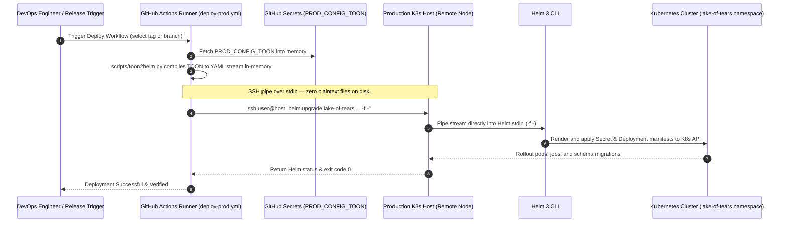

# Deployment and Operations

This is the operational runbook for Lake of Tears: deploying locally or to production with Helm on Kubernetes, checking health, maintaining storage, and rotating secrets. Troubleshooting steps are collected in section 5.

Lake of Tears standardizes 100% on Kubernetes and Helm across all environments.

## 1. Local setup with Helm (Kubernetes)

### Prerequisites

- A local Kubernetes cluster: [OrbStack](https://orbstack.dev/) (macOS), Docker Desktop (with Kubernetes enabled), [minikube](https://minikube.sigs.k8s.io/), [kind](https://kind.sigs.k8s.io/), or [k3s](https://k3s.io/).
- An Ingress controller:
  - OrbStack provides built-in ingress on port 80.
  - For minikube: `minikube addons enable ingress`
  - For kind / other: install `ingress-nginx`
- `helm` 3+ and `kubectl`.
- At least 8 GB of memory allocated to your container runtime.

### Steps

```bash
git clone https://github.com/Lake-of-Tears/lake-of-tears.git
cd lake-of-tears

# Option A: Unified TOON deployment (Recommended)
cp lake-of-tears.example.toon lake-of-tears.local.toon
helm upgrade --install lake-of-tears ./deploy/helm/lake-of-tears \
  --namespace lake-of-tears --create-namespace \
  -f <(python scripts/toon2helm.py -i lake-of-tears.local.toon)

# Option B: Standard Helm values override
# cp deploy/helm/values-local.example.yaml values-local.yaml
# helm upgrade --install lake-of-tears ./deploy/helm/lake-of-tears \
#   --namespace lake-of-tears --create-namespace \
#   -f values-local.yaml
```

Wait for pods to be ready:
```bash
kubectl wait --namespace lake-of-tears \
  --for=condition=ready pod \
  --selector=app.kubernetes.io/instance=lake-of-tears \
  --timeout=180s
```

Open **http://localhost** and register the first account: it becomes the superadmin.

### Everyday commands

```bash
kubectl get pods,svc,ingress -n lake-of-tears      # status of all workloads
kubectl logs -f deployment/lake-of-tears-backend -n lake-of-tears # follow backend logs
kubectl logs -f deployment/lake-of-tears-ui -n lake-of-tears      # follow UI logs
kubectl rollout restart deployment -n lake-of-tears             # restart deployments
helm upgrade lake-of-tears ./deploy/helm/lake-of-tears -n lake-of-tears -f values-local.yaml # apply changes
helm uninstall lake-of-tears -n lake-of-tears                   # teardown release
```

## 2. Unified Platform Configuration (TOON)

Lake of Tears standardizes on **Token-Oriented Object Notation (TOON)** as its single unified specification for configuring the entire platform across local development, staging, and production. The canonical template is located at the root of the repository: [`lake-of-tears.example.toon`](../../lake-of-tears.example.toon).

### Architectural Philosophy & Benefits

Maintaining separate `values.yaml`, `values-prod.yaml`, and `values-secret.yaml` files frequently leads to configuration drift, orphaned credentials, and accidental leaks. TOON addresses this with three core design pillars:

1. **40–60% Token Compression:** By utilizing tabular arrays (`key[N]{col1,col2}: ...`) for uniform collections (TLS definitions, OAuth providers, data connectors) and compact indentation for nested key-value pairs, TOON significantly reduces token counts compared to verbose YAML or JSON. This makes it exceptionally efficient for LLM-driven DevOps agents, CI/CD runners, and clean human audits.
2. **Single Source of Truth:** All ingress hosts, storage class tiers, CPU/RAM budgets, database users, SSO providers, and ingestion connectors are declared in one authoritative file.
3. **Multi-Level Dedenting Engine:** The Lake of Tears TOON parser (`pipeline/shared/toon.py` and `ui/toon.py`) utilizes common-prefix dedenting (`textwrap.dedent`), allowing arbitrarily deep sub-child dictionaries (e.g. `minio.resources.cpu_request` or `backend.auth.secretKey`) to maintain strict relative hierarchy without losing their parent context.

---

### Canonical Specification Domains (`lake-of-tears.example.toon`)

The specification covers 8 core platform domains:

| Domain | Key Sections | Purpose & Highlights |
|---|---|---|
| **Global** | `global.storageClass`, `global.allowDefaultNamespace` | Cluster PVC storage class (`local-path`, `nfs-client`, cloud CSI) and safety guards against deploying to the `default` namespace. |
| **Ingress & TLS** | `ingress.host`, `ingress.minioConsoleHost`, `ingress.supersetHost`, `ingress.tls[N]` | Unified routing rules and a tabular TLS matrix mapping TLS certificates to multi-host SAN lists. |
| **MinIO Storage** | `minio.rootUser`, `minio.rootPassword`, `minio.buckets`, `minio.persistence`, `minio.resources` | S3-compatible object storage configuration, persistent disk size, automatic initial bucket provisioning (`datalake`, `raw`, `analytics`, `workspaces`), and compute limits. |
| **Lake UI Shell** | `lakeui.service.port`, `lakeui.resources`, `lakeui.minioConsoleUrl`, `lakeui.supersetUrl` | Unified FastAPI + Tailwind shell configuration and cross-service navigation endpoints. |
| **JupyterLab** | `jupyter.token`, `jupyter.persistence.size`, `jupyter.resources` | Interactive notebook workspaces, internal token authentication, and persistent storage. |
| **Apache Superset** | `superset.secretKey`, `superset.adminPassword`, `superset.persistence.size`, `superset.resources` | BI dashboarding engine, Flask session encryption key, and administrator credentials. |
| **Apache Airflow** | `airflow.secretKey`, `airflow.adminPassword`, `airflow.extraPipPackages`, `airflow.waitForDb`, `airflow.resources` | Scheduled ETL orchestration, Fernet encryption key, PostgreSQL readiness probe container, and pre-installed Python libraries (`pandas`, `pyarrow`, `duckdb`). |
| **Backend & SSO** | `backend.auth`, `backend.smtp`, `backend.oauth[N]`, `backend.resources` | JWT signing secret, public base URL, SMTP notification relay, and tabular OAuth identity matrix (Google, GitHub, Microsoft, Apple, etc.). |
| **PostgreSQL** | `postgres.auth`, `postgres.airflow`, `postgres.persistence`, `postgres.resources`, `postgres.dsn` | Internal PostgreSQL database credentials for Lake auth and Airflow metadata, along with external DSN connectivity. |
| **Connectors** | `connectors[N]`, `stripe`, `shopify`, `hubspot`, etc. | Tabular ingestion schedule matrix (`sync_history_days`, cron schedules, credential refs) and top-level connector API tokens. |

---

### The TOON-to-Helm Compiler (`scripts/toon2helm.py`)

Lake of Tears includes a high-performance compiler utility in [`scripts/toon2helm.py`](../../scripts/toon2helm.py) (backed by [`pipeline/shared/toon2helm.py`](../../pipeline/shared/toon2helm.py)) to translate `.toon` files directly into Helm `values.yaml` dictionaries.

#### Automated Normalization Rules:

- **Compute Resources:** Converts flat TOON properties (`cpu_request`, `mem_request`, `cpu_limit`, `mem_limit`) into standard Kubernetes resource maps:
  ```yaml
  resources:
    requests:
      cpu: "500m"
      memory: "1Gi"
    limits:
      cpu: "2"
      memory: "4Gi"
  ```
- **TLS Host Lists:** Expands comma-separated host strings from tabular TLS rows into structured YAML arrays (`hosts: ["lake.example.com", "minio.example.com"]`).
- **Dynamic URL Derivation:** Automatically calculates `lakeui.minioConsoleUrl` and `lakeui.supersetUrl` using the defined ingress hostnames if not explicitly configured.
- **OAuth Expansion:** Expands the tabular `backend.oauth[...]` matrix into discrete Helm values blocks (`backend.google`, `backend.github`, `backend.microsoft`, `backend.apple`), populating `clientId`, `clientSecret`, `tenantId`, `teamId`, and `keyId`.

#### CLI Compilation & In-Memory Streaming:

```bash
# 1. Compile TOON directly to a static values.yaml file
python scripts/toon2helm.py --input /path/to/lake-of-tears.toon --output values-prod.yaml

# 2. In-memory deployment via bash process substitution (no YAML written to disk)
helm upgrade --install lake-of-tears ./deploy/helm/lake-of-tears \
  --namespace lake-of-tears \
  --create-namespace \
  -f <(python scripts/toon2helm.py -i /path/to/lake-of-tears.toon) \
  --wait --timeout 10m
```

---

## 3. Zero-Disk Streaming & GitHub Actions CI/CD

In production environments, persisting unencrypted YAML values files (such as `/etc/lake-of-tears/values-secret.yaml`) to runner disk or host storage creates compliance risks and security exposure.

Lake of Tears implements a **Zero-Disk In-Memory Streaming** architecture in [lake-of-tears-infra](https://github.com/Lake-of-Tears/lake-of-tears-infra):

### Architecture & Data Flow



### Key Security Guarantees:

1. **Zero Runner Disk Footprint:** `PROD_CONFIG_TOON` is fetched directly into runner memory, piped into `scripts/toon2helm.py`, and streamed across the SSH connection. No intermediate `values.yaml` is ever written to the GitHub Actions runner filesystem.
2. **Zero Host Disk Footprint:** The production host receives the YAML stream over SSH `stdin` directly into `helm upgrade ... -f -`. No plaintext secrets file resides on the remote server's filesystem.
3. **Fail-Fast Validation:** The deployment workflow (`.github/workflows/deploy-prod.yml`) validates that `PROD_CONFIG_TOON` is present before triggering deployment steps.

### Configuring `PROD_CONFIG_TOON` in GitHub Secrets

Store your production configuration in GitHub Actions Secrets using the GitHub CLI:

```bash
# Upload production TOON file directly to GitHub Repository Secrets
gh secret set PROD_CONFIG_TOON \
  --repo Lake-of-Tears/lake-of-tears-infra \
  < /secure/path/lake-of-tears.prod.toon
```

### GitHub Actions CI/CD Workflow Execution

The production deployment step in `.github/workflows/deploy-prod.yml` executes the zero-disk pipeline:

```yaml
- name: Deploy Lake of Tears via In-Memory Stream
  env:
    PROD_CONFIG_TOON: ${{ secrets.PROD_CONFIG_TOON }}
    TARGET_REF: ${{ steps.resolve_target.outputs.ref }}
  run: |
    # Fail-fast check
    if [ -z "$PROD_CONFIG_TOON" ]; then
      echo "::error::PROD_CONFIG_TOON secret is empty!"
      exit 1
    fi

    # Compile TOON in-memory and pipe over SSH directly to Helm stdin
    python scripts/toon2helm.py -i <(printf '%s\n' "$PROD_CONFIG_TOON") | \
      ssh -o StrictHostKeyChecking=no "$SSH_USER@$SSH_HOST" \
        "helm upgrade --install lake-of-tears ./deploy/helm/lake-of-tears \
          --namespace lake-of-tears \
          --create-namespace \
          -f - \
          --wait --timeout 10m"
```

---

## 4. Production on Kubernetes with Helm

### Prerequisites

Kubernetes with an `ingress-nginx` controller, a StorageClass for PersistentVolumeClaims, DNS names for your hostnames, and `helm` 3 or later with `kubectl`.

### Chart structure

`deploy/helm/lake-of-tears/` contains `Chart.yaml`, `values.yaml` and these templates:

| Template | Creates |
|---|---|
| `backend.yaml`, `ui.yaml` | Backend API and Lake UI deployments and services |
| `postgres.yaml` | PostgreSQL |
| `minio.yaml` | MinIO deployment, services and the bucket-creation job |
| `airflow.yaml` | Airflow (`LocalExecutor`, PostgreSQL metadata) |
| `superset.yaml`, `superset-config.yaml` | Superset, its config and an init job |
| `jupyter.yaml` | JupyterLab |
| `ingress.yaml` | The Ingress resources |
| `pvc.yaml` | PersistentVolumeClaims |
| `secrets.yaml` | The Secret, built from your values |
| `validation.yaml` | Install-time guards (see below) |
| `NOTES.txt` | URLs printed after install |

A default install renders 7 deployments, 2 one-shot jobs, 6 Ingress resources and 4 PVCs.

### Values files

| File | Use |
|---|---|
| `deploy/helm/lake-of-tears/values.yaml` | Defaults and documentation of every setting |
| `deploy/helm/values-local.yaml` | A local cluster (OrbStack, Docker Desktop, kind, k3s): `*.localhost` hosts, `local-path` storage, development credentials |
| `deploy/helm/values-local.example.yaml` | A template to copy and customise |
| `deploy/helm/values-prod.yaml` | An example of production overrides (a single-VM k3s install in this repository) |
| `/etc/lake-of-tears/values-secret.yaml` | **Your** secrets, kept outside the repository and never committed |

Pass several files with repeated `--values`; later files win.

### Namespace guard and required secrets

The chart refuses to install into the `default` namespace:

```
[FATAL ERROR] Lake of Tears cannot be deployed into the 'default' namespace.
```

Always use `--namespace lake-of-tears --create-namespace`. It can be bypassed with `--set global.allowDefaultNamespace=true`, but you should not.

Without secrets, rendering fails with the first missing value (for example `minio.rootPassword is required`). The required values are:

```yaml
# /etc/lake-of-tears/values-secret.yaml
minio:    { rootUser: "minio", rootPassword: "<strong password>" }
jupyter:  { token: "<random token>" }
superset: { secretKey: "<random>", adminPassword: "<password>" }
airflow:  { secretKey: "<random>", adminPassword: "<password>" }
postgres:
  auth:    { password: "<password>" }     # lake_auth database
  airflow: { password: "<password>" }    # Airflow metadata database
backend:
  auth: { secretKey: "<random>" }         # JWT signing key
```

### Security context policy

Rendering the chart shows every workload hardened the same way:

- **Pod level:** `runAsNonRoot: true`, a fixed non-root `runAsUser`, and `seccompProfile: RuntimeDefault`. Users differ per image (backend and UI 10001, MinIO 10001, PostgreSQL 70, Airflow 50000, Jupyter 1000, Superset 1000).
- **Container level (including init containers and jobs):** `allowPrivilegeEscalation: false` and `capabilities: drop: [ALL]`.

These can be overridden per service through `<service>.securityContext` in values.

### Ingress and TLS

Hostnames come from the `ingress` block:

| Setting | Serves |
|---|---|
| `ingress.host` | Lake UI, the API and `/airflow` |
| `ingress.supersetHost` | Superset (its own host, because path-based proxying breaks its assets) |
| `ingress.minioConsoleHost` | MinIO console |
| `ingress.minioApiHost` | MinIO S3 API, for external clients |

Enable TLS by listing a secret and the hosts. The secret must already exist in the namespace (for example created by cert-manager):

```yaml
ingress:
  tls:
    - secretName: lake-of-tears-tls
      hosts:
        - lake.example.com
        - superset.example.com
        - minio.example.com
        - minio-api.example.com
```

With `tls` set, the rendered Ingress resources carry the `tls` section. Also set `backend.auth.baseUrl` and `lakeui.minioConsoleUrl` to the `https://` addresses so OAuth callbacks and the Storage page links are correct.

### Storage

The chart creates PVCs for PostgreSQL, MinIO data, Superset home and Airflow home, all `ReadWriteOnce`, using `global.storageClass` (empty means the cluster default). Sizes are set per service with `<service>.persistence.size`; the defaults are 200 Gi for MinIO, 5 Gi for PostgreSQL and 1 Gi for Superset and Airflow, so size MinIO to your data.

> **Known gap:** `jupyter.persistence.size` exists in the values but is not used by any template, so Jupyter has no persistent volume and notebooks are lost if its pod restarts ([#176](https://github.com/Lake-of-Tears/lake-of-tears/issues/176)).

The PVCs carry no `helm.sh/resource-policy: keep` annotation, so `helm uninstall` removes them and **their data** (expected Helm behavior; not tested on a cluster). Back up before uninstalling.

### Install, upgrade and roll back

```bash
helm upgrade --install lake-of-tears ./deploy/helm/lake-of-tears \
  --namespace lake-of-tears --create-namespace \
  --values deploy/helm/values-prod.yaml \
  --values /etc/lake-of-tears/values-secret.yaml \
  --wait --timeout 10m

helm lint ./deploy/helm/lake-of-tears --namespace lake-of-tears    # before upgrading
helm history lake-of-tears -n lake-of-tears
helm rollback lake-of-tears <revision> -n lake-of-tears
```

Check what will be applied without a cluster with `helm template ... ` or `helm install ... --dry-run=client`, which also prints the post-install notes. The Jupyter URL appears in the notes only if you enabled the opt-in `jupyter.ingress`.

## 5. Monitoring and Health Checks

### Health endpoints

| Service | Check | Healthy answer |
|---|---|---|
| Lake UI | `GET /health` (through Ingress at `http://localhost/health`) | `{"status":"ok"}` |
| Backend API | `GET /api/health` | `{"status":"ok"}` |
| MinIO | `GET /minio/health/live` and `/minio/health/ready` | `200` |
| Superset | `GET /health` | `OK` |
| Airflow | `GET /airflow/health` (JSON with scheduler and metadatabase status) | `200` |
| PostgreSQL | `pg_isready -U lake_auth -d lake_auth` | accepting connections |

In Kubernetes the chart defines liveness and readiness probes on these endpoints for the backend, UI, MinIO, Superset, Airflow and PostgreSQL.

Quick checks:

```bash
kubectl get pods,pvc,ingress -n lake-of-tears
for u in http://localhost/health http://localhost/api/health http://localhost/airflow/health; do
  printf '%s -> ' "$u"; curl -s -o /dev/null -w '%{http_code}\n' "$u"
done
kubectl logs deploy/lake-of-tears-backend -n lake-of-tears
```

Look at Airflow's task logs and DAG state for pipeline problems ([Airflow Orchestration](Airflow-Orchestration.md)).

## 6. Maintenance

### Upgrading

1. Take a database backup first (see below); `helm rollback` restores previous chart configurations but not database migrations.
2. Pull the latest repository changes.
3. If building images locally, rebuild and load them into your cluster.
4. Run `helm upgrade`:
   ```bash
   helm upgrade lake-of-tears ./deploy/helm/lake-of-tears \
     --namespace lake-of-tears \
     -f values-local.yaml
   ```
   Database migrations (Alembic) run automatically when the backend pod starts up.

### Backups

What to back up on Kubernetes:

| Data | Where | How |
|---|---|---|
| Users, workspaces, catalogs (PostgreSQL) | PVC `postgres` | `pg_dump` via `kubectl exec` |
| All data files (MinIO) | PVC `minio` | `mc mirror` or CSI volume snapshot |
| Notebooks, DAGs, pipeline code | PVC / Git repo | Git version control & volume snapshot |
| Superset dashboards | PVC `superset` | CSI volume snapshot |
| Your configuration | `values-secret.yaml` | Safe secret storage / manager |

PostgreSQL dump and restore:

```bash
# Dump the database
kubectl exec -it deployment/lake-of-tears-postgres -n lake-of-tears -- \
  pg_dump -U lake_auth -d lake_auth > lake_auth_$(date +%F).sql

# Test restore into scratch database
kubectl exec -i deployment/lake-of-tears-postgres -n lake-of-tears -- \
  psql -U lake_auth -d postgres -c "CREATE DATABASE restore_check"
kubectl exec -i deployment/lake-of-tears-postgres -n lake-of-tears -- \
  psql -U lake_auth -d restore_check < lake_auth_$(date +%F).sql
kubectl exec -i deployment/lake-of-tears-postgres -n lake-of-tears -- \
  psql -U lake_auth -d postgres -c "DROP DATABASE restore_check"
```

MinIO data backup:
```bash
# Using MinIO Client (mc)
mc alias set lake http://localhost:9000 <access key> <secret key>
mc mirror lake/datalake /backup/datalake/
```

### Storage lifecycle

- **Application cleanup.** Deleted catalogs and workspaces are purged after a grace period by the `purge_deleted_catalogs` (daily 02:00) and `purge_inactive_workspaces` (hourly) DAGs. The grace periods are set by a superadmin in the Admin Panel; see [Workspaces and Catalog Management](Workspaces-and-Catalog-Management.md).
- **MinIO lifecycle rules.** To expire objects automatically use MinIO's `mc ilm`. Add a rule only for a prefix you own, for example scratch output; do not expire `raw/` or catalog prefixes by accident:

  ```bash
  mc alias set lake http://localhost:9000 <access key> <secret key>
  mc ilm rule add --expire-days 30 --prefix "tmp/" lake/datalake
  mc ilm rule ls lake/datalake
  mc ilm rule rm --all --force lake/datalake
  ```

- **Small files.** Many small Parquet files slow queries; automatic compaction is a planned improvement ([#103](https://github.com/Lake-of-Tears/lake-of-tears/issues/103)).
- **Disk usage.** Check volume sizes and usage via `kubectl get pvc -n lake-of-tears`.

### Rotating secrets

Rotate on a schedule and whenever a secret may have been exposed. Edit your values secret file, run `helm upgrade`, then restart deployments so pods pick up new Secret definitions:

```bash
helm upgrade lake-of-tears ./deploy/helm/lake-of-tears -n lake-of-tears -f values-secret.yaml
kubectl rollout restart deployment -n lake-of-tears
```

| Secret | What to do | Effect |
|---|---|---|
| `AUTH_SECRET_KEY` | Set a new value in values, upgrade & rollout restart | All users are signed out (existing tokens no longer validate) |
| `POSTGRES_AUTH_PASSWORD` | **First** change it inside PostgreSQL: `kubectl exec -it deployment/lake-of-tears-postgres -n lake-of-tears -- psql -U lake_auth -d lake_auth -c "ALTER USER lake_auth PASSWORD '<new>'"` then update values, upgrade and restart | Database credentials updated |
| `MINIO_ROOT_PASSWORD` | Update values, upgrade, rollout restart MinIO | MinIO applies new root password; services reconnect |
| `JUPYTER_TOKEN` | Update values, upgrade, rollout restart Jupyter | Jupyter restarts, running notebook kernels stop |
| `AIRFLOW_PASSWORD` | Update values, upgrade, rollout restart Airflow | Applied on restart by the Airflow entrypoint |
| `AIRFLOW_SECRET_KEY` | Update values, upgrade, rollout restart Airflow | Airflow web sessions end |
| `SUPERSET_SECRET_KEY` | Update values, upgrade, rollout restart Superset | Sessions end. Follow Superset's `re-encrypt-secrets` procedure |
| AI provider and key | Superadmin: Settings, Admin Panel, AI Provider | Stored encrypted in PostgreSQL; takes effect immediately |
| SSO client secrets | Rotate at the provider, update values, rollout restart backend | Users re-authenticate |

## 7. Troubleshooting

| Symptom | Cause and fix |
|---|---|
| Ingress / Port 80 not responding | Another service is using port 80 or your local Ingress controller is not running. Ensure Ingress controller (e.g. OrbStack or ingress-nginx) is enabled |
| Sign-in shows "Not Found" | Make sure you access the application through the Ingress entrypoint (`http://localhost`), not the pod direct port |
| `helm install` stops with `cannot be deployed into the 'default' namespace` | Add `--namespace lake-of-tears --create-namespace` |
| `helm install` stops with `... is required` | A required configuration or secret is missing from your TOON or values file (section 2 and section 4) |
| Pods stay `Pending` | No usable StorageClass: verify `kubectl get storageclass` and set `global.storageClass` in values if needed |
| Changed a secret but nothing changed | Kubernetes pods read Secrets on container startup; run `kubectl rollout restart deployment -n lake-of-tears` |
| Changed `POSTGRES_AUTH_PASSWORD` and the backend cannot connect | The database user password was not updated inside PostgreSQL; run `ALTER USER` before updating secrets (section 6) |
| Notebooks disappear after a Jupyter pod restart | Ensure persistent volume is configured; see [#176](https://github.com/Lake-of-Tears/lake-of-tears/issues/176) |

## Related pages

- [Home](Home.md)
- [Architecture Overview](Architecture-Overview.md): what each component does
- [Airflow Orchestration](Airflow-Orchestration.md): pipeline operations
- [DuckDB Querying and Analytics](DuckDB-Querying-and-Analytics.md)
- [Workspaces and Catalog Management](Workspaces-and-Catalog-Management.md): purge DAGs and grace periods
