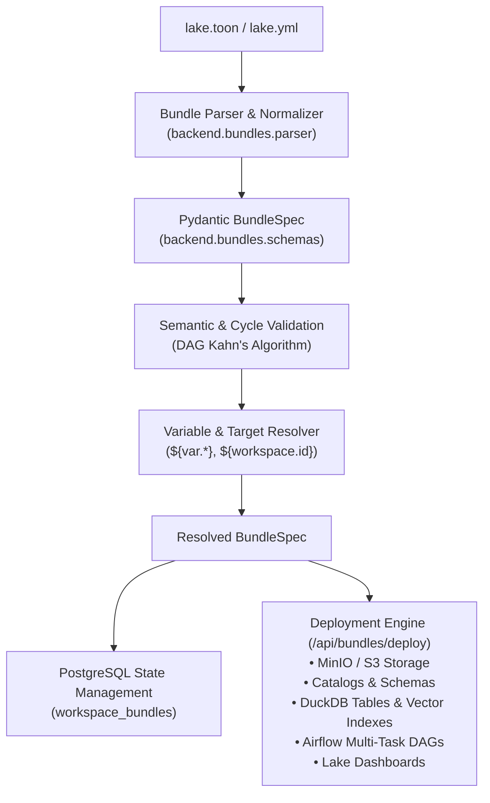

# Lake Asset Bundles (LABs)

## Overview & Architecture

Lake Asset Bundles (LABs) provide a declarative Infrastructure-as-Code (IaC) framework for Lake of Tears architectures. Inspired by Databricks Asset Bundles (DABs), LABs allow data platform teams to define, validate, version-control, and deploy complete lakehouse environments.

Unlike traditional platforms that rely strictly on verbose YAML, Lake of Tears uses **TOON (Token-Oriented Object Notation)** as the primary AI-native manifest format (`lake.toon`), with backward-compatible support for `lake.yml` and `lake.json`. TOON's tabular array syntax (`key[N]{cols...}:`) reduces LLM token consumption by **30–60%**, accelerates streaming speeds, and eliminates indentation bugs during AI code generation.



---

## 1. Manifest Structure

A Lake Asset Bundle manifest consists of four primary sections:

1. **`bundle`**: Metadata identifying the bundle, version, author, and description.
2. **`variables`**: Parameterized variables with default values, types (`string`, `int`, `float`, `bool`, `list`), and documentation.
3. **`targets`**: Deployment targets (`dev`, `staging`, `prod`) specifying target workspaces, compute clusters, and environment variable overrides.
4. **`resources`**: Asset declarations spanning catalogs, medallion schemas (`bronze`, `silver`, `gold`), Parquet tables, vector indexes, Airflow pipelines, and visual dashboards.

### Example Manifest (`lake.toon`)

```toon
bundle:
  name: customer360-medallion
  version: 0.1.0
  author: data-platform@lakeoftears.io
  description: Customer 360 Medallion Architecture

variables:
  raw_bucket:
    default: datalake-bronze
    type: string
  batch_size:
    default: 50000
    type: int

targets:
  dev:
    workspace: dev-workspace
    default_catalog: main_dev
    variables:
      raw_bucket: datalake-dev
  prod:
    workspace: prod-workspace
    default_catalog: main_prod
    variables:
      raw_bucket: datalake-prod

resources:
  catalogs[1]{name,description}:
    main_lake,Primary analytics lakehouse catalog

  schemas[3]{catalog,name,tier,description}:
    main_lake,bronze,bronze,Raw ingested customer events
    main_lake,silver,silver,Cleaned customer entities
    main_lake,gold,gold,Aggregated revenue and lifetime value analytical marts

  tables[2]{name,catalog,schema,format,s3_path_pattern}:
    raw_customers,main_lake,bronze,parquet,"s3://${var.raw_bucket}/customers/*.parquet"
    dim_customers,main_lake,silver,parquet,"s3://${var.raw_bucket}/silver/dim_customers/*.parquet"

  vector_indexes[1]{name,table,column,metric}:
    customer_notes_idx,main_lake.silver.dim_customers,notes,cosine

  pipelines:
    customer_pipeline:
      schedule: "0 2 * * *"
      tasks[3]{name,type,entrypoint,upstream_tasks}:
        extract_events,duckdb_sql,sql/extract.sql,[]
        clean_silver,duckdb_sql,sql/silver.sql,[extract_events]
        build_gold,duckdb_sql,sql/gold.sql,[clean_silver]

  dashboards:
    executive_overview:
      widgets:
        revenue_metric:
          type: metric
          query: "SELECT sum(ltv) FROM main_lake.gold.customer_ltv"
          width: 4
          height: 2
```

---

## 2. Variable Interpolation & Context Tokens

Variables are referenced throughout manifests using `${var.<variable_name>}` syntax. Variables can also reference other variables iteratively up to 10 depths:

```toon
variables:
  region:
    default: us-east-1
  s3_bucket:
    default: "analytics-${var.region}"
  base_path:
    default: "s3://${var.s3_bucket}/${bundle.name}/${target.name}"
```

### Contextual Built-in Tokens

| Token | Description | Resolved Example |
| :--- | :--- | :--- |
| `${bundle.name}` | Root bundle name identifier | `customer360-medallion` |
| `${bundle.version}` | Bundle version string | `0.1.0` |
| `${target.name}` | Active deployment target | `dev`, `prod` |
| `${workspace.id}` | Target workspace slug or UUID | `dev-workspace` |

---

## 3. Python API (`backend.bundles`)

The `backend.bundles` module provides complete programmatic access to parse, validate, and serialize bundles:

```python
from backend.bundles import parse_bundle_file, resolve_bundle, dump_bundle_to_str

# 1. Parse manifest from TOON, YAML, or JSON file
bundle_spec = parse_bundle_file("lake.toon")

# 2. Resolve variables for target deployment environment
dev_bundle = resolve_bundle(bundle_spec, target="dev")

# 3. Export resolved bundle to TOON, YAML, or JSON
toon_output = dump_bundle_to_str(dev_bundle, format="toon")
yaml_output = dump_bundle_to_str(dev_bundle, format="yaml")
```

---

## 4. Pipeline DAG Dependency & Cycle Validation

Pipelines defined within bundles undergo rigorous topological validation:
- All `upstream_tasks` references are verified against declared task identifiers.
- Self-dependencies (`task_a -> task_a`) are rejected.
- Circular dependency cycles (`task_a -> task_b -> task_a`) are detected using 3-state depth-first search (DFS) with full cycle path reporting.

---

## 5. PostgreSQL State Management & Drift Detection

Every bundle deployment is tracked in PostgreSQL via the `workspace_bundles` table:

- **Deployment Tracking:** Records bundle name, deployment target, active status (`active`, `deploying`, `failed`, `destroyed`), version, deployed Git commit SHA, and deploying user.
- **Resources Map:** Tracks all provisioned asset UUIDs (`catalogs`, `schemas`, `tables`, `vector_indexes`, `pipelines`, `dashboards`, `artifacts`).
- **Drift Detection:** `BundleStateService.detect_drift(db, bundle_id)` compares registered resource UUIDs and names against the live database, reporting missing or deleted assets in real time.

---

## 6. Deployment Orchestration Engine (`BundleDeployer`)

The deployment engine (`backend/bundles/deployer.py`) automates end-to-end lakehouse provisioning:

1. **Dry-Run Diff Calculation:** Compares desired bundle specifications against current workspace state to produce an exact change summary (`create`, `update`, `delete`, `unchanged`).
2. **Artifact Synchronization:** Syncs SQL transformation scripts, Python modules, and Jupyter notebooks to workspace MinIO storage (`workspaces/{slug}/bundles/{bundle_name}/`).
3. **Catalog & Schema Provisioning:** Idempotently creates or updates catalogs and automatically initializes the standard medallion schemas (`bronze`, `silver`, `gold`).
4. **Table & Vector Index Provisioning:** Registers managed/external DuckDB Parquet tables with column definitions and applies vector embedding search configurations.
5. **Airflow Multi-Task DAG Compilation:** Generates isolated, syntactically verified Python Airflow DAG code with multi-task dependencies (`task_extract >> task_clean >> task_mart`) and writes DAG files into Airflow workspace directories.
6. **Dashboard Provisioning:** Creates or updates native workspace dashboards with configured metrics, line charts, and SQL queries.
7. **Clean Teardown:** Destroys bundle resources recoverably (see [Section 6.1](#61-destroy-semantics-trash-and-bundle-created-containers)) while safeguarding core medallion schemas.

### 6.1. Destroy Semantics: Trash and Bundle-Created Containers

`angler bundle destroy` (or `DELETE /api/bundles/{bundle_id}`) works as follows:

| Resource | What destroy does |
| :--- | :--- |
| **Tables** | Moved to Trash through the catalog trash service (same as deleting a table in the Catalog page). Managed tables' files move to `workspaces/{ws}/.trash/{asset_id}/`; external tables drop metadata only; Iceberg tables keep their storage in place. All tables from one destroy share a `batch_id`. They can be restored with **Restore** in the Trash drawer, `angler catalog undrop <asset_id>`, or `UNDROP TABLE` until the retention period (default 7 days) ends. |
| **Tables still in use** | A table that another pipeline still references is **kept** and reported under `skipped_dependencies`. The bundle's own pipelines never block it. |
| **Pipelines, dashboards** | Deleted outright (not recoverable through Trash). |
| **Schemas / catalogs the bundle created** | Soft-deleted once empty (see below). Recoverable. |
| **Schemas / catalogs that already existed** | **Never removed.** A catalog or schema counts as created by the bundle only if the deploy that provisioned it created it; the deployer records this (`created_catalogs`, `created_schemas`) and keeps it across redeploys. Bundles deployed before this tracking existed are treated as having created nothing. |
| **Resources shared with another active bundle record** | Kept and reported under `skipped_shared`. |

A bundle-created **schema** is removed only when it is not claimed by another active record, is not a medallion schema (`bronze`/`silver`/`gold`), and has no live tables or older Trash entries. A bundle-created **catalog** is removed only when it is not the default catalog, is not claimed by another active record, nothing live or in Trash from before this destroy remains in it, and every non-medallion schema in it is also being removed. Medallion schemas go with a bundle-created catalog but are never dropped on their own. A catalog removal is the same soft delete as the UI Delete button (`deleted_at`, scheduled purge after the retention period); it is skipped when soft delete is disabled.

**Restoring.** Restore tables from Trash. A soft-deleted catalog does not currently appear in the Trash drawer or `angler catalog trash list`; restore it with **Reactivate** in Settings > Workspace, or redeploy the bundle: deploy reactivates a soft-deleted catalog it finds by name.

**Options.**
- `--dry-run` (`dry_run=true`): lists the tables, schemas and catalogs that would be removed and changes nothing.
- `--keep-catalogs` (`keep_catalogs=true`): keeps catalogs *and* schemas the bundle created, even if empty. Tables still go to Trash.
- `--record-only`: removes only the bundle record and keeps every resource.
- `--purge-storage`: also deletes uploaded bundle artifacts.
- Interactive destroy prints the plan first and asks you to type `yes`; `-y` skips the prompt. Destroying an already-destroyed record is a no-op.

---

## 7. REST API Suite (`/api/bundles`)

Mounted under `/api/bundles` and `/api/v1/bundles`:

| Method | Endpoint | Description | Access Role |
| :--- | :--- | :--- | :--- |
| `POST` | `/api/bundles/validate` | Validates manifest syntax, DAG cycles, and generates dry-run diff | Viewer / Member |
| `POST` | `/api/bundles/deploy` | Executes atomic deployment and updates state | Write / Admin |
| `GET` | `/api/bundles` | Lists all deployed bundles in the active workspace | Viewer / Member |
| `GET` | `/api/bundles/{bundle_id}` | Retrieves deployment detail, resource map, snapshot, and drift | Viewer / Member |
| `POST` | `/api/bundles/{bundle_id}/run` | Triggers ad-hoc execution of a bundle pipeline | Write / Admin |
| `DELETE` | `/api/bundles/{bundle_id}` | Destroys a bundle: tables to Trash, bundle-created empty catalogs/schemas soft-deleted. Query: `dry_run`, `keep_catalogs`, `record_only`, `purge_storage` ([Section 6.1](#61-destroy-semantics-trash-and-bundle-created-containers)) | Write / Admin |

---

## 8. Lake UI Bundles Explorer & Conversational AI Generator

Mounted at `/bundles` within the primary navigation sidebar (under *Data Engineering*):

### 8.1. Declarative Bundles Gallery
- **Reactive State Management:** Driven by the offline Alpine.js controller `bundlesManager` in `ui/static/js/controllers/bundles.js`.
- **Filtering & Search:** Real-time search by bundle name, version, and target, with target (`dev`, `staging`, `prod`) and deployment status filters.
- **Resource Summary Cards:** Visual counters for provisioned catalogs, tables, pipelines, and dashboards, with deployment timestamps and Git commit badges.

### 8.2. Slide-Over Details & Topology Drawer
- **Overview Tab:** Live drift detection report, deployment metadata, and ad-hoc Airflow pipeline execution triggers.
- **Resources Tab:** Grouped inventory of all provisioned database objects with column specifications and task entrypoints.
- **Manifest Tab:** Canonical manifest viewer with 1-click clipboard copy and syntax highlighting.
- **Visual Topology Tab:** Multi-tier DAG visualization depicting the asset flow from storage namespaces through managed tables, Airflow transformation tasks, and visual dashboards.

### 8.3. Pre-Deploy & Dry-Run Validation Modal
- Direct manifest editing in TOON, YAML, or JSON.
- 1-click **Validate & Diff** executing dry-run reconciliation before modifying live state.
- Visual breakdown of resources to create, update, delete, or leave unchanged.

### 8.4. Conversational AI Prompt-to-Bundle Generator
- Natural language to production-ready TOON specification generator powered by workspace LLM integrations via `GatewayClient` with automatic fallback to heuristic starter templates.
- Curated template prompts for Customer 360, E-Commerce Medallion Lakehouses, and Fraud Detection pipelines.
- Direct handoff into the Pre-Deploy modal for immediate validation and rollout.

### 8.5. Teardown & Deletion Safeguards
- Typed confirmation (`DESTROY`) required before resource destruction.
- Optional storage purge toggle for raw Parquet and vector embeddings.
- Automatic preservation of core medallion schemas (`bronze`, `silver`, `gold`).
- Tables go to Trash and can be restored; see [Section 6.1](#61-destroy-semantics-trash-and-bundle-created-containers).

