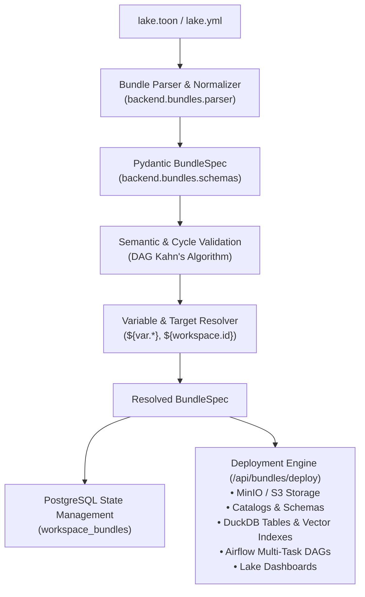

# Lake Asset Bundles (LABs)

## Overview & Architecture

Lake Asset Bundles (LABs) provide a declarative Infrastructure-as-Code (IaC) framework for Lake of Tears architectures. Inspired by Databricks Asset Bundles (DABs), LABs allow data platform teams to define, validate, version-control, and deploy complete lakehouse environments.

Unlike traditional platforms that rely strictly on verbose YAML, Lake of Tears uses **TOON (Token-Oriented Object Notation)** as the primary AI-native manifest format (`lake.toon`), with backward-compatible support for `lake.yml` and `lake.json`. TOON's tabular array syntax (`key[N]{cols...}:`) reduces LLM token consumption by **30–60%**, accelerates streaming speeds, and eliminates indentation bugs during AI code generation.



---

## 1. Manifest Structure

A Lake Asset Bundle manifest consists of four primary sections:

1. **`bundle`**: Metadata identifying the bundle, version, author, and description.
2. **`variables`**: Parameterized variables with default values, types (`string`, `int`, `float`, `bool`, `list`), and documentation.
3. **`targets`**: Deployment targets (`dev`, `staging`, `prod`) specifying target workspaces, compute clusters, and environment variable overrides.
4. **`resources`**: Asset declarations spanning catalogs, medallion schemas (`bronze`, `silver`, `gold`), Parquet tables, vector indexes, Airflow pipelines, and visual dashboards.

### Example Manifest (`lake.toon`)

```toon
bundle:
  name: customer360-medallion
  version: 0.1.0
  author: data-platform@lakeoftears.io
  description: Customer 360 Medallion Architecture

variables:
  raw_bucket:
    default: datalake-bronze
    type: string
  batch_size:
    default: 50000
    type: int

targets:
  dev:
    workspace: dev-workspace
    default_catalog: main_dev
    variables:
      raw_bucket: datalake-dev
  prod:
    workspace: prod-workspace
    default_catalog: main_prod
    variables:
      raw_bucket: datalake-prod

resources:
  catalogs[1]{name,description}:
    main_lake,Primary analytics lakehouse catalog

  schemas[3]{catalog,name,tier,description}:
    main_lake,bronze,bronze,Raw ingested customer events
    main_lake,silver,silver,Cleaned customer entities
    main_lake,gold,gold,Aggregated revenue and lifetime value analytical marts

  tables[2]{name,catalog,schema,format,s3_path_pattern}:
    raw_customers,main_lake,bronze,parquet,"s3://${var.raw_bucket}/customers/*.parquet"
    dim_customers,main_lake,silver,parquet,"s3://${var.raw_bucket}/silver/dim_customers/*.parquet"

  vector_indexes[1]{name,table,column,metric}:
    customer_notes_idx,main_lake.silver.dim_customers,notes,cosine

  pipelines:
    customer_pipeline:
      schedule: "0 2 * * *"
      tasks[3]{name,type,entrypoint,upstream_tasks}:
        extract_events,duckdb_sql,sql/extract.sql,[]
        clean_silver,duckdb_sql,sql/silver.sql,[extract_events]
        build_gold,duckdb_sql,sql/gold.sql,[clean_silver]

  dashboards:
    executive_overview:
      widgets:
        revenue_metric:
          type: metric
          query: "SELECT sum(ltv) FROM main_lake.gold.customer_ltv"
          width: 4
          height: 2
```

---

## 2. Variable Interpolation & Context Tokens

Variables are referenced throughout manifests using `${var.<variable_name>}` syntax. Variables can also reference other variables iteratively up to 10 depths:

```toon
variables:
  region:
    default: us-east-1
  s3_bucket:
    default: "analytics-${var.region}"
  base_path:
    default: "s3://${var.s3_bucket}/${bundle.name}/${target.name}"
```

### Contextual Built-in Tokens

| Token | Description | Resolved Example |
| :--- | :--- | :--- |
| `${bundle.name}` | Root bundle name identifier | `customer360-medallion` |
| `${bundle.version}` | Bundle version string | `0.1.0` |
| `${target.name}` | Active deployment target | `dev`, `prod` |
| `${workspace.id}` | Target workspace slug or UUID | `dev-workspace` |

---

## 3. Python API (`backend.bundles`)

The `backend.bundles` module provides complete programmatic access to parse, validate, and serialize bundles:

```python
from backend.bundles import parse_bundle_file, resolve_bundle, dump_bundle_to_str

# 1. Parse manifest from TOON, YAML, or JSON file
bundle_spec = parse_bundle_file("lake.toon")

# 2. Resolve variables for target deployment environment
dev_bundle = resolve_bundle(bundle_spec, target="dev")

# 3. Export resolved bundle to TOON, YAML, or JSON
toon_output = dump_bundle_to_str(dev_bundle, format="toon")
yaml_output = dump_bundle_to_str(dev_bundle, format="yaml")
```

---

## 4. Pipeline DAG Dependency & Cycle Validation

Pipelines defined within bundles undergo rigorous topological validation:
- All `upstream_tasks` references are verified against declared task identifiers.
- Self-dependencies (`task_a -> task_a`) are rejected.
- Circular dependency cycles (`task_a -> task_b -> task_a`) are detected using 3-state depth-first search (DFS) with full cycle path reporting.
