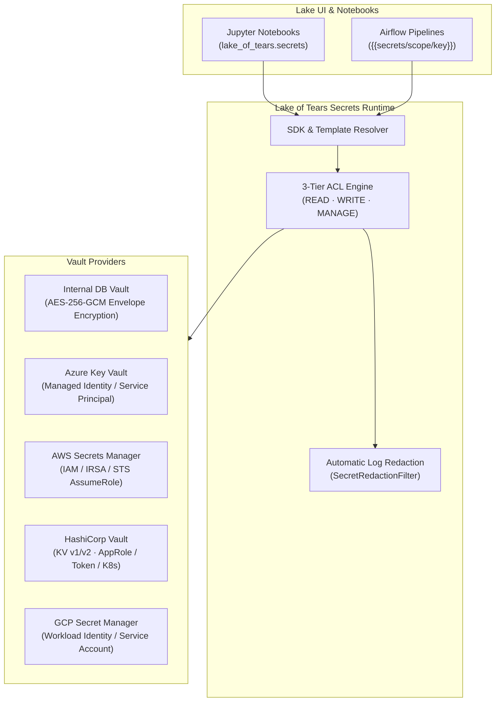
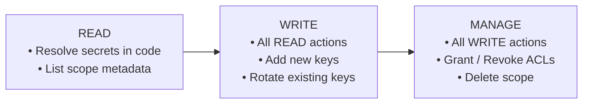

# Secret Management

Lake of Tears includes a Databricks-compatible **Secret Management System**. It enables data teams, notebooks, and automated Airflow pipelines to securely consume API tokens, database credentials, and encryption keys without hardcoding secrets in code, configuration files, or notebooks.

Plaintext secrets are never stored unencrypted, are never revealed once stored, and are automatically redacted from execution logs and terminal output.

---

## 1. Core Architecture & Databricks Parity

Secret management in Lake of Tears is organized around **Secret Scopes**. A scope is a logical namespace that groups related keys (for example, `stripe_prod`, `snowflake_dw`, or `marketing_apis`) and isolates them with granular access control lists (ACLs).



### Highlights
- **Databricks Parity:** Native `dbutils.secrets` equivalent (`lake_of_tears.secrets` and alias `lot.secrets`).
- **Multiple Vault Backends:** Built-in internal AES-256-GCM encrypted database vault, Azure Key Vault, and AWS Secrets Manager.
- **Write-Only Security:** Once a secret key is written, its plaintext value is never exposed in the UI or list APIs.
- **Automatic Output Redaction:** Secret values fetched during pipeline or notebook execution are automatically tracked and masked as `[REDACTED]` in stdout, stderr, and task instance logs.
- **Workspace Scoping & Sharing:** Scopes belong to an active workspace, and superadmins can configure enterprise cloud vaults system-wide.

---

## 2. Vault Providers

Every secret scope is backed by a specific vault provider. When creating a scope in **Workspace Settings**, administrators select which backend manages the keys.

| Provider | Backend Identifier | Storage & Encryption | Authentication | Best For |
|---|---|---|---|---|
| **Internal DB Vault** | `internal` | PostgreSQL (`secret_keys` table) with AES-256-GCM envelope encryption | In-cluster platform master key | Default self-hosted setups; zero external cloud dependencies |
| **Azure Key Vault** | `azure_kv` / `azure_keyvault` | Microsoft Azure Key Vault HSM / Software | DefaultAzureCredential (Workload Identity) or Service Principal | Enterprise Azure deployments & hybrid clouds |
| **AWS Secrets Manager** | `aws_sm` / `aws_secrets_manager` | Amazon Web Services Secrets Manager | IAM Role, EKS IRSA, AssumeRole STS, or static keys | Enterprise AWS deployments & EKS clusters |
| **HashiCorp Vault** | `hashicorp_vault` / `vault` | HashiCorp Vault (KV v1 / KV v2 engines) | Token, AppRole (`role_id` & `secret_id`), or Kubernetes SA | Enterprise on-premise, HCP Vault, and multi-cloud |
| **GCP Secret Manager** | `gcp_secret_manager` / `gcp` | Google Cloud Secret Manager | Workload Identity (GKE / ADC) or Service Account Key JSON | Google Cloud workloads and GKE clusters |

---

## 3. Access Control (ACLs) & Permissions

Access to secret scopes is governed by a **3-tier permission hierarchy** compatible with Databricks:



### Permission Levels

- **`READ`**: Grants permission to fetch and decrypt secret values in notebooks and pipelines via the SDK (`secrets.get(scope, key)`) or template interpolation (`{{secrets/scope/key}}`). Users with `READ` permission can see the scope in their inventory and view key names, but cannot add, rotate, or delete keys.
- **`WRITE`**: Grants `READ` permissions plus the ability to create new secret keys and rotate (overwrite) existing secret keys within the scope.
- **`MANAGE`**: Full administrative ownership. Can read and write secrets, grant or revoke scope permissions for other users and workspace roles, and delete the scope.

### Ownership & Bypass Rules
- **Creator Ownership:** The user who creates a secret scope is automatically granted `MANAGE` permission.
- **Superadmin Bypass:** Platform superadmins automatically possess `MANAGE` access to all secret scopes across all workspaces.
- **Principals:** Permissions can be assigned to individual workspace members (`user`) or workspace roles (`role`, such as `admin`, `write`, or `read`).

---

## 4. Consuming Secrets in Notebooks & Code

Lake of Tears ships with a Python SDK client pre-installed in the notebook and pipeline environments.

### Python SDK (`lake_of_tears.secrets`)

Import either `lake_of_tears.secrets` or the convenient alias `lot.secrets`:

```python
import lake_of_tears.secrets as secrets
# or: from lot import secrets

# 1. Fetch a secret value (automatically registered for log redaction)
api_token = secrets.get(scope="stripe_prod", key="api_key")
db_password = secrets.get(scope="postgres_warehouse", key="password")

# 2. List all keys within an authorized scope (metadata only, no plaintext)
keys = secrets.list(scope="stripe_prod")
for k in keys:
    print(f"Key: {k.key}, Version: {k.version}, Updated: {k.updated_at}")

# 3. List all scopes accessible to your current user/workspace
scopes = secrets.list_scopes()
for s in scopes:
    print(f"Scope: {s.name} (Backend: {s.backend_type}, Permission: {s.user_permission})")
```

> [!NOTE]
> Attempting to fetch a key from a scope you do not have permission for raises `PermissionError` (`HTTP 403 Forbidden`). Requesting a non-existent key raises `KeyError` (`HTTP 404 Not Found`).

---

## 5. Configuration Templating & Pipeline Placeholders

You can reference secrets directly in ingestion YAML configurations, Airflow DAG definitions, and connection parameters without invoking Python code:

### Supported Syntax
- `{{secrets/scope/key}}` (Databricks standard)
- `{{secrets.scope.key}}`
- `${secrets:scope:key}`

### Example Ingestion Configuration

```yaml
connector: postgres_cdc
host: db.production.internal
port: 5432
database: analytics
username: lake_ingest_user
# Secret placeholders are resolved securely at runtime
password: "{{secrets/production_db/postgres_password}}"
api_token: "${secrets:third_party_apis:marketing_token}"
```

The template engine resolves placeholders recursively through dictionaries, lists, and strings during pipeline initialization. If the active workspace or pipeline execution context lacks permission to any referenced secret, the pipeline run fails immediately before connecting to external systems.

---

## 6. Automatic Output Log Redaction

To prevent credentials from leaking into pipeline task logs, notebook cell outputs, or exception tracebacks, Lake of Tears integrates a thread-safe **Secret Redaction Engine**:

1. Whenever `secrets.get(scope, key)` or a template placeholder resolves a secret, the plaintext string is registered in an in-memory redaction filter.
2. Standard output (`sys.stdout`), standard error (`sys.stderr`), and logging handlers are wrapped in a `RedactingStream`.
3. If any log message or stdout line contains a registered secret string, it is automatically sanitized:

```
[2026-11-05 03:40:12] INFO: Connecting to Stripe API with key: [REDACTED]
[2026-11-05 03:40:14] INFO: Ingested 1,420 charges successfully.
```

Airflow execution task logs rendered in the Lake UI shell (`/api/airflow/logs/...`) are similarly sanitized on the fly.

---

## 7. Workspace User Guide (Managing Scopes & Keys)

Workspace members with `admin` or `write` roles manage secrets directly from the **Workspace Settings** screen.

### Navigating to Secret Scopes
1. Open the user menu in the top right corner and click **Workspace** (or navigate to `http://localhost/settings/workspace#secret-scopes`).
2. Scroll to the **Secret Scopes** section.

### Creating a Secret Scope
1. Click **`+ New scope`** (or **`+ Create your first secret scope`** if no scopes exist).
2. Enter a **Scope Name** (alphanumeric characters, underscores, and hyphens).
3. Select the **Backend Vault Provider**:
   - `Internal Encrypted Database (AES-256-GCM)`
   - `Azure Key Vault (External Cloud)`
   - `AWS Secrets Manager (External Cloud)`
4. Click **Create Scope**.

### Adding & Rotating Secret Keys
1. In the Secret Scopes list, find the target scope and click **Manage Keys**.
2. Under **Add or Rotate Secret Key**:
   - Enter the **Key Name** (e.g., `api_key` or `oauth_client_secret`).
   - Enter the **Secret Value** (use the eye icon toggle to reveal/mask as you type).
   - Click **Save Secret**.
3. **Instant Reactivity:** The modal displays an instant confirmation banner (`✓ Key '...' saved successfully`), updates the stored key list, and **dynamically updates the scope counter badge in the workspace table** without needing to refresh the page.

### Managing Scope Permissions (ACLs)
1. On a scope where you have `MANAGE` access, click **Permissions**.
2. View existing user and role grants.
3. To add a permission:
   - Select the **Principal Type** (`Workspace Member` or `Workspace Role`).
   - Choose the member or role.
   - Choose the permission level: `READ`, `WRITE`, or `MANAGE`.
   - Click **Grant Permission**.
4. To revoke access, click the trash icon next to any existing permission entry.

---

## 8. Administrator Guide (Cloud Vault Providers)

Platform superadmins can configure enterprise cloud providers at **Settings $\rightarrow$ Admin Panel $\rightarrow$ Vault Providers** (`/settings/admin#vault-settings`).

### Azure Key Vault Configuration
1. Open **Settings** $\rightarrow$ **Admin Panel** and select the **Azure Key Vault** tab.
2. Enter the **Vault URL** (e.g., `https://my-company-vault.vault.azure.net`).
3. For Service Principal authentication, supply:
   - **Tenant ID**
   - **Client ID**
   - **Client Secret**
4. For Kubernetes Workload Identity / Azure Managed Identity: leave the Client Secret blank to use `DefaultAzureCredential`.
5. **Test Connection:** The **Test Connection** button is disabled until a Vault URL is entered. Click **Test Connection** to test authentication against Azure in real time.
6. Click **Save Azure Vault**.

### AWS Secrets Manager Configuration
1. Open **Settings** $\rightarrow$ **Admin Panel** and select the **AWS Secrets Manager** tab.
2. Enter the **AWS Region** (e.g., `us-east-1`).
3. Authentication options:
   - **IAM Role / EKS IRSA (Recommended):** Enter an optional **IAM Role ARN** to assume, or leave credentials blank to use the pod's instance profile / service account.
   - **Static IAM Credentials:** Enter the **Access Key ID** and **Secret Access Key**.
4. **Test Connection:** The **Test Connection** button is enabled once region and valid credentials or role are present. Click to perform live STS validation.
5. Click **Save AWS Vault**.

### HashiCorp Vault Configuration
1. Open **Settings** $\rightarrow$ **Admin Panel** and select the **HashiCorp Vault** tab.
2. Enter the **Vault Server URL** (e.g., `https://vault.internal.net:8200`).
3. Configure KV Engine:
   - **KV Version:** Version 2 (default) or Version 1.
   - **Mount Point:** Path of the secret engine mount (defaults to `secret`).
   - **Namespace (Optional):** Specify namespace for HCP Vault or Vault Enterprise (e.g. `admin` or `engineering`).
4. Select Authentication Mode:
   - **Token Authentication:** Enter Vault Token.
   - **AppRole Authentication:** Enter **Role ID** and **Secret ID** (and optional custom mount point).
   - **Kubernetes Service Account:** Authenticates via pod's in-cluster service account JWT token.
5. Click **Test Connection** to verify Vault reachability, auth, and seal status.
6. Click **Save Vault Settings**.

### Google Cloud Secret Manager Configuration
1. Open **Settings** $\rightarrow$ **Admin Panel** and select the **GCP Secret Manager** tab.
2. Enter the **GCP Project ID** (e.g., `my-company-project`).
3. Authentication options:
   - **Workload Identity / ADC (Recommended):** Leave Service Account Key JSON blank to authenticate automatically via GKE Workload Identity or Application Default Credentials.
   - **Service Account Key JSON:** Paste the full Service Account Key JSON object.
4. Click **Test Connection** to verify project access and permissions.
5. Click **Save GCP Settings**.

### Cross-Workspace Audit Inventory
The superadmin panel includes a **Cross-Workspace Secret Scopes** audit table:
- Lists all scopes created across every workspace in the platform.
- Displays the owning workspace, scope name, backend provider, active key count, and creation date.

---

## 9. REST API Reference

All secret management operations are backed by a versioned REST API.

| Endpoint | Method | Required Permission | Description |
|---|---|---|---|
| `/api/v1/workspaces/{ws_id}/secrets/scopes` | `GET` | Workspace Member | List secret scopes accessible to user |
| `/api/v1/workspaces/{ws_id}/secrets/scopes` | `POST` | `admin` / Superadmin | Create a new secret scope |
| `/api/v1/workspaces/{ws_id}/secrets/scopes/{scope_id}` | `GET` | `READ` | Get scope metadata and user permission |
| `/api/v1/workspaces/{ws_id}/secrets/scopes/{scope_id}` | `DELETE` | `MANAGE` | Delete scope and all contained keys |
| `/api/v1/workspaces/{ws_id}/secrets/scopes/{scope_id}/keys` | `GET` | `READ` | List keys in scope (names and versions only) |
| `/api/v1/workspaces/{ws_id}/secrets/scopes/{scope_id}/keys` | `POST` | `WRITE` | Create or rotate a secret key |
| `/api/v1/workspaces/{ws_id}/secrets/scopes/{scope_id}/keys/{key}` | `GET` | `READ` | Fetch decrypted secret value |
| `/api/v1/workspaces/{ws_id}/secrets/scopes/{scope_id}/keys/{key}` | `DELETE` | `WRITE` | Delete a secret key |
| `/api/v1/workspaces/{ws_id}/secrets/scopes/{scope_id}/acls` | `GET` | `MANAGE` | List active ACLs for the scope |
| `/api/v1/workspaces/{ws_id}/secrets/scopes/{scope_id}/acls` | `POST` | `MANAGE` | Grant or update scope ACL |
| `/api/v1/workspaces/{ws_id}/secrets/scopes/{scope_id}/acls/{acl_id}` | `DELETE` | `MANAGE` | Revoke scope ACL |
| `/api/admin/vault-providers` | `GET` | Superadmin | Get cloud vault configuration statuses |
| `/api/admin/vault-providers/{provider}` | `POST` | Superadmin | Save cloud vault configuration |
| `/api/admin/vault-providers/{provider}/test` | `POST` | Superadmin | Test live vault provider connectivity |
