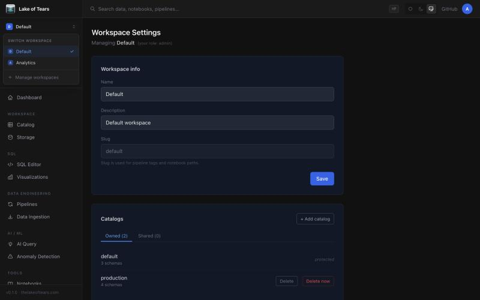
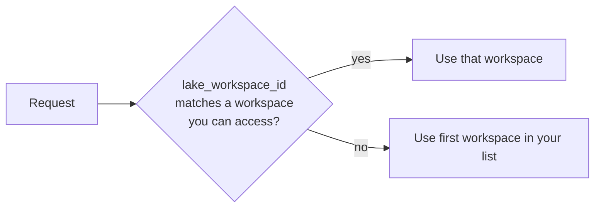
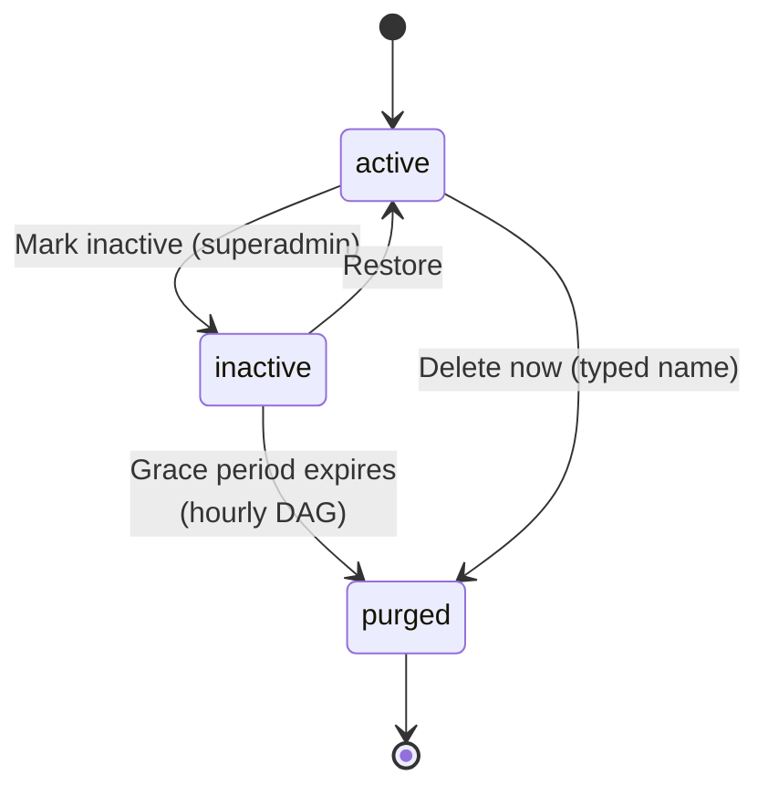
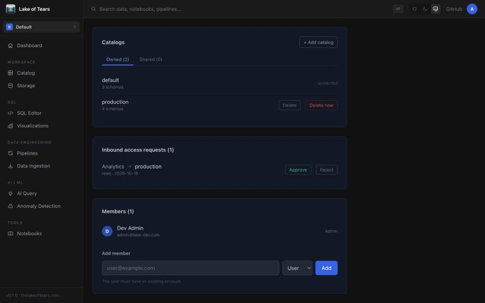
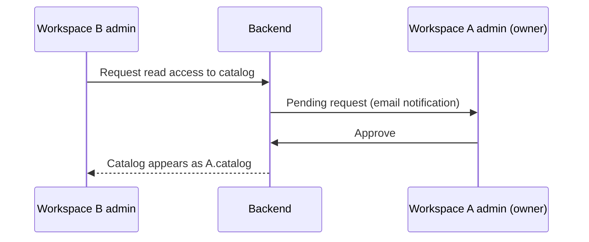
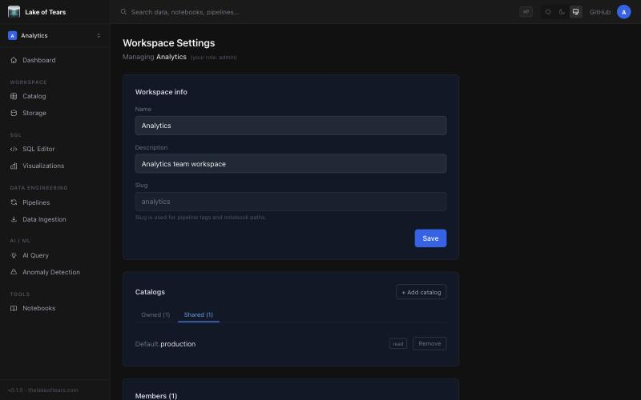
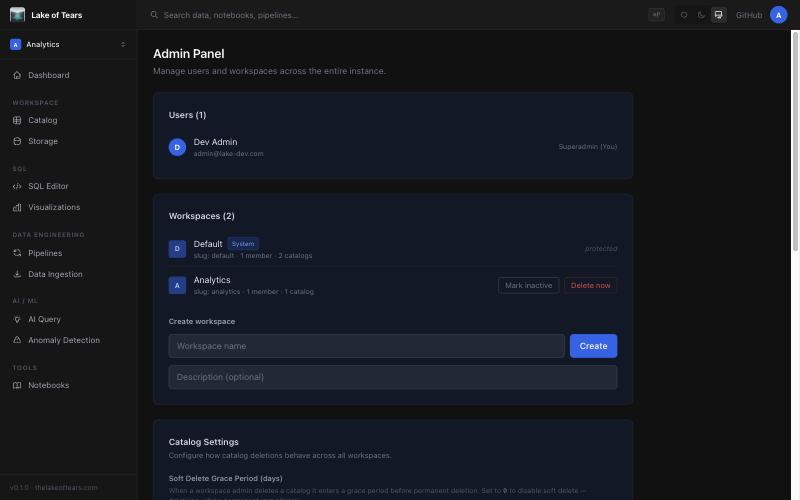

# Workspaces and Catalog Management

This guide explains how Lake of Tears isolates teams into **workspaces**, how **catalogs** organize data inside them, and how superadmins and workspace admins manage both from the Lake UI.

---

## 1. Workspace architecture

A **workspace** is a tenant boundary. Users belong to one or more workspaces with a role (`admin`, `user`, or `viewer`), and each workspace owns its own catalogs. Superadmins can see and manage every workspace.

The first user to register becomes the superadmin and a **Default** workspace is created automatically (`is_system = true`). The Default workspace is meant to be undeletable.

> Installs created before fix #129 (PR #130) had the Default workspace unflagged; migration `0007` backfills them. Default is now created with `is_system = true`, the admin API returns `409` if you try to delete it, and the Admin panel shows a **System** badge with no delete actions.



### Creating a workspace

Any signed-in user can create a workspace (`POST /api/workspaces`). The creator becomes its admin, and a protected `default` catalog is created inside it automatically.

### Switching workspaces and the `lake_workspace_id` cookie

The active workspace is stored in a browser cookie, `lake_workspace_id`, set when you pick a workspace from the switcher (`/workspace/switch`).

| Property | Value |
|---|---|
| Name | `lake_workspace_id` |
| Lifetime | 30 days |
| SameSite | `lax` |
| Cleared | On logout |

On every request the UI middleware looks the cookie up against the workspaces you can access. If the cookie is missing, stale, or points at a workspace you no longer belong to (for example one that was deleted), the UI falls back to the first workspace in your list. Members are not notified when this happens.



### Deleting a workspace: soft vs. hard

Only superadmins can delete workspaces, using `DELETE /api/admin/workspaces/{id}` with a `mode`.

| | Hard delete | Soft delete (mark inactive) |
|---|---|---|
| Confirmation | Type the exact workspace name | Inline "Are you sure?" |
| Effect | Workspace and everything it owns removed immediately | `status = inactive`; owned catalogs soft-deleted with the same purge date |
| Reversible | No | Yes, until the grace period ends |
| Name | Released | Reserved during the grace period |

The grace period is the system setting `workspace_inactive_grace_period_days` (default 30). Changing it does not alter purge dates already set.

A restore (`POST /api/admin/workspaces/{id}/restore`) returns the workspace to `active`, reactivates its catalogs, and members regain access because their memberships were never removed.

### Inactivity lifecycle and purging



The Airflow DAG `purge_inactive_workspaces` runs **hourly** (`0 * * * *`). It selects workspaces where `status = 'inactive'` and `scheduled_purge_at <= now()`, deletes their catalog data from MinIO, then removes the database records.

---

## 2. Catalog management

A **catalog** is the top level of the data hierarchy: `catalog > schema > table`. Each catalog is owned by exactly one workspace.

### Default catalog protection

Every workspace gets a `default` catalog on creation (`is_default = true`). It cannot be soft-deleted or purged by anyone, including superadmins. The API returns `409 Conflict` ("The default catalog cannot be deleted"), and the UI shows a **protected** label instead of delete buttons.

### Storage paths

Catalog data lives in the MinIO bucket `datalake` as Hive-partitioned Parquet. The documented layout is:

```
s3://datalake/<catalog>/<schema>/<table>/year=YYYY/month=MM/day=DD/
```

> The layout above is a convention. Each table stores its own free-form `s3_path_pattern` (in the `catalog_tables` table), so it is not computed from the catalog name and is not enforced.

### Deleting a catalog

| Step | Who | What happens |
|---|---|---|
| Delete | Workspace admin | Soft delete: `deleted_at` and `scheduled_purge_at` set (default 30 days). Catalog disappears from every workspace's explorer. Shared access grants are **suspended**, not removed. |
| Reactivate | Workspace admin | Clears the dates and restores suspended grants. |
| Delete now | Workspace admin (only if already soft-deleted) or superadmin (any catalog) | Hard delete. Requires typing the catalog name (`POST /api/catalogs/{id}/purge`). |

The grace period is `catalog_soft_delete_days` (0 to 365). When it is `0`, soft delete is disabled and deletions must go through the purge flow. The catalog name stays reserved in its workspace while it is pending deletion.

The Airflow DAG `purge_deleted_catalogs` runs **daily at 02:00** and permanently removes catalogs past `scheduled_purge_at`, deleting their MinIO objects first.

> "Delete now" removes the catalog's objects from MinIO first, then its database rows. If storage deletion fails the request returns `502` and the catalog is kept, so you can retry. Object prefixes also used by tables in other catalogs are left in place.

### Sharing catalogs between workspaces

The owning workspace sees the request under **Inbound access requests** and approves or rejects it. The default catalog shows a **protected** label instead of delete buttons.



Sharing is read-only and approval-based.



After approval the requesting workspace sees the catalog under its **Shared** tab as read-only, with a **Remove** button.



- Shared catalogs display as `<owning_workspace>.<catalog_name>`.
- Access is always `read`, with status `pending` or `approved`.
- A workspace admin can **Remove** a shared catalog at any time; the grant is deleted immediately and the owner's admins are emailed.
- If the owner soft-deletes the catalog, grants are suspended and return on reactivation.

### Schema auto-refresh and caching

The Airflow DAG `refresh_catalog_schemas` runs **nightly at 06:00**. For every catalog table with an `s3_path_pattern` it reads the Parquet files with DuckDB, infers the columns, and merges them with the stored definitions:

- New columns are added.
- Columns that disappeared are flagged `deprecated`, not removed.
- A deprecated column that reappears is un-flagged.
- Any change sets `schema_drift = true` on the table.
- Descriptions you wrote on columns are preserved.

> There is no separate cache of catalog metadata: column definitions are re-inferred nightly by the refresh DAG above. (The UI only caches session settings, for 60 seconds.)

---

## 3. Administering in the Lake UI

| Task | Where | Who |
|---|---|---|
| Switch workspace | Workspace switcher | Any member |
| Create / rename workspace | Settings > Workspace | Creator / workspace admin |
| Manage members and roles | Settings > Workspace | Workspace admin |
| Delete, reactivate, or purge owned catalogs; add or remove shared catalogs | Settings > Workspace > Catalogs | Workspace admin |
| Mark inactive, restore, or delete workspaces | Settings > Admin > Workspaces | Superadmin |
| Set grace periods (`catalog_soft_delete_days`, `workspace_inactive_grace_period_days`) and session limits | Settings > Admin | Superadmin |



---

## 4. Quick reference

| System setting | Default | Meaning |
|---|---|---|
| `catalog_soft_delete_days` | 30 | Catalog grace period; `0` disables soft delete |
| `workspace_inactive_grace_period_days` | 30 | Inactive-workspace grace period |

| DAG | Schedule | Purpose |
|---|---|---|
| `purge_inactive_workspaces` | Hourly | Purge expired inactive workspaces |
| `purge_deleted_catalogs` | Daily 02:00 | Purge expired soft-deleted catalogs |
| `refresh_catalog_schemas` | Daily 06:00 | Schema inference and drift detection |

---

## 5. Running locally: use port 80

With Docker Compose, open **http://localhost** (the nginx entry point), not `http://localhost:3000`. Port 3000 is the UI container on its own and does not proxy `/api/`, so the login page loads but signing in fails with "Not Found". The workspace cookie and every `/api/` call only work through port 80.
