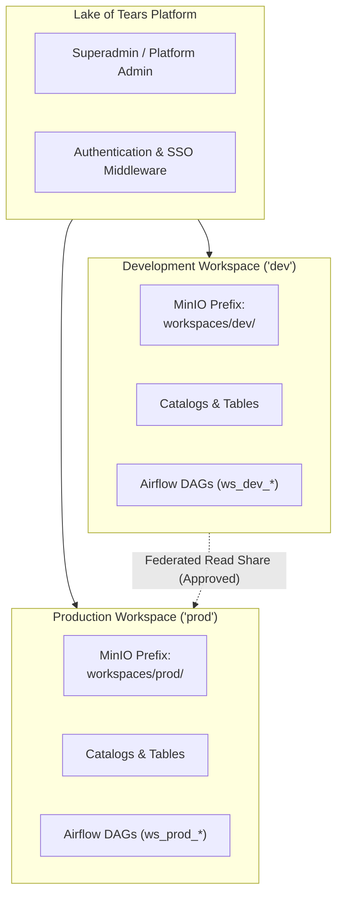
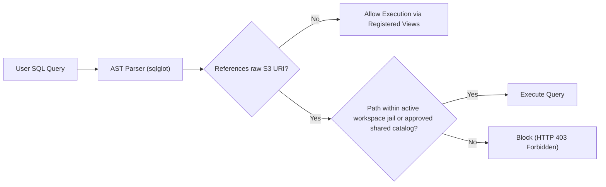
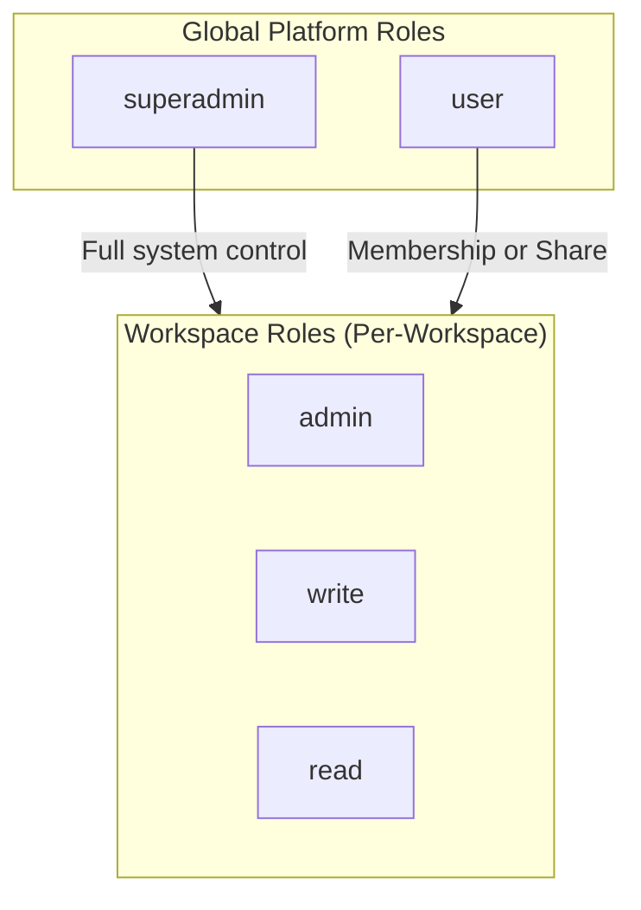
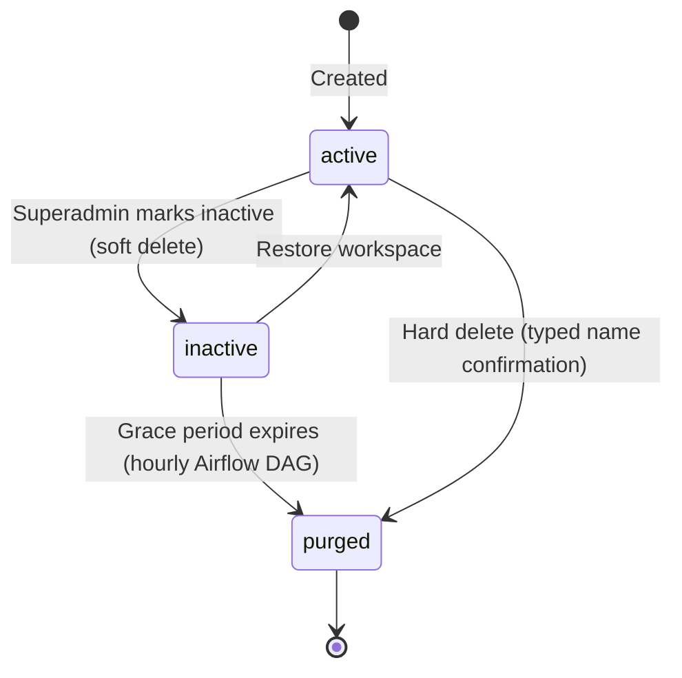
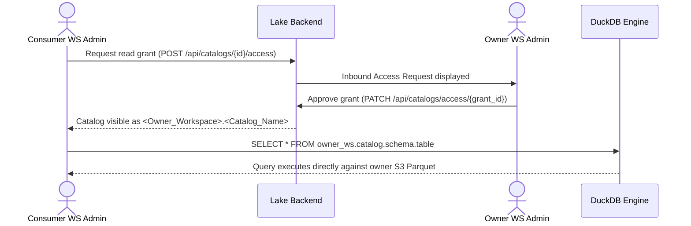
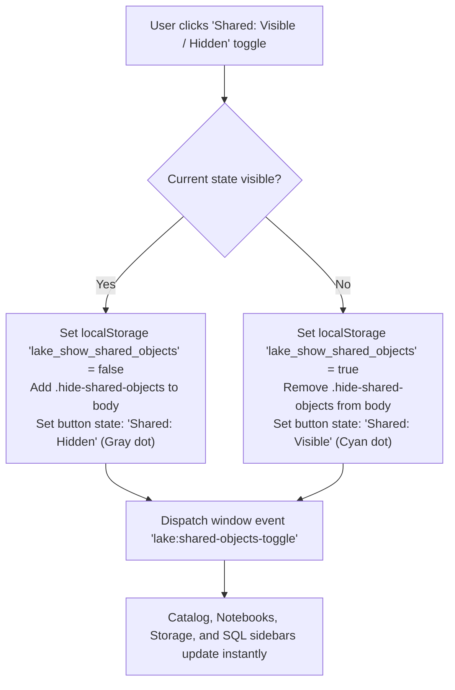
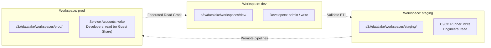
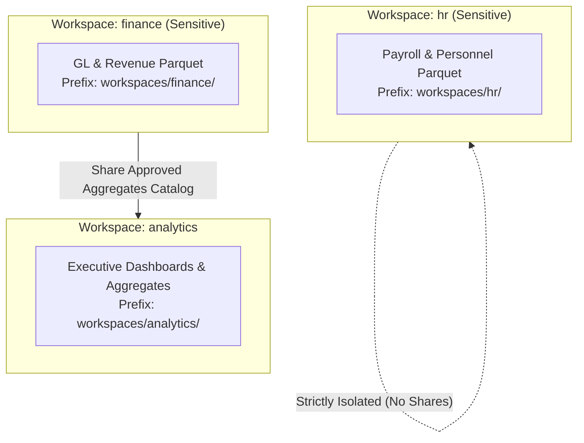

# Workspaces and Catalog Management: User & Administrator Guide

This guide provides a comprehensive overview of how Lake of Tears enforces **workspace isolation**, how **catalogs** structure lakehouse data, and how administrators and users manage multi-tenancy, federated asset sharing, and multi-environment segregation across the Lake UI and REST APIs.

For underlying architectural rationale and trade-offs, refer to [ADR 0002: Workspace Isolation Architecture](../decisions/0002-workspace-isolation-architecture.md).

---

## 1. Workspace Isolation Architecture & Tenant Boundaries

A **workspace** is the primary tenant boundary in Lake of Tears. It logically segregates teams, functional departments (such as `engineering`, `analytics`, `finance`), and deployment environments (such as `dev`, `staging`, `prod`) within a unified lakehouse cluster.

Every workspace owns its catalogs, ingestion configurations, pipelines, notebooks, and dashboards. Users belong to one or more workspaces with explicit role assignments (`admin`, `write`, or `read`). Superadmins can view and administer every workspace across the platform.



### Storage Prefix Partitioning & S3 Jailing

All physical Parquet files, raw ingest records, vector embeddings, and catalog table data are strictly jailed inside the workspace's designated MinIO/S3 key prefix:

```
s3://datalake/workspaces/<workspace_slug>/
```

| Asset Category | Jailed Storage Key Layout | Description |
|---|---|---|
| **Raw Ingest** | `s3://datalake/workspaces/<slug>/raw/<source>/year=YYYY/month=MM/day=DD/` | Files captured by scheduled connectors and landing webhooks |
| **Vector Embeddings** | `s3://datalake/workspaces/<slug>/embeddings/<table_slug>/data.parquet` | Chunked text vectors for semantic RAG and NL-to-SQL search |
| **Catalog Tables** | `s3://datalake/workspaces/<slug>/<catalog>/<schema>/<table>/data.parquet` | Hive-partitioned analytics data registered in catalogs |

> [!IMPORTANT]
> The storage browser (`GET /api/storage/browse` and UI `/storage`) enforces this jail automatically. A user in workspace `analytics` cannot navigate to, list, upload to, or delete objects outside `workspaces/analytics/`. Any path traversal (`../`) or cross-prefix reference is rejected with `HTTP 403 Forbidden`.

### DuckDB SQL Guardrails & View Encapsulation

Because DuckDB runs embedded in-process with access to MinIO credentials via the `httpfs` extension, Lake of Tears uses an AST-level query inspection engine (`sqlglot`) to guarantee query-layer isolation:

1. **Catalog View Encapsulation:** When users run queries in the SQL Editor or AI Genie, tables are registered as logical views (`catalog.schema.table`). Users do not construct raw storage paths manually.
2. **AST-Level Path Inspection:** Before executing any SQL containing table-reading functions (`read_parquet`, `parquet_scan`, `scan_parquet`, `read_csv`, `read_json`, `delta_scan`, `iceberg_scan`, `glob`), the query is parsed into an Abstract Syntax Tree.
3. **Fail-Closed Enforcement:** Every S3 URI is validated. It must reside inside `s3://datalake/workspaces/<active_workspace_slug>/` or match an authorized shared catalog pattern. Unrecognized paths or parse failures containing S3 strings immediately trigger `SQLGuardrailViolation` (`HTTP 403 Forbidden`).



### Workspace Switching & the `lake_workspace_id` Cookie

The Lake UI maintains your active workspace in an HTTP cookie named `lake_workspace_id`:

| Property | Value |
|---|---|
| **Cookie Name** | `lake_workspace_id` |
| **Lifetime** | 30 days |
| **SameSite** | `Lax` |
| **Cleared** | On logout or workspace deletion |


On each request, UI middleware evaluates the cookie:
- If valid and matches a workspace you belong to (or have an approved share for), that workspace context is activated.
- If missing, expired, or pointing to a deleted workspace, the UI falls back to the first accessible workspace in your list without interrupting your session.

---

## 2. Role-Based Access Control (RBAC) & Membership

Lake of Tears uses a **two-tier RBAC architecture**: Global Platform Roles and Scoped Workspace Roles.



### Global Platform Roles (`User.role`)

- **`superadmin`:** Full administrative control over the entire platform. Can create, soft-delete, restore, or hard-purge any workspace, adjust global retention grace periods, manage AI provider keys, and inspect all platform telemetry.
- **`user`:** Standard platform user. Access is strictly scoped to the workspaces where they hold direct membership or approved guest shares.

### Scoped Workspace Roles (`WorkspaceMember.role`)

Every member within a workspace holds one of three roles:

| Capability | `admin` | `write` | `read` |
|---|:---:|:---:|:---:|
| Switch into workspace & view dashboards | Yes | Yes | Yes |
| Run SQL queries & AI Assistant (within guardrails) | Yes | Yes | Yes |
| Browse catalogs, schemas, tables, and storage | Yes | Yes | Yes |
| View pipeline execution logs | Yes | Yes | Yes |
| Create, update, or delete catalog tables & schemas | Yes | Yes | No |
| Trigger data ingestion runs & connector syncs | Yes | Yes | No |
| Execute Jupyter notebooks & scheduled pipelines | Yes | Yes | No |
| Upload objects into workspace storage prefix | Yes | Yes | No |
| Run anomaly detection on workspace tables | Yes | Yes | No |
| Invite, modify, or remove workspace members | Yes | No | No |
| Approve / reject inbound workspace share requests | Yes | No | No |
| Approve / reject inbound catalog access requests | Yes | No | No |
| Configure workspace settings & rename workspace | Yes | No | No |
| Soft-delete or purge owned catalogs | Yes | No | No |

---

## 3. Workspace Administration & Lifecycle

### System Workspace Protection

When Lake of Tears boots for the first time, the platform automatically provisions a **Default** workspace (`is_system = true`).
- The default workspace cannot be deleted or marked inactive.
- Attempting to delete it via API returns `HTTP 409 Conflict`.
- In the Lake UI, the Default workspace displays a **System** badge with deletion actions permanently disabled.


### Creating a Workspace

- **Superadmins** can create workspaces at any time from **Settings > Admin > Workspaces** or via `POST /api/workspaces`.
- **Standard Users** can also create workspaces (`POST /api/workspaces`). The creator is automatically assigned the `admin` role for that workspace, and a protected `default` catalog is initialized.

### Inactivity Lifecycle & Automated Purging

Workspaces support two deletion modes:

| Mode | Trigger | Effect | Reversible? |
|---|---|---|---|
| **Soft Delete** (Mark Inactive) | Superadmin clicks "Mark Inactive" or calls `DELETE /api/admin/workspaces/{id}?mode=soft` | `status` set to `inactive`; owned catalogs soft-deleted; grace period scheduled (`scheduled_purge_at`) | Yes, via `POST /api/admin/workspaces/{id}/restore` |
| **Hard Delete** (Delete Now) | Superadmin types exact workspace name or calls `DELETE /api/admin/workspaces/{id}?mode=hard` | Storage objects deleted from MinIO immediately; database records permanently removed | No |



1. **Grace Period (`workspace_inactive_grace_period_days`):** Configured in platform settings (default `30` days). During this window, the workspace name remains reserved.
2. **Automated Purging DAG (`purge_inactive_workspaces`):** Runs **hourly** (`0 * * * *`). It finds workspaces where `status = 'inactive'` and `scheduled_purge_at <= now()`, purges all associated objects in MinIO (`workspaces/<slug>/`), and deletes database records.
3. **Workspace Restoration:** Calling `POST /api/admin/workspaces/{id}/restore` reverts the workspace to `active`, reactivates owned catalogs, and restores member access without data loss.

---

## 4. User Workspace Sharing (Guest Access)

In addition to direct membership, Lake of Tears supports **User Workspace Sharing**. This mechanism allows an external user to collaborate within a workspace under guest `read` permissions without granting full membership or write capabilities.

### User Workspace Sharing vs. Catalog Sharing

| Feature | User Workspace Sharing (`WorkspaceShare`) | Catalog Access Sharing (`CatalogAccess`) |
|---|---|---|
| **Scope** | Entire workspace environment | Specific catalog only |
| **Beneficiary** | Individual user account | An entire consumer workspace |
| **Permissions** | Guest `read` access across catalogs, storage, dashboards | Read access to schemas and tables under `<owner>.<catalog>` |
| **Switcher** | Workspace appears in user's workspace switcher (`🔗 Shared`) | Catalog appears in consumer workspace's catalog list |

### Sharing Lifecycle Workflow

```mermaid
sequenceDiagram
    actor User as Requesting User
    participant UI as Lake UI / API
    actor Admin as Workspace Admin
    participant S3 as Storage / DuckDB

    User->>UI: Request share (POST /api/workspaces/{id}/shares)
    UI-->>User: Status: "pending"
    Note over Admin,UI: Inbound share notification appears in Workspace Settings
    Admin->>UI: Review & Approve (PATCH /api/workspaces/{id}/shares/{share_id})
    UI-->>Admin: Status: "approved"
    User->>UI: Switch to shared workspace (lake_workspace_id cookie)
    UI->>S3: SQL Guardrails permit read-only execution
    User-->>UI: Browses catalogs & dashboards (🔗 Shared badge displayed)
    User->>UI: Disconnect Share (DELETE /api/workspaces/{id}/shares)
    UI-->>User: Share revoked; UI returns to primary workspace
```

### Step-by-Step Guide: Managing User Workspace Shares

1. **Requesting Access:**
   - A user who is not a member navigates to the workspace directory or submits `POST /api/workspaces/{workspace_id}/shares`.
   - The share enters `pending` status. Users can track their pending requests via `GET /api/workspaces/shares/mine`.
2. **Reviewing & Approving:**
   - Workspace admins navigate to **Settings > Workspace > Shares** or call `GET /api/workspaces/{workspace_id}/shares?status=pending`.
   - The admin clicks **Approve** or **Reject** (`PATCH /api/workspaces/{workspace_id}/shares/{share_id}` with `{"status": "approved"}`).
3. **Collaborating as a Guest:**
   - Once approved, the workspace appears in the user's workspace switcher marked with a `🔗 Shared` badge.
   - The user operates with guest `read` permissions: they can view dashboards, browse catalog schemas, inspect pipeline schedules, and execute queries. Write operations (ingestion, table drops, settings modifications) are blocked.
4. **Disconnecting a Workspace Share:**
   - **By the User:** In the top bar or workspace switcher, click the workspace options and select **Disconnect Share**. A confirmation modal opens. Confirming issues `DELETE /api/workspaces/{workspace_id}/shares`, immediately revoking access and redirecting to the user's primary workspace.
   - **By the Admin:** Admins can revoke any share at any time from **Settings > Workspace > Shares** via `DELETE /api/workspaces/{workspace_id}/shares/{share_id}`.

---

## 5. Catalog Management & Federated Sharing

A **catalog** organizes tables into schemas (`catalog > schema > table`). Each catalog belongs to exactly one owning workspace.

### Default Catalog Protection

Every workspace receives a `default` catalog upon creation (`is_default = true`). It cannot be soft-deleted, renamed, or purged. API calls attempting to delete it return `HTTP 409 Conflict`, and the UI displays a **Protected** badge.

### Catalog Deletion & Purge Lifecycle

| Step | Initiator | Action |
|---|---|---|
| **Soft Delete** | Workspace Admin | `deleted_at` and `scheduled_purge_at` are set based on `catalog_soft_delete_days` (default 30). The catalog is hidden from search; external shares are suspended. |
| **Reactivate** | Workspace Admin | Clears purge dates and reactivates suspended external catalog shares. |
| **Delete Now (Purge)** | Workspace Admin or Superadmin | Removes Parquet objects from MinIO first, then drops database records (`POST /api/catalogs/{id}/purge`). Requires typing the exact catalog name. |

The Airflow maintenance DAG `purge_deleted_catalogs` runs **daily at 02:00** to permanently purge expired soft-deleted catalogs.

### Cross-Workspace Federated Catalog Sharing

When two workspaces need to share data without copying Parquet files across prefixes, they use **Federated Catalog Access**:




- **Naming Convention:** Shared catalogs are mounted in the consumer workspace as `<owning_workspace>.<catalog_name>`.
- **Zero Replication:** Data is read directly from the owner's MinIO prefix. The SQL guardrail engine automatically whitelists the owner's Parquet path patterns for the consumer workspace.
- **Revocation:** Either workspace admin can remove the grant at any time via `DELETE /api/workspaces/{workspace_id}/catalogs/{catalog_id}/shared`.

---

## 6. UI Asset Isolation & the "Hide Shared Assets" Toggle

When multiple catalogs or workspaces are shared with you, views can become crowded. Lake of Tears provides visual badges and an instant visibility filter to distinguish native assets from shared assets.

### Recognizing Shared vs. Native Assets

Every shared object in the Lake UI is rendered with distinct styling:
- **Visual Badge:** Shared items display `🔗 Shared · <workspace_name>` or `🔗 Shared · Read-Only`.
- **Segregated Sections:** In the Catalog, Notebooks, Pipelines, and Storage explorers, assets are divided into two clear collapsible groups:
  - **Native Workspace Assets:** Objects created and owned by your current workspace.
  - **Shared with You:** Catalogs and assets federated from other workspaces.

### The "Hide Shared Assets" Global UI Toggle

A visibility toggle is located in the top navigation bar whenever shared objects exist:

```
[ ● Shared: Visible ]   <─── Click to toggle ───>   [ ○ Shared: Hidden ]
 (Cyan Dot, Active)                                  (Gray Dot, Muted)
```

- **Persistence:** Your preference is preserved across page navigations in browser `localStorage` (`lake_show_shared_objects`).
- **Instant Filtering:** Toggling to **Hidden** applies the CSS class `hide-shared-objects` to the document `<body>`. All `.shared-with-you-section`, `.shared-object-item`, and `.shared-object-badge` elements fade out immediately without reloading the page.
- **Event Dispatching:** Triggers a window event `lake:shared-objects-toggle` so dynamic components (such as DuckDB schema trees and SQL auto-completers) adjust their displays in real time.



---

## 7. Best Practices: Multi-Environment & Department Segregation

### Multi-Environment Segregation (Dev, Staging, Prod)

To prevent accidental data loss, schema corruption, or unauthorized production queries, structure your environments into discrete workspaces:



1. **Jailed Storage Prefixes:** Test runs in `dev` write to `workspaces/dev/raw/` and can never overwrite `workspaces/prod/`.
2. **Least Privilege Member Roles:**
   - Developers receive `admin` or `write` in `dev`.
   - In `prod`, developers hold `read` (or request temporary User Workspace Shares). Only automated deployment service accounts hold `write`.
3. **Safe Production Modeling:**
   - Rather than syncing production data to staging/dev, share production catalogs via **Catalog Access Grants** (`read-only`).
   - Analysts query production data directly through DuckDB views without copying terabytes of Parquet files.

### Departmental Segregation (Finance, Engineering, HR, SecOps)



1. **Confidentiality:** Workspaces like `hr` and `finance` host sensitive employee and financial records. AST SQL guardrails prevent members of `engineering` or `marketing` from executing raw `read_parquet()` scans across these prefixes.
2. **Controlled Aggregation:** When Analytics needs revenue summaries, Finance exports an aggregated catalog (e.g. `monthly_revenue_summary`) and shares that specific catalog with `analytics`. Raw transaction tables remain strictly sealed within the `finance` workspace jail.

---

## 8. Workspace-Scoped API Reference

All workspace-scoped endpoints authenticate via bearer token (`Authorization: Bearer <token>`) or the `lake_token` session cookie.

### Workspaces API

#### 1. List Accessible Workspaces
```bash
curl -s -X GET "https://lake.company.com/api/workspaces" \
  -H "Authorization: Bearer $LAKE_TOKEN"
```
**Response (`200 OK`):**
```json
[
  {
    "id": "7f8c9b20-6d42-4b8c-8f12-098234756123",
    "name": "Analytics",
    "slug": "analytics",
    "description": "Enterprise Business Intelligence & Data Science",
    "status": "active",
    "is_system": false,
    "my_role": "admin",
    "is_shared": false,
    "has_shared_catalogs": true,
    "created_at": "2026-10-15T08:00:00Z"
  },
  {
    "id": "9a1b2c3d-4e5f-6a7b-8c9d-0e1f2a3b4c5d",
    "name": "Production Core",
    "slug": "prod-core",
    "description": "Primary transactional lakehouse",
    "status": "active",
    "is_system": false,
    "my_role": "read",
    "is_shared": true,
    "has_shared_catalogs": false,
    "created_at": "2026-09-01T12:00:00Z"
  }
]
```

#### 2. Create a Workspace
```bash
curl -s -X POST "https://lake.company.com/api/workspaces" \
  -H "Authorization: Bearer $LAKE_TOKEN" \
  -H "Content-Type: application/json" \
  -d '{
    "name": "Marketing Operations",
    "description": "Campaign telemetry and ad spend analytics"
  }'
```

#### 3. Manage Workspace Members & Roles
```bash
# List members
curl -s -X GET "https://lake.company.com/api/workspaces/7f8c9b20-6d42-4b8c-8f12-098234756123/members" \
  -H "Authorization: Bearer $LAKE_TOKEN"

# Add or update member role ('admin', 'write', 'read')
curl -s -X POST "https://lake.company.com/api/workspaces/7f8c9b20-6d42-4b8c-8f12-098234756123/members" \
  -H "Authorization: Bearer $LAKE_TOKEN" \
  -H "Content-Type: application/json" \
  -d '{
    "email": "analyst@company.com",
    "role": "write"
  }'

# Remove a member
curl -s -X DELETE "https://lake.company.com/api/workspaces/7f8c9b20-6d42-4b8c-8f12-098234756123/members/3fa85f64-5717-4562-b3fc-2c963f66afa6" \
  -H "Authorization: Bearer $LAKE_TOKEN"
```

### User Workspace Sharing API

#### 1. Request Guest Access to a Workspace
```bash
curl -s -X POST "https://lake.company.com/api/workspaces/9a1b2c3d-4e5f-6a7b-8c9d-0e1f2a3b4c5d/shares" \
  -H "Authorization: Bearer $LAKE_TOKEN"
```
**Response (`200 OK`):**
```json
{
  "id": "c1a2b3c4-d5e6-7f8a-9b0c-1d2e3f4a5b6c",
  "workspace_id": "9a1b2c3d-4e5f-6a7b-8c9d-0e1f2a3b4c5d",
  "workspace_name": "Production Core",
  "workspace_slug": "prod-core",
  "user_id": "3fa85f64-5717-4562-b3fc-2c963f66afa6",
  "user_email": "engineer@company.com",
  "status": "pending",
  "requested_at": "2026-11-01T15:30:00Z"
}
```

#### 2. Review Inbound Share Request (Admin)
```bash
# List pending requests
curl -s -X GET "https://lake.company.com/api/workspaces/9a1b2c3d-4e5f-6a7b-8c9d-0e1f2a3b4c5d/shares?status=pending" \
  -H "Authorization: Bearer $LAKE_TOKEN"

# Approve request
curl -s -X PATCH "https://lake.company.com/api/workspaces/9a1b2c3d-4e5f-6a7b-8c9d-0e1f2a3b4c5d/shares/c1a2b3c4-d5e6-7f8a-9b0c-1d2e3f4a5b6c" \
  -H "Authorization: Bearer $LAKE_TOKEN" \
  -H "Content-Type: application/json" \
  -d '{"status": "approved"}'
```

#### 3. Disconnect Workspace Share
```bash
curl -s -X DELETE "https://lake.company.com/api/workspaces/9a1b2c3d-4e5f-6a7b-8c9d-0e1f2a3b4c5d/shares" \
  -H "Authorization: Bearer $LAKE_TOKEN"
# Returns 204 No Content
```

### Workspace Storage Browser API

Browsing storage objects is automatically jailed to the active workspace prefix:

```bash
# Browse files under the workspace's raw/ landing prefix
curl -s -X GET "https://lake.company.com/api/storage/browse?prefix=raw/" \
  -H "Authorization: Bearer $LAKE_TOKEN" \
  -H "X-Workspace-Id: 7f8c9b20-6d42-4b8c-8f12-098234756123"
```
**Response (`200 OK`):**
```json
{
  "prefix": "workspaces/analytics/raw/",
  "workspace": "analytics",
  "folders": ["orders/", "web_events/"],
  "files": [],
  "parent_prefix": null,
  "breadcrumbs": [
    {"label": "raw", "prefix": "raw/"}
  ]
}
```

---

## 9. Quick Reference

### System Settings

| Setting Key | Default | Description |
|---|---|---|
| `catalog_soft_delete_days` | `30` | Retention grace period for soft-deleted catalogs (`0` disables soft delete) |
| `workspace_inactive_grace_period_days` | `30` | Inactive workspace retention window before permanent automated purge |

### Scheduled Maintenance DAGs

| DAG Identifier | Cron Schedule | Execution Purpose |
|---|---|---|
| `purge_inactive_workspaces` | Hourly (`0 * * * *`) | Permanently deletes MinIO S3 prefixes and DB records for expired inactive workspaces |
| `purge_deleted_catalogs` | Daily (`0 2 * * *`) | Permanently purges expired soft-deleted catalogs and their Parquet storage files |
| `refresh_catalog_schemas` | Daily (`0 6 * * *`) | Automatically infers Parquet schemas, detects schema drift, and registers new columns |

---

## 10. Local Development & Port 80 Proxying

When working in local Kubernetes or Helm development environments, always access the Lake UI via the Ingress entry point at **http://localhost** (port 80). 

> [!WARNING]
> Connecting directly to the internal pod port (`http://localhost:3000`) bypasses the Ingress proxy. While the static login HTML will load, `/api/` calls and the `lake_workspace_id` cookie verification will fail with `404 Not Found`. Always connect via port 80.
